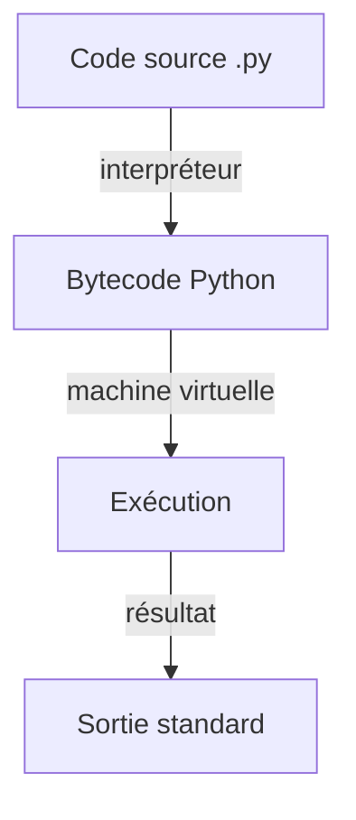
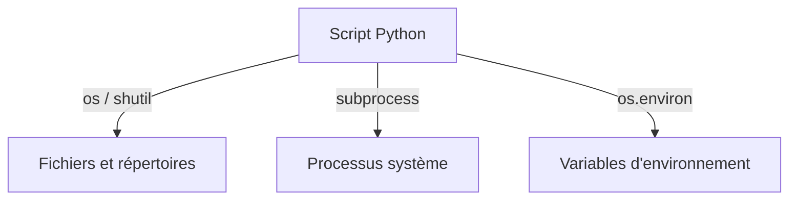
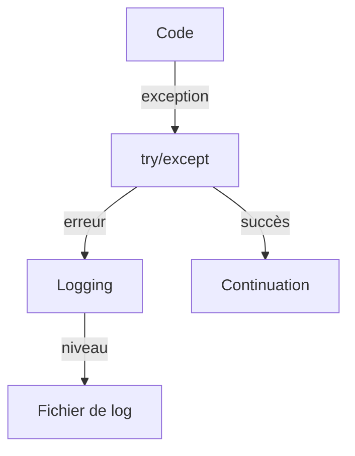
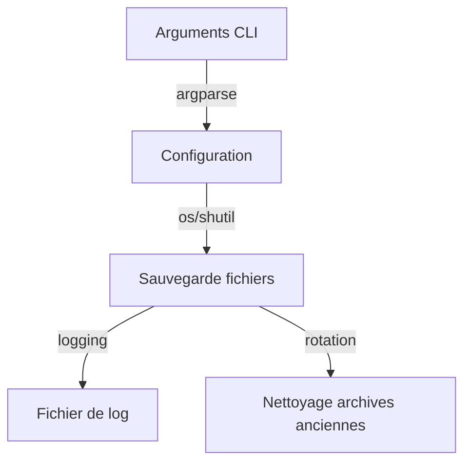
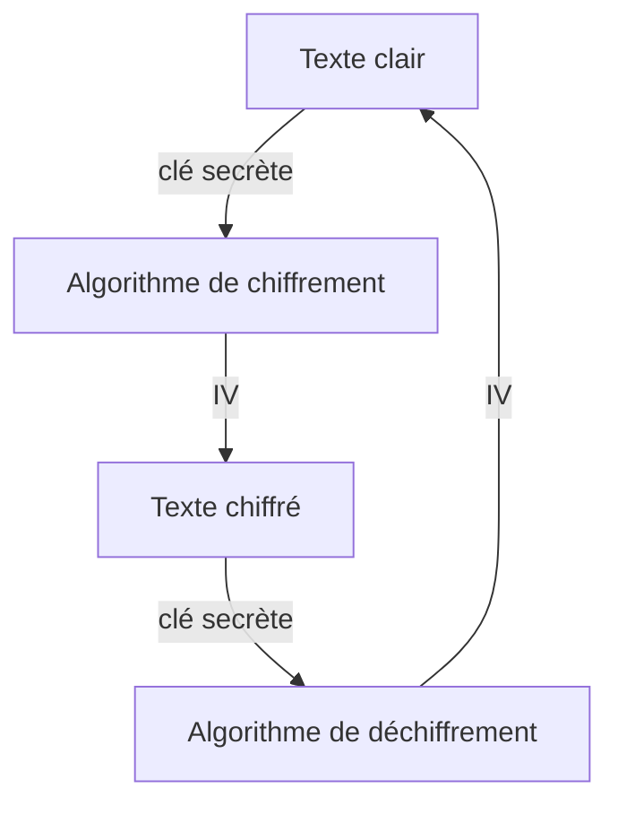
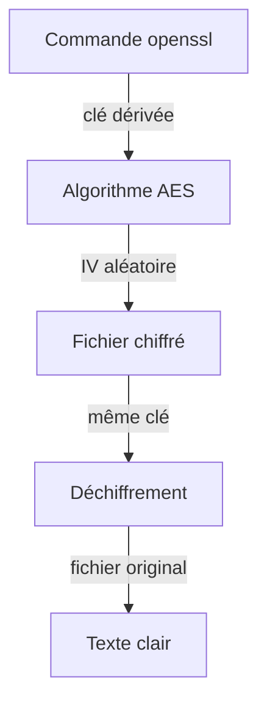
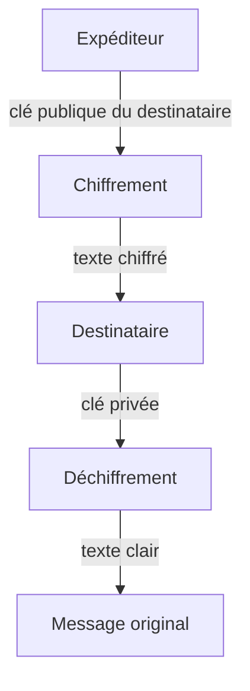
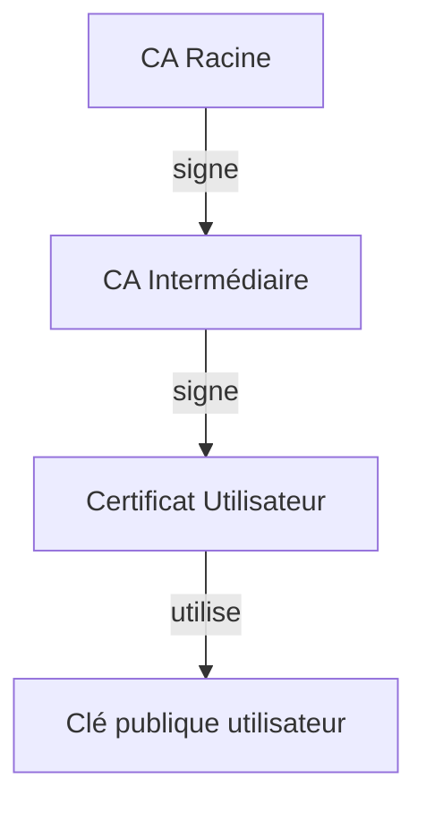
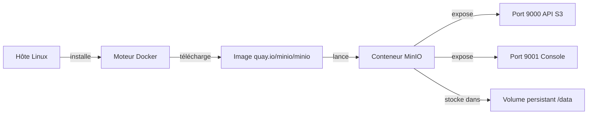
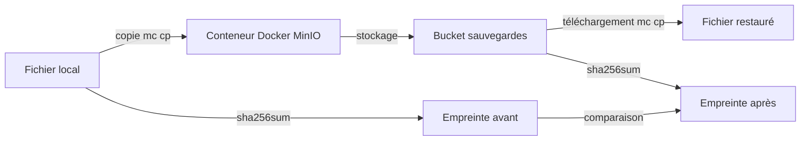

# Scripting Bash et PowerShell — EXTRA

## Python et Cryptographie — Modules complémentaires (17/09/2026)

> **Fil conducteur** — Ce module complémentaire prolonge les 4 jours de formation (Bash J1-J2, PowerShell J3-J4) avec l'administration système en Python (chapitres 17-20) et la cryptographie symétrique/asymétrique (chapitres 21-24).

---

## Objectifs du Module

- Écrire des scripts d'administration système en Python
- Manipuler fichiers, processus et environnement avec Python
- Comprendre et appliquer la cryptographie symétrique et asymétrique
- Mettre en œuvre une PKI avec OpenSSL

---

## Planning du Module

| Chapitre | Horaires | Thème | Durée |
| 17 | 9h00-10h30 | Introduction à Python pour l'administration système | 1h30 |
| — | 10h30-10h45 | Pause | 15min |
| 18 | 10h45-12h00 | Manipulation de fichiers, processus et système avec Python | 1h15 |
| — | 12h00-13h00 | Pause déjeuner | 1h |
| 19 | 13h00-14h30 | Automatisation et scripting système avec Python | 1h30 |
| — | 14h30-14h45 | Pause | 15min |
| 20 | 14h45-16h00 | Cas pratique Python — script d'administration complet | 1h15 |
| — | 16h00-16h15 | Pause | 15min |
| 21 | 16h15-17h45 | Cryptographie symétrique — principes et algorithmes | 1h30 |
| — | 17h45-18h00 | Pause | 15min |
| 22 | 18h00-19h15 | Cryptographie symétrique — mise en pratique (OpenSSL, Python) | 1h15 |
| — | 19h15-20h15 | Pause déjeuner | 1h |
| 23 | 20h15-21h45 | Cryptographie asymétrique — principes et algorithmes | 1h30 |
| — | 21h45-22h00 | Pause | 15min |
| 24 | 22h00-23h15 | Cryptographie asymétrique — PKI, certificats, signatures numériques | 1h15 |

---

## Chapitre 17 — Introduction à Python pour l'administration système (9h00-10h30)

### Objectifs

- Comprendre ce qu'est Python et sa différence avec Bash
- Installer et vérifier Python sur un poste Linux
- Écrire et exécuter un premier script Python

### Contenu Théorique (1h30)

#### 1. Qu'est-ce que Python ? (30min)

Python est un langage de programmation interprété, de haut niveau, à typage dynamique. Contrairement à Bash qui traite tout comme du texte, Python manipule des objets typés.

```python
# python3 --version : affiche la version de Python installée
# python3 : lance l'interpréteur Python
```

> **Concept clé** — Python est un langage interprété : le code source est compilé en bytecode puis exécuté par la machine virtuelle Python.

> **Bon à savoir** — Python est préinstallé sur la plupart des distributions Linux modernes ; la commande `which python3` permet de localiser l'interpréteur sur le poste.

#### 2. Premier script Python (45min)

```python
#!/usr/bin/env python3
# #!/usr/bin/env python3 : shebang indiquant l'interpréteur Python
print("Bonjour, administration système")
# print : affiche une chaîne de caractères sur la sortie standard
```

**Fig 1 — Flux d'exécution d'un script Python**



### Lab 17 — Premier script Python (45min)

#### Environnement

| Élément | Valeur |
|---------|--------|
| Poste | Linux |
| Interpréteur | Python 3 |

#### Exercices

**Exercice 17.1 — Vérifier la version de Python (10min)**

```bash
python3 --version
# python3 : lance l'interpréteur Python 3
# --version : affiche le numéro de version
```

- [ ] La version de Python s'affiche correctement

**Exercice 17.2 — Créer et exécuter un premier script (15min)**

```bash
nano hello.py
# nano : éditeur de texte en mode terminal
# hello.py : nom du fichier script Python
```

```python
#!/usr/bin/env python3
print("Bonjour, monde")
```

```bash
chmod 755 hello.py
# chmod : modifie les droits d'accès
# 755 : lecture/écriture/exécution pour le propriétaire, lecture/exécution pour les autres
./hello.py
# ./ : exécute le script depuis le répertoire courant
```

- [ ] Le script hello.py s'exécute et affiche "Bonjour, monde"

### Démonstration commentée

Le shebang `#!/usr/bin/env python3` permet au noyau Linux de trouver l'interpréteur Python via la variable d'environnement PATH, rendant le script portable.

### Correction et résolution pas à pas

<details>
<summary>Solution Exercice 17.2</summary>

```python
#!/usr/bin/env python3
print("Bonjour, monde")
```

</details>

### Bonnes pratiques

| Pratique | Description |
|----------|-------------|
| Shebang | Toujours commencer par `#!/usr/bin/env python3` |
| Droits | `chmod 755` pour rendre le script exécutable |

> **Bonnes pratiques** — Le shebang avec `env` est préférable à un chemin fixe car il s'adapte à l'installation de Python sur chaque poste.

### Exercices — Chapitre 17

**Exercice 17.3 — Afficher des variables (10min)**

```python
nom = "Admin"
version = 3
print(f"Utilisateur : {nom}, Python : {version}")
```

- [ ] Les variables s'affichent correctement

<details>
<summary>Solution Exercice 17.3</summary>

```python
nom = "Admin"
version = 3
print(f"Utilisateur : {nom}, Python : {version}")
```

</details>

### Ce qu'on a retenu

> **Ce qu'on a retenu**
> - Python est un langage interprété à typage dynamique
> - Le shebang `#!/usr/bin/env python3` rend le script portable
> - `chmod 755` rend le script exécutable

---

## Chapitre 18 — Manipulation de fichiers, processus et système avec Python (10h45-12h00)

### Objectifs

- Utiliser les modules os, shutil, subprocess
- Lire et écrire des fichiers avec open() et with
- Accéder aux variables d'environnement

### Contenu Théorique (1h15)

#### 1. Module os (30min)

```python
import os
# import os : importe le module d'interaction avec le système d'exploitation

cwd = os.getcwd()
# os.getcwd() : retourne le répertoire de travail courant

print(os.listdir('.'))
# os.listdir() : liste le contenu d'un répertoire
```

> **Concept clé** — Le module `os` fournit une interface portable aux appels système du noyau Linux.

> **Pourquoi le module os ?** — Il offre une couche d'abstraction portable : un même script Python fonctionne sur Linux, Windows ou macOS sans modification, car Python traduit les appels vers l'API du système hôte.

#### 2. Lecture/écriture de fichiers (45min)

```python
with open('fichier.txt', 'w') as f:
    # open() : ouvre un fichier
    # 'w' : mode écriture (écrase le contenu existant)
    # with : garantit la fermeture automatique du fichier
    f.write("Contenu du fichier\n")
    # f.write() : écrit une chaîne dans le fichier
```

**Fig 2 — Interaction Python avec le système d'exploitation**



### Lab 18 — Manipulation de fichiers (45min)

#### Environnement

| Élément | Valeur |
|---------|--------|
| Poste | Linux |
| Répertoire de travail | /tmp/lab_python |

#### Exercices

**Exercice 18.1 — Lister un répertoire (10min)**

```python
import os
print(os.listdir('/tmp'))
```

- [ ] Le contenu de /tmp s'affiche

**Exercice 18.2 — Créer et écrire un fichier (15min)**

```bash
mkdir -p /tmp/lab_python
# mkdir -p : crée le répertoire de travail (et ses parents) s'il n'existe pas
# /tmp/lab_python : cible du laboratoire (prérequis indispensable avant toute écriture de fichier)
```

```python
with open('/tmp/lab_python/test.txt', 'w') as f:
    f.write("Test Python\n")
```

- [ ] Le fichier test.txt est créé et contient "Test Python"

### Démonstration commentée

Le bloc `with` garantit que le fichier est fermé même en cas d'erreur, évitant les fuites de descripteurs de fichier.

### Correction et résolution pas à pas

<details>
<summary>Solution Exercice 18.2</summary>

```python
with open('/tmp/lab_python/test.txt', 'w') as f:
    f.write("Test Python\n")
```

</details>

### Bonnes pratiques

| Pratique | Description |
|----------|-------------|
| with statement | Toujours utiliser `with` pour ouvrir des fichiers |
| Chemins absolus | Utiliser des chemins absolus en lab pour éviter les ambiguïtés |

> **Bonnes pratiques** — Le `with` statement est la méthode recommandée pour gérer les ressources (fichiers, connexions) en Python.

### Exercices — Chapitre 18

**Exercice 18.3 — Lire un fichier (10min)**

```python
with open('/tmp/lab_python/test.txt', 'r') as f:
    print(f.read())
```

- [ ] Le contenu du fichier s'affiche

<details>
<summary>Solution Exercice 18.3</summary>

```python
with open('/tmp/lab_python/test.txt', 'r') as f:
    print(f.read())
```

</details>

### Ce qu'on a retenu

> **Ce qu'on a retenu**
> - Le module `os` permet d'interagir avec le système d'exploitation
> - Le `with` statement garantit la fermeture des fichiers
> - `os.listdir()` liste le contenu d'un répertoire

---

## Chapitre 19 — Automatisation et scripting système avec Python (13h00-14h30)

### Objectifs

- Gérer les erreurs avec try/except/finally
- Configurer le logging avec le module logging
- Utiliser argparse pour les arguments de ligne de commande

### Contenu Théorique (1h30)

#### 1. Gestion des erreurs (45min)

```python
try:
    # try : bloc contenant le code susceptible de lever une exception
    fichier = open('inexistant.txt', 'r')
except FileNotFoundError:
    # except : bloc exécuté si l'exception spécifiée se produit
    print("Le fichier n'existe pas")
finally:
    # finally : bloc toujours exécuté, avec ou sans exception
    print("Nettoyage terminé")
```

> **Concept clé** — La gestion d'erreurs avec `try/except` permet de contrôler le flux du programme en cas d'exception, évitant l'arrêt brutal du script.

> **Bon à savoir** — Les niveaux de logging, du plus détaillé au plus critique, sont : DEBUG, INFO, WARNING, ERROR et CRITICAL. Ils permettent de filtrer les messages selon l'importance de l'événement.

#### 2. Logging et argparse (45min)

```python
import logging
import argparse

logging.basicConfig(level=logging.INFO)
# logging.basicConfig() : configure le système de logging

parser = argparse.ArgumentParser()
# argparse.ArgumentParser() : crée un parseur d'arguments de ligne de commande
parser.add_argument('--nom', required=True)
# add_argument() : ajoute un argument attendu
args = parser.parse_args()
# parse_args() : analyse les arguments passés en ligne de commande
```

**Fig 3 — Flux de gestion d'erreurs et de logging**



### Lab 19 — Automatisation (45min)

#### Environnement

| Élément | Valeur |
|---------|--------|
| Poste | Linux |
| Python | 3.x |

#### Exercices

**Exercice 19.1 — Gestion d'erreurs (15min)**

```python
try:
    x = 10 / 0
except ZeroDivisionError:
    print("Division par zéro interdite")
```

- [ ] L'erreur est interceptée et le message s'affiche

**Exercice 19.2 — Script avec argparse (15min)**

```python
import argparse
parser = argparse.ArgumentParser()
parser.add_argument('--message', default='Hello')
args = parser.parse_args()
print(args.message)
```

- [ ] Le script accepte l'argument --message

### Démonstration commentée

Le module `logging` permet de tracer l'exécution d'un script avec différents niveaux (DEBUG, INFO, WARNING, ERROR, CRITICAL), essentiel pour le débogage en production.

### Correction et résolution pas à pas

<details>
<summary>Solution Exercice 19.1</summary>

```python
try:
    x = 10 / 0
except ZeroDivisionError:
    print("Division par zéro interdite")
```

</details>

### Bonnes pratiques

| Pratique | Description |
|----------|-------------|
| Logging | Utiliser logging au lieu de print pour les scripts de production |
| Arguments | Utiliser argparse pour les scripts en ligne de commande |

> **Bonnes pratiques** — Le logging est préférable à `print` car il permet de contrôler le niveau de détail et de rediriger les sorties vers un fichier.

### Exercices — Chapitre 19

**Exercice 19.3 — Logging (10min)**

```python
import logging
logging.basicConfig(level=logging.INFO)
logging.info("Démarrage du script")
```

- [ ] Le message de log s'affiche

<details>
<summary>Solution Exercice 19.3</summary>

```python
import logging
logging.basicConfig(level=logging.INFO)
logging.info("Démarrage du script")
```

</details>

### Ce qu'on a retenu

> **Ce qu'on a retenu**
> - `try/except/finally` gère les erreurs de manière contrôlée
> - `logging` trace l'exécution avec différents niveaux
> - `argparse` parse les arguments de ligne de commande

---

## Chapitre 20 — Cas pratique Python — script d'administration complet (14h45-16h00)

### Objectifs

- Intégrer plusieurs concepts dans un script complet
- Implémenter une sauvegarde automatisée avec rotation
- Tester l'exécution et vérifier les logs

### Contenu Théorique (1h15)

#### 1. Script de sauvegarde complet (45min)

```python
#!/usr/bin/env python3
import os
import shutil
import logging
from datetime import datetime

logging.basicConfig(level=logging.INFO, format='%(asctime)s - %(levelname)s - %(message)s')

def sauvegarde(source, destination):
    # def : définit une fonction
    horodatage = datetime.now().strftime('%Y%m%d_%H%M%S')
    # datetime.now() : retourne la date et l'heure actuelles
    # strftime() : formate la date selon un modèle
    nom_archive = f"sauvegarde_{horodatage}.tar.gz"
    chemin_archive = os.path.join(destination, nom_archive)
    # os.path.join() : construit un chemin de fichier de manière portable
    
    logging.info(f"Début de la sauvegarde : {source} -> {chemin_archive}")
    shutil.make_archive(chemin_archive.replace('.tar.gz', ''), 'gztar', source)
    # shutil.make_archive() : crée une archive compressée
    logging.info(f"Sauvegarde terminée : {chemin_archive}")
```

**Fig 4 — Architecture du script d'administration complet**



> **Concept clé** — Un script d'administration complet combine plusieurs modules (os, shutil, logging, datetime) pour être modulaire, traçable et robuste face aux erreurs.

> **Contre-mesure** — Toujours valider l'existence des répertoires source et destination avant d'écrire, afin d'éviter les erreurs d'exécution en production lorsque les chemins sont absents.

### Lab 20 — Cas pratique (45min)

#### Environnement

| Élément | Valeur |
|---------|--------|
| Poste | Linux |
| Répertoire source | /tmp/lab_python/source |
| Répertoire destination | /tmp/lab_python/destination |

#### Exercices

**Exercice 20.1 — Créer le script de sauvegarde (20min)**

```python
#!/usr/bin/env python3
import os, shutil, logging
from datetime import datetime

logging.basicConfig(level=logging.INFO)

source = '/tmp/lab_python/source'
destination = '/tmp/lab_python/destination'

os.makedirs(source, exist_ok=True)
os.makedirs(destination, exist_ok=True)
with open(os.path.join(source, 'document.txt'), 'w') as f:
    f.write("Données à sauvegarder\n")
horodatage = datetime.now().strftime('%Y%m%d_%H%M%S')
archive = os.path.join(destination, f'sauvegarde_{horodatage}.tar.gz')
shutil.make_archive(archive.replace('.tar.gz', ''), 'gztar', source)
logging.info(f"Sauvegarde créée : {archive}")
```

- [ ] Le script s'exécute sans erreur
- [ ] Une archive est créée dans le répertoire de destination

### Démonstration commentée

Le script combine plusieurs modules : `os` pour la gestion des répertoires, `shutil` pour la compression, `logging` pour le traçage, et `datetime` pour l'horodatage des archives.

### Correction et résolution pas à pas

<details>
<summary>Solution Exercice 20.1</summary>

```python
#!/usr/bin/env python3
import os, shutil, logging
from datetime import datetime

logging.basicConfig(level=logging.INFO)

source = '/tmp/lab_python/source'
destination = '/tmp/lab_python/destination'

os.makedirs(source, exist_ok=True)
os.makedirs(destination, exist_ok=True)
with open(os.path.join(source, 'document.txt'), 'w') as f:
    f.write("Données à sauvegarder\n")
horodatage = datetime.now().strftime('%Y%m%d_%H%M%S')
archive = os.path.join(destination, f'sauvegarde_{horodatage}.tar.gz')
shutil.make_archive(archive.replace('.tar.gz', ''), 'gztar', source)
logging.info(f"Sauvegarde créée : {archive}")
```

</details>

### Bonnes pratiques

| Pratique | Description |
|----------|-------------|
| Modularité | Organiser le code en fonctions réutilisables |
| Logging | Traçer chaque étape importante du script |

> **Bonnes pratiques** — Un script d'administration doit être modulaire, traçable et robuste face aux erreurs.

### Exercices — Chapitre 20

**Exercice 20.2 — Vérifier l'archive (10min)**

```bash
ls -lh /tmp/lab_python/destination/
# ls -lh : liste les fichiers avec tailles lisibles
```

- [ ] L'archive de sauvegarde est présente

<details>
<summary>Solution Exercice 20.2</summary>

```bash
ls -lh /tmp/lab_python/destination/
```

</details>

### Ce qu'on a retenu

> **Ce qu'on a retenu**
> - Un script complet intègre fichiers, processus, logging et gestion d'erreurs
> - `shutil.make_archive` crée des archives compressées
> - Le logging permet de tracer l'exécution en production

---

## Chapitre 21 — Cryptographie symétrique — principes et algorithmes (16h15-17h45)

### Objectifs

- Comprendre la cryptographie symétrique (clé unique partagée)
- Connaître les algorithmes DES, 3DES, AES
- Comprendre les modes d'opération et le vecteur d'initialisation

### Contenu Théorique (1h30)

#### 1. Principes de la cryptographie symétrique (45min)

La cryptographie symétrique utilise une seule clé secrète pour chiffrer et déchiffrer. L'expéditeur et le destinataire doivent partager cette clé de manière sécurisée.

> **Concept clé** — La sécurité de la cryptographie symétrique repose entièrement sur la confidentialité de la clé partagée.

> **Bon à savoir** — Le mode CBC nécessite un vecteur d'initialisation (IV) aléatoire et unique par chiffrement, afin que deux messages identiques chiffrés avec la même clé produisent des textes chiffrés différents.

#### 2. Algorithmes et modes (45min)

| Algorithme | Taille de clé | Statut |
|------------|---------------|--------|
| DES | 56 bits | Obsolète |
| 3DES | 112/168 bits | Déconseillé |
| AES | 128/192/256 bits | Standard actuel |

**Fig 5 — Flux de chiffrement symétrique**



### Lab 21 — Chiffrement symétrique (45min)

#### Environnement

| Élément | Valeur |
|---------|--------|
| Outil | OpenSSL 3.x |
| Algorithme | AES-256-CBC |

#### Exercices

**Exercice 21.1 — Générer une clé symétrique (10min)**

```bash
openssl rand -hex 32
# openssl : boîte à outils cryptographique
# rand : génère des octets aléatoires
# -hex 32 : affiche 32 octets en hexadécimal (256 bits)
```

- [ ] Une clé de 256 bits s'affiche

**Exercice 21.2 — Chiffrer un fichier (15min)**

```bash
echo "Données sensibles" > fichier.txt
openssl enc -aes-256-cbc -salt -pbkdf2 -in fichier.txt -out fichier.enc
# openssl enc : commande de chiffrement/déchiffrement
# -aes-256-cbc : algorithme AES-256 en mode CBC
# -salt : ajoute un sel pour renforcer la clé dérivée
# -pbkdf2 : fonction de dérivation de clé
# -in : fichier d'entrée
# -out : fichier de sortie chiffré
```

- [ ] Le fichier fichier.enc est créé

### Démonstration commentée

L'option `-pbkdf2` dérive une clé cryptographique à partir d'un mot de passe, rendant l'attaque par dictionnaire plus difficile.

### Correction et résolution pas à pas

<details>
<summary>Solution Exercice 21.2</summary>

```bash
openssl enc -aes-256-cbc -salt -pbkdf2 -in fichier.txt -out fichier.enc
```

</details>

### Bonnes pratiques

| Pratique | Description |
|----------|-------------|
| Taille de clé | Utiliser AES-256 pour une sécurité maximale |
| IV unique | Ne jamais réutiliser le même IV avec la même clé |

> **Bonnes pratiques** — AES-256-CBC avec PBKDF2 est une combinaison robuste pour le chiffrement de fichiers.

### Exercices — Chapitre 21

**Exercice 21.3 — Déchiffrer un fichier (10min)**

```bash
openssl enc -d -aes-256-cbc -salt -pbkdf2 -in fichier.enc -out fichier_dechiffre.txt
# -d : mode déchiffrement
```

- [ ] Le fichier déchiffré contient le texte original

<details>
<summary>Solution Exercice 21.3</summary>

```bash
openssl enc -d -aes-256-cbc -salt -pbkdf2 -in fichier.enc -out fichier_dechiffre.txt
```

</details>

### Ce qu'on a retenu

> **Ce qu'on a retenu**
> - La cryptographie symétrique utilise une clé unique partagée
> - AES-256 est l'algorithme standard actuel
> - Le mode CBC avec un IV aléatoire renforce la sécurité

---

## Chapitre 22 — Cryptographie symétrique — mise en pratique (OpenSSL, Python) (18h00-19h15)

### Objectifs

- Utiliser OpenSSL pour chiffrer/déchiffrer des fichiers
- Utiliser le module Python cryptography (Fernet)
- Gérer sécuriséement les clés (chmod 600)

### Contenu Théorique (1h15)

#### 1. OpenSSL en pratique (45min)

```bash
openssl enc -aes-256-cbc -salt -pbkdf2 -in secret.txt -out secret.enc -pass pass:MonMotDePasse
# -pass pass: : spécifie le mot de passe directement
```

> **Piège (version)** — Les mots de passe contenant des caractères spéciaux (`!`, `$`, `*`) peuvent être interprétés par le shell. Utiliser des guillemets simples ou échapper les caractères.

> **Bon à savoir** — Fernet utilise le chiffrement symétrique AES-128 en mode CBC avec une authentification HMAC, garantissant à la fois la confidentialité et l'intégrité du message.

#### 2. Python cryptography (Fernet) (30min)

```python
from cryptography.fernet import Fernet
# from cryptography.fernet import Fernet : importe la classe Fernet

cle = Fernet.generate_key()
# Fernet.generate_key() : génère une clé symétrique Fernet

f = Fernet(cle)
jeton = f.encrypt(b"Message secret")
# f.encrypt() : chiffre un message (bytes requis)
```

**Fig 6 — Pipeline de chiffrement avec OpenSSL**



### Lab 22 — Mise en pratique (45min)

#### Environnement

| Élément | Valeur |
|---------|--------|
| Outil | OpenSSL 3.x, Python 3.x |
| Module | cryptography |

#### Exercices

**Exercice 22.1 — Chiffrement OpenSSL avec mot de passe (15min)**

```bash
echo "Confidentiel" > secret.txt
# echo : écrit la chaîne sur la sortie standard
# > secret.txt : redirige la sortie vers le fichier secret.txt (écrasement)
openssl enc -aes-256-cbc -salt -pbkdf2 -in secret.txt -out secret.enc -pass pass:Secret123
# openssl enc : commande de chiffrement/déchiffrement OpenSSL
# -aes-256-cbc : algorithme AES-256 en mode CBC
# -salt : ajoute un sel pour renforcer la clé dérivée
# -pbkdf2 : fonction de dérivation de clé à partir d'un mot de passe
# -in : fichier d'entrée en clair
# -out : fichier de sortie chiffré
# -pass pass: : spécifie le mot de passe directement en ligne de commande
```

- [ ] Le fichier secret.enc est créé

**Exercice 22.2 — Chiffrement Python Fernet (15min)**

```python
from cryptography.fernet import Fernet
cle = Fernet.generate_key()
f = Fernet(cle)
jeton = f.encrypt(b"Message secret")
print(jeton)
```

- [ ] Le jeton chiffré s'affiche

### Démonstration commentée

Fernet garantit que le message ne peut pas être lu ou modifié sans la clé. Il combine chiffrement et authentification (HMAC).

### Correction et résolution pas à pas

<details>
<summary>Solution Exercice 22.2</summary>

```python
from cryptography.fernet import Fernet
cle = Fernet.generate_key()
f = Fernet(cle)
jeton = f.encrypt(b"Message secret")
print(jeton)
```

</details>

### Bonnes pratiques

| Pratique | Description |
|----------|-------------|
| Protection des clés | `chmod 600` sur les fichiers contenant des clés |
| Ne pas coder en dur | Utiliser des variables d'environnement pour les mots de passe |

> **Bonnes pratiques** — Une clé privée doit toujours être protégée par des droits restrictifs (`chmod 600`) et jamais codée en dur dans le script.

### Exercices — Chapitre 22

**Exercice 22.3 — Déchiffrement Python Fernet (10min)**

```python
from cryptography.fernet import Fernet
cle = Fernet.generate_key()
f = Fernet(cle)
jeton = f.encrypt(b"Message secret")
message = f.decrypt(jeton)
# f.decrypt() : déchiffre un jeton Fernet
print(message)
```

- [ ] Le message original s'affiche

<details>
<summary>Solution Exercice 22.3</summary>

```python
from cryptography.fernet import Fernet
f = Fernet(cle)
message = f.decrypt(jeton)
print(message)
```

</details>

### Ce qu'on a retenu

> **Ce qu'on a retenu**
> - OpenSSL permet le chiffrement symétrique en ligne de commande
> - Fernet (Python) combine chiffrement et authentification
> - Les clés doivent être protégées (chmod 600)

---

## Chapitre 23 — Cryptographie asymétrique — principes et algorithmes (20h15-21h45)

### Objectifs

- Comprendre la cryptographie asymétrique (paire de clés)
- Connaître RSA, ECC, Diffie-Hellman
- Comprendre les signatures numériques

### Contenu Théorique (1h30)

#### 1. Principes de la cryptographie asymétrique (45min)

La cryptographie asymétrique utilise une paire de clés : une clé publique (pour chiffrer ou vérifier) et une clé privée (pour déchiffrer ou signer).

> **Concept clé** — La clé publique peut être diffusée librement, tandis que la clé privée doit rester secrète.

> **Bon à savoir** — RSA 2048 bits est le minimum recommandé aujourd'hui ; 4096 bits offre une marge de sécurité supérieure pour les clés à longue durée de vie.

#### 2. Algorithmes (45min)

| Algorithme | Usage | Taille de clé recommandée |
|------------|-------|--------------------------|
| RSA | Chiffrement, signatures | 2048 ou 4096 bits |
| ECC | Chiffrement, signatures | 256 ou 384 bits |
| Diffie-Hellman | Échange de clés | 2048 bits minimum |

**Fig 7 — Flux de chiffrement asymétrique**



### Lab 23 — Clés asymétriques (45min)

#### Environnement

| Élément | Valeur |
|---------|--------|
| Outil | OpenSSL 3.x |
| Algorithme | RSA 2048 bits |

#### Exercices

**Exercice 23.1 — Générer une paire de clés RSA (15min)**

```bash
openssl genpkey -algorithm RSA -pkeyopt rsa_keygen_bits:2048 -out cle_privee.pem
# openssl genpkey : génère une clé privée
# -algorithm RSA : algorithme RSA
# -pkeyopt rsa_keygen_bits:2048 : taille de clé 2048 bits
# -out : fichier de sortie

openssl rsa -in cle_privee.pem -pubout -out cle_publique.pem
# openssl rsa : commande de gestion des clés RSA
# -in : fichier de clé privée en entrée
# -pubout : extrait la clé publique
# -out : fichier de sortie de la clé publique
```

- [ ] Les fichiers cle_privee.pem et cle_publique.pem sont créés

**Exercice 23.2 — Chiffrer avec la clé publique (15min)**

```bash
echo "Message secret" > message.txt
# echo : écrit la chaîne sur la sortie standard
# > message.txt : redirige la sortie vers le fichier message.txt
openssl pkeyutl -encrypt -inkey cle_publique.pem -pubin -in message.txt -out message.enc
# openssl pkeyutl : utilitaire d'opérations sur clés publiques
# -encrypt : mode chiffrement
# -inkey : fichier de clé
# -pubin : la clé est une clé publique
# -in : fichier d'entrée
# -out : fichier de sortie chiffré
```

- [ ] Le fichier message.enc est créé

### Démonstration commentée

La clé publique chiffre le message, mais seule la clé privée correspondante peut le déchiffrer. Cela permet une communication sécurisée sans échange préalable de clé secrète.

### Correction et résolution pas à pas

<details>
<summary>Solution Exercice 23.1</summary>

```bash
openssl genpkey -algorithm RSA -pkeyopt rsa_keygen_bits:2048 -out cle_privee.pem
openssl rsa -in cle_privee.pem -pubout -out cle_publique.pem
```

</details>

### Bonnes pratiques

| Pratique | Description |
|----------|-------------|
| Taille de clé | RSA 2048 bits minimum, 4096 bits recommandé |
| Protection clé privée | `chmod 600` sur le fichier de clé privée |

> **Bonnes pratiques** — La clé privée doit être protégée avec des droits restrictifs et stockée de manière sécurisée.

### Exercices — Chapitre 23

**Exercice 23.3 — Déchiffrer avec la clé privée (10min)**

```bash
openssl pkeyutl -decrypt -inkey cle_privee.pem -in message.enc -out message_dechiffre.txt
# -decrypt : mode déchiffrement
```

- [ ] Le fichier message_dechiffre.txt contient le message original

<details>
<summary>Solution Exercice 23.3</summary>

```bash
openssl pkeyutl -decrypt -inkey cle_privee.pem -in message.enc -out message_dechiffre.txt
```

</details>

### Ce qu'on a retenu

> **Ce qu'on a retenu**
> - La cryptographie asymétrique utilise une paire de clés (publique/privée)
> - RSA 2048 bits est le minimum recommandé
> - La clé publique chiffre, la clé privée déchiffre

---

## Chapitre 24 — Cryptographie asymétrique — PKI, certificats, signatures numériques (22h00-23h15)

### Objectifs

- Comprendre l'infrastructure à clés publiques (PKI)
- Créer une autorité de certification (CA)
- Générer et signer des certificats X.509
- Comprendre les signatures numériques

### Contenu Théorique (1h15)

#### 1. PKI et certificats (45min)

Une PKI (Public Key Infrastructure) permet de lier une clé publique à une identité via un certificat signé par une Autorité de Certification (CA).

> **Concept clé** — La chaîne de confiance repose sur une CA racine de confiance qui signe les certificats intermédiaires et utilisateurs.

> **Bon à savoir** — Une CA auto-signée est utile pour les tests et les environnements internes, mais les navigateurs et systèmes externes ne lui feront pas confiance sans installation préalable de son certificat racine.

#### 2. Signatures numériques (30min)

Une signature numérique prouve l'intégrité, l'authenticité et la non-répudiation d'un document.

**Fig 8 — Chaîne de confiance PKI**



### Lab 24 — PKI et certificats (45min)

#### Environnement

| Élément | Valeur |
|---------|--------|
| Outil | OpenSSL 3.x |
| Type de CA | Auto-signée |

#### Exercices

**Exercice 24.1 — Créer une CA auto-signée (15min)**

```bash
openssl req -x509 -newkey rsa:2048 -keyout cle_ca.pem -out certificat_ca.pem -days 365 -nodes -subj "/CN=MaCA"
# openssl req : gestion des demandes de certificat
# -x509 : génère un certificat auto-signé
# -newkey rsa:2048 : génère une nouvelle clé RSA 2048 bits
# -keyout : fichier de sortie de la clé privée
# -out : fichier de sortie du certificat
# -days 365 : durée de validité en jours
# -nodes : ne pas chiffrer la clé privée (No DES)
# -subj : sujet du certificat (CN = Common Name)
```

- [ ] Le certificat CA et sa clé privée sont créés

**Exercice 24.2 — Générer un CSR et le signer (15min)**

```bash
openssl req -newkey rsa:2048 -keyout cle_utilisateur.pem -out requete.csr -nodes -subj "/CN=Utilisateur"
# openssl req : gestion des demandes de certificat
# -newkey rsa:2048 : génère une nouvelle clé RSA 2048 bits
# -keyout : fichier de sortie de la clé privée
# -out : fichier de sortie de la demande de certificat (CSR)
# -nodes : ne pas chiffrer la clé privée (No DES)
# -subj : sujet du certificat (CN = Common Name)
openssl x509 -req -in requete.csr -CA certificat_ca.pem -CAkey cle_ca.pem -CAcreateserial -out certificat_utilisateur.pem -days 365
# openssl x509 -req : signe une demande de certificat (CSR)
# -CA : certificat de l'autorité de certification
# -CAkey : clé privée de la CA
# -CAcreateserial : crée un fichier de numéro de série
# -out : fichier de sortie du certificat signé
```

- [ ] Le certificat utilisateur est signé par la CA

### Démonstration commentée

Le certificat signé par la CA permet à quiconque possédant le certificat de la CA de vérifier l'authenticité de la clé publique de l'utilisateur.

### Correction et résolution pas à pas

<details>
<summary>Solution Exercice 24.1</summary>

```bash
openssl req -x509 -newkey rsa:2048 -keyout cle_ca.pem -out certificat_ca.pem -days 365 -nodes -subj "/CN=MaCA"
```

</details>

### Bonnes pratiques

| Pratique | Description |
|----------|-------------|
| Durée de validité | Limiter la durée de vie des certificats (1 an maximum recommandé) |
| Protection clé CA | Protéger la clé privée de la CA avec des droits restrictifs |

> **Bonnes pratiques** — La clé privée de la CA est l'élément le plus critique : sa compromission invalide toute la chaîne de confiance.

### Exercices — Chapitre 24

**Exercice 24.3 — Vérifier un certificat (10min)**

```bash
openssl verify -CAfile certificat_ca.pem certificat_utilisateur.pem
# openssl verify : vérifie la signature d'un certificat
# -CAfile : fichier contenant le certificat de la CA
```

- [ ] La vérification retourne "OK"

<details>
<summary>Solution Exercice 24.3</summary>

```bash
openssl verify -CAfile certificat_ca.pem certificat_utilisateur.pem
```

</details>

### Ce qu'on a retenu

> **Ce qu'on a retenu**
> - Une PKI repose sur une chaîne de confiance (CA racine → CA intermédiaire → utilisateur)
> - Les certificats X.509 lient une identité à une clé publique
> - `openssl verify` permet de vérifier la chaîne de signature

---

## Chapitre 25 — MinIO S3 — Sauvegarde et restauration vers un bucket S3 (23h30-00h15)

### Objectifs

- Vérifier la présence de Docker et l'installer si nécessaire
- Déployer MinIO via Docker (conteneur serveur S3 compatible)
- Configurer le client mc (MinIO Client)
- Créer un bucket, sauvegarder un fichier, restaurer un fichier
- Vérifier l'intégrité (sha256sum avant/après)

### Contenu Théorique (1h30)

#### 1. Vérification de Docker (15min)

Docker est une plateforme de conteneurisation : elle permet d'empaqueter une application avec toutes ses dépendances dans une image, puis d'exécuter cette image dans un conteneur isolé du système hôte. Avant de déployer MinIO, il faut s'assurer que le moteur Docker est présent sur le poste.

```bash
docker --version
# docker : client en ligne de commande du moteur Docker
# --version : affiche le numéro de version de Docker installé
```

Si Docker est installé, la commande affiche un numéro de version (par exemple `Docker version 27.x`). Dans le cas contraire, le shell signale que la commande est introuvable et il faut procéder à l'installation décrite à la section suivante.

> **Pourquoi Docker pour MinIO ?** — Déployer MinIO dans un conteneur isole le serveur S3 du reste du système : ses dépendances, ses ports réseau et ses données sont encapsulés. Le déploiement devient reproductible d'un poste à l'autre, et le nettoyage après le laboratoire se limite à arrêter et supprimer le conteneur.

> **Concept clé** — Une image Docker est un modèle immuable contenant le système de fichiers et la configuration d'une application. Un conteneur est l'instance d'exécution isolée de cette image.

#### 2. Installation de Docker (si absent) (20min)

Sur Debian/Ubuntu, l'installation s'appuie sur le dépôt officiel de Docker.

Mise à jour des listes de paquets :

```bash
sudo apt-get update
# sudo : exécute la commande avec les privilèges du superutilisateur (root)
# apt-get : gestionnaire de paquets des distributions Debian et Ubuntu
# update : recharge la liste des paquets disponibles depuis les dépôts configurés
```

Installation des prérequis :

```bash
sudo apt-get install -y ca-certificates curl gnupg
# -y : répond automatiquement oui aux questions de confirmation durant l'installation
# ca-certificates : fournit les certificats racines nécessaires aux connexions HTTPS
# curl : outil de transfert de données depuis une URL
# gnupg : suite d'outils de chiffrement et de gestion de clés GPG
```

Ajout de la clé GPG officielle de Docker :

```bash
sudo install -m 0755 -d /etc/apt/keyrings
# install : copie des fichiers et définit leurs droits d'accès
# -m 0755 : droits lecture/écriture/exécution pour le propriétaire, lecture/exécution pour le groupe et les autres
# -d : crée un répertoire
# /etc/apt/keyrings : répertoire stockant les clés GPG des dépôts APT

curl -fsSL https://download.docker.com/linux/ubuntu/gpg | sudo gpg --dearmor -o /etc/apt/keyrings/docker.gpg
# curl -fsSL : transfert silencieux, suivi des redirections, détection d'erreurs HTTP, sortie brute
# https://download.docker.com/linux/ubuntu/gpg : adresse de la clé GPG officielle de Docker
# | : redirige la sortie de curl vers l'entrée de la commande gpg
# sudo gpg --dearmor -o : convertit la clé GPG au format binaire utilisable par APT
# /etc/apt/keyrings/docker.gpg : fichier de sortie contenant la clé de Docker
```

Déclaration du dépôt Docker :

```bash
echo "deb [arch=$(dpkg --print-architecture) signed-by=/etc/apt/keyrings/docker.gpg] https://download.docker.com/linux/ubuntu $(. /etc/os-release && echo "$VERSION_CODENAME") stable" | sudo tee /etc/apt/sources.list.d/docker.list > /dev/null
# echo : affiche la ligne de configuration du dépôt
# deb : déclare un dépôt de paquets binaires
# arch=$(dpkg --print-architecture) : restreint le dépôt à l'architecture matérielle du poste
# signed-by=/etc/apt/keyrings/docker.gpg : clé GPG utilisée pour vérifier la signature des paquets
# https://download.docker.com/linux/ubuntu : adresse du dépôt Docker
# $(. /etc/os-release && echo "$VERSION_CODENAME") : détecte le nom de code de la version d'Ubuntu ou Debian
# stable : branche stable du dépôt Docker
# | sudo tee : écrit le contenu dans le fichier cible avec les privilèges root
# /etc/apt/sources.list.d/docker.list : fichier de déclaration du dépôt Docker
# > /dev/null : masque l'affichage de la commande tee sur la sortie standard
```

Installation du moteur Docker :

```bash
sudo apt-get update
# recharge les listes de paquets en prenant en compte le nouveau dépôt Docker

sudo apt-get install -y docker-ce docker-ce-cli containerd.io docker-buildx-plugin docker-compose-plugin
# docker-ce : moteur Docker Community Edition
# docker-ce-cli : interface en ligne de commande de Docker
# containerd.io : démon de gestion des conteneurs de bas niveau
# docker-buildx-plugin : extension de construction d'images Docker
# docker-compose-plugin : orchestration d'applications multi-conteneurs
```

Démarrage du service et ajout de l'utilisateur au groupe docker :

```bash
sudo systemctl start docker
# systemctl : outil de gestion des services du gestionnaire systemd
# start : démarre le service immédiatement
# docker : nom du service Docker

sudo systemctl enable docker
# enable : active le démarrage automatique du service Docker à chaque boot du système

sudo usermod -aG docker $USER
# usermod : modifie un compte utilisateur existant
# -aG docker : ajoute l'utilisateur au groupe docker sans le retirer des autres groupes
# $USER : nom de l'utilisateur courant
```

Après `usermod`, l'utilisateur doit se déconnecter puis se reconnecter pour que l'appartenance au groupe docker soit prise en compte.

> **Contre-mesure** — L'appartenance au groupe docker confère des privilèges équivalents à root, car le groupe peut piloter le moteur Docker. En production, restreindre ce groupe aux seuls administrateurs.

> **Bon à savoir** — La commande `systemctl enable docker` garantit que Docker démarre automatiquement avec le système, évitant de devoir lancer le service manuellement après chaque redémarrage.

#### 3. Déploiement de MinIO via Docker (20min)

MinIO est un serveur de stockage objet compatible avec l'API Amazon S3. L'image officielle `quay.io/minio/minio` contient le serveur MinIO prêt à être exécuté.

Création du répertoire de données persistantes :

```bash
mkdir -p /tmp/lab_minio/data
# mkdir -p : crée le répertoire et ses parents s'ils n'existent pas encore
# /tmp/lab_minio/data : répertoire de l'hôte qui recevra les données du conteneur (persistance)
```

Lancement du conteneur MinIO :

```bash
# Nettoyage d'un éventuel déploiement précédent (évite l'erreur --name minio déjà utilisé)
docker stop minio 2>/dev/null || true
# docker stop : arrête le conteneur nommé minio s'il est en cours d'exécution
# minio : nom du conteneur à arrêter
# 2>/dev/null : masque le message d'erreur si le conteneur n'existe pas
# || true : retourne un code de succès même si l'arrêt échoue (conteneur absent)

docker rm minio 2>/dev/null || true
# docker rm : supprime le conteneur nommé minio s'il existe
# minio : nom du conteneur à supprimer
# 2>/dev/null : masque le message d'erreur si le conteneur n'existe pas
# || true : retourne un code de succès même si la suppression échoue (conteneur absent)
```

```bash
docker run -d \
  --name minio \
  -p 9000:9000 \
  -p 9001:9001 \
  -e MINIO_ROOT_USER=admin \
  -e MINIO_ROOT_PASSWORD=MinioPass123 \
  -v /tmp/lab_minio/data:/data \
  quay.io/minio/minio server /data --console-address ":9001"
# docker run : crée et démarre un conteneur à partir d'une image
# -d : exécute le conteneur en arrière-plan (mode détaché, le terminal reste disponible)
# --name minio : assigne le nom "minio" au conteneur pour le référencer facilement par la suite
# -p 9000:9000 : publie le port 9000 du conteneur sur le port 9000 de l'hôte (API S3)
# -p 9001:9001 : publie le port 9001 du conteneur sur le port 9001 de l'hôte (console d'administration web)
# -e MINIO_ROOT_USER=admin : définit la variable d'environnement du login administrateur de MinIO
# -e MINIO_ROOT_PASSWORD=MinioPass123 : définit le mot de passe administrateur de MinIO
# -v /tmp/lab_minio/data:/data : monte un volume persistant (répertoire de l'hôte vers le répertoire du conteneur)
# quay.io/minio/minio : nom de l'image officielle de MinIO sur le registre de conteneurs Quay
# server : sous-commande lançant le mode serveur de MinIO
# /data : répertoire de stockage des objets à l'intérieur du conteneur
# --console-address ":9001" : adresse et port de la console d'administration web de MinIO
```

Vérification du conteneur :

```bash
docker ps
# docker ps : liste les conteneurs Docker en cours d'exécution
```

> **Concept clé** — Un volume Docker (`-v`) lie un répertoire de l'hôte à un répertoire du conteneur. Les données écrites dans `/data` à l'intérieur du conteneur sont ainsi conservées sur le disque de l'hôte, même après l'arrêt ou la suppression du conteneur.

> **Piège (version)** — Les identifiants `admin` et `MinioPass123` sont des valeurs de démonstration. En production, ils doivent être remplacés par des identifiants forts et uniques, et le serveur doit être exposé via HTTPS avec un reverse proxy.

#### 4. Configuration du client mc (15min)

Le client mc (MinIO Client) est l'outil en ligne de commande officiel pour interagir avec un serveur compatible S3.

Téléchargement et installation :

```bash
wget https://dl.min.io/client/mc/release/linux-amd64/mc
# wget : télécharge un fichier depuis une URL
# https://dl.min.io/client/mc/release/linux-amd64/mc : adresse du binaire mc pour Linux 64 bits

chmod +x mc
# chmod +x : ajoute le droit d'exécution au fichier mc
# mc : nom du binaire client MinIO
```

Configuration d'un alias de connexion :

```bash
./mc alias set myminio http://localhost:9000 admin MinioPass123
# ./mc : exécute le client MinIO depuis le répertoire courant
# alias set : configure un alias de connexion nommé
# myminio : nom court de l'alias, référence à ce serveur MinIO
# http://localhost:9000 : URL de l'API S3 du serveur MinIO local
# admin : identifiant d'accès (MINIO_ROOT_USER)
# MinioPass123 : mot de passe d'accès (MINIO_ROOT_PASSWORD)
```

L'alias est enregistré dans le fichier de configuration `~/.mc/config.json` et évite de ressaisir l'URL et les identifiants à chaque commande.

#### 5. Opérations bucket et fichiers (20min)

Création d'un bucket :

```bash
./mc mb myminio/sauvegardes
# ./mc : client MinIO
# mb : make bucket, crée un nouveau bucket
# myminio/sauvegardes : alias du serveur suivi du nom du bucket à créer
```

Sauvegarde d'un fichier vers le bucket :

```bash
echo "Données de sauvegarde" > document.txt
# echo : écrit la chaîne sur la sortie standard
# > document.txt : redirige la sortie vers le fichier (création ou écrasement)

sha256sum document.txt
# sha256sum : calcule l'empreinte cryptographique SHA-256 d'un fichier
# document.txt : fichier dont on calcule l'empreinte avant envoi

./mc cp document.txt myminio/sauvegardes/
# ./mc : client MinIO
# cp : copie un fichier d'une source vers une destination
# document.txt : fichier source local
# myminio/sauvegardes/ : destination (bucket sur l'alias myminio)
```

Restauration d'un fichier depuis le bucket :

```bash
./mc cp myminio/sauvegardes/document.txt document_restaure.txt
# myminio/sauvegardes/document.txt : fichier source dans le bucket
# document_restaure.txt : fichier de destination local (restauré)
```

Vérification d'intégrité :

```bash
sha256sum document.txt document_restaure.txt
# calcule l'empreinte SHA-256 des deux fichiers pour les comparer
```

Les deux empreintes doivent être identiques pour garantir que le fichier restauré est une copie exacte de l'original.

Synchronisation d'un répertoire :

```bash
./mc mirror /tmp/lab_minio/dossier_source myminio/sauvegardes/dossier_source
# mc mirror : synchronise un répertoire local avec un bucket (copie incrémentielle des fichiers nouveaux ou modifiés)
```

Suppression d'un objet :

```bash
./mc rm myminio/sauvegardes/document.txt
# mc rm : supprime un objet du bucket
```

> **Bon à savoir** — La commande `mc mirror` ne copie que les fichiers nouveaux ou modifiés, ce qui optimise les sauvegardes incrémentielles et réduit le temps de transfert.

> **Contre-mesure** — Toujours vérifier l'intégrité des fichiers restaurés avec `sha256sum` avant de les considérer comme valides, notamment après un transfert réseau.

**Fig 10 — Déploiement du conteneur MinIO sur l'hôte Docker**



**Fig 11 — Flux de sauvegarde et restauration avec MinIO via Docker**



### Lab 25 — Sauvegarde et restauration avec MinIO S3 via Docker (45min)

#### Environnement

| Élément | Valeur |
|---------|--------|
| Poste | Linux |
| Outils | Docker, MinIO server (conteneur), MinIO client (mc), sha256sum |
| Répertoire de travail | /tmp/lab_minio |
| Port API S3 | 9000 |
| Port console | 9001 |

#### Exercices (les exercices s'enchaînent pour former un lab complet)

**Exercice 25.1 — Vérifier et installer Docker si nécessaire (10min)**

Objectif : s'assurer que Docker est disponible sur le poste ; dans le cas contraire, l'installer.

```bash
docker --version
# docker : client en ligne de commande de Docker
# --version : affiche la version de Docker installée
```

- [ ] La commande `docker --version` retourne un numéro de version
- [ ] Sinon, Docker est installé via le dépôt officiel (apt)
- [ ] Le service Docker est démarré (`systemctl start docker`)
- [ ] L'utilisateur courant est ajouté au groupe docker

<details>
<summary>Solution Exercice 25.1</summary>

Étape 1 — Vérifier la présence de Docker :

```bash
docker --version
# docker : client Docker
# --version : affiche la version installée
```

Justification : si Docker est présent, le numéro de version s'affiche ; sinon, le shell indique que la commande est introuvable.

Étape 2 — Installer Docker si absent (Debian/Ubuntu) :

```bash
sudo apt-get update
sudo apt-get install -y ca-certificates curl gnupg
sudo install -m 0755 -d /etc/apt/keyrings
curl -fsSL https://download.docker.com/linux/ubuntu/gpg | sudo gpg --dearmor -o /etc/apt/keyrings/docker.gpg
echo "deb [arch=$(dpkg --print-architecture) signed-by=/etc/apt/keyrings/docker.gpg] https://download.docker.com/linux/ubuntu $(. /etc/os-release && echo "$VERSION_CODENAME") stable" | sudo tee /etc/apt/sources.list.d/docker.list > /dev/null
sudo apt-get update
sudo apt-get install -y docker-ce docker-ce-cli containerd.io docker-buildx-plugin docker-compose-plugin
```

Justification : ces commandes ajoutent le dépôt officiel de Docker, puis installent le moteur Docker et ses extensions.

Étape 3 — Démarrer et activer le service :

```bash
sudo systemctl start docker
sudo systemctl enable docker
```

Justification : `start` lance le moteur immédiatement ; `enable` assure son démarrage automatique au prochain boot.

Étape 4 — Ajouter l'utilisateur au groupe docker :

```bash
sudo usermod -aG docker $USER
```

Justification : permet d'exécuter `docker` sans préfixer `sudo` à chaque commande. Une déconnexion puis une reconnexion de session sont nécessaires pour prendre en compte le nouveau groupe.

</details>

**Exercice 25.2 — Déployer MinIO via Docker (10min)**

```bash
mkdir -p /tmp/lab_minio/data
# mkdir -p : crée le répertoire de données et ses parents
# /tmp/lab_minio/data : volume persistant pour les données MinIO

# Nettoyage d'un éventuel déploiement précédent (évite l'erreur --name minio déjà utilisé)
docker stop minio 2>/dev/null || true
# docker stop : arrête le conteneur nommé minio s'il est en cours d'exécution
# minio : nom du conteneur à arrêter
# 2>/dev/null : masque le message d'erreur si le conteneur n'existe pas
# || true : retourne un code de succès même si l'arrêt échoue (conteneur absent)

docker rm minio 2>/dev/null || true
# docker rm : supprime le conteneur nommé minio s'il existe
# minio : nom du conteneur à supprimer
# 2>/dev/null : masque le message d'erreur si le conteneur n'existe pas
# || true : retourne un code de succès même si la suppression échoue (conteneur absent)

docker run -d \
  --name minio \
  -p 9000:9000 \
  -p 9001:9001 \
  -e MINIO_ROOT_USER=admin \
  -e MINIO_ROOT_PASSWORD=MinioPass123 \
  -v /tmp/lab_minio/data:/data \
  quay.io/minio/minio server /data --console-address ":9001"
# docker run : crée et démarre un conteneur à partir d'une image
# -d : exécute le conteneur en arrière-plan (mode détaché)
# --name minio : assigne le nom "minio" au conteneur pour le référencer facilement
# -p 9000:9000 : publie le port 9000 du conteneur sur le port 9000 de l'hôte (API S3)
# -p 9001:9001 : publie le port 9001 du conteneur sur le port 9001 de l'hôte (console web)
# -e MINIO_ROOT_USER=admin : définit le login administrateur de MinIO via variable d'environnement
# -e MINIO_ROOT_PASSWORD=MinioPass123 : définit le mot de passe administrateur de MinIO
# -v /tmp/lab_minio/data:/data : monte un volume persistant (hôte vers conteneur)
# quay.io/minio/minio : image officielle de MinIO sur le registre Quay
# server /data : lance le mode serveur de MinIO avec le répertoire de stockage /data
# --console-address ":9001" : adresse et port de la console d'administration web

docker ps
# docker ps : liste les conteneurs en cours d'exécution
```

- [ ] Le répertoire /tmp/lab_minio/data est créé
- [ ] Le conteneur minio est créé et démarré
- [ ] `docker ps` affiche le conteneur minio en cours d'exécution
- [ ] Les ports 9000 et 9001 sont publiés

<details>
<summary>Solution Exercice 25.2</summary>

Étape 1 — Créer le répertoire de données persistantes :

```bash
mkdir -p /tmp/lab_minio/data
# mkdir -p : crée le répertoire et ses parents si nécessaire
# /tmp/lab_minio/data : répertoire de l'hôte recevant les données du conteneur
```

Justification : isoler les données dans un répertoire dédié permet de les conserver après l'arrêt du conteneur.

Étape 2 — Lancer le conteneur MinIO :

```bash
# Nettoyage d'un éventuel déploiement précédent (évite l'erreur --name minio déjà utilisé)
docker stop minio 2>/dev/null || true
# docker stop : arrête le conteneur nommé minio s'il est en cours d'exécution
# minio : nom du conteneur à arrêter
# 2>/dev/null : masque le message d'erreur si le conteneur n'existe pas
# || true : retourne un code de succès même si l'arrêt échoue (conteneur absent)

docker rm minio 2>/dev/null || true
# docker rm : supprime le conteneur nommé minio s'il existe
# minio : nom du conteneur à supprimer
# 2>/dev/null : masque le message d'erreur si le conteneur n'existe pas
# || true : retourne un code de succès même si la suppression échoue (conteneur absent)
```

```bash
docker run -d \
  --name minio \
  -p 9000:9000 \
  -p 9001:9001 \
  -e MINIO_ROOT_USER=admin \
  -e MINIO_ROOT_PASSWORD=MinioPass123 \
  -v /tmp/lab_minio/data:/data \
  quay.io/minio/minio server /data --console-address ":9001"
```

Justification : `-d` détache le conteneur, `-p` publie les ports API et console, `-e` définit les identifiants root, `-v` monte le volume persistant, et `server /data` lance MinIO avec le répertoire de stockage.

Étape 3 — Vérifier le conteneur :

```bash
docker ps
# docker ps : liste les conteneurs en cours d'exécution
```

Justification : confirmer que le conteneur minio est bien actif avant de configurer le client mc.

</details>

**Exercice 25.3 — Configurer mc et créer un bucket (10min)**

```bash
wget https://dl.min.io/client/mc/release/linux-amd64/mc
# wget : télécharge le binaire client mc
# https://dl.min.io/client/mc/release/linux-amd64/mc : adresse du binaire mc pour Linux 64 bits

chmod +x mc
# chmod +x : rend le binaire mc exécutable
# mc : nom du binaire client MinIO

./mc alias set myminio http://localhost:9000 admin MinioPass123
# ./mc : exécute le client MinIO depuis le répertoire courant
# alias set : configure un alias de connexion nommé
# myminio : nom court de l'alias (référence à ce serveur)
# http://localhost:9000 : URL de l'API S3 du serveur MinIO local
# admin : identifiant d'accès (MINIO_ROOT_USER)
# MinioPass123 : mot de passe d'accès (MINIO_ROOT_PASSWORD)

./mc mb myminio/sauvegardes
# ./mc : client MinIO
# mb : make bucket, crée un nouveau bucket
# myminio/sauvegardes : alias du serveur suivi du nom du bucket

./mc ls myminio
# ./mc : client MinIO
# ls : liste les buckets de l'alias myminio
```

- [ ] Le binaire mc est téléchargé et rendu exécutable
- [ ] L'alias myminio est configuré vers le serveur local
- [ ] Le bucket sauvegardes est créé
- [ ] `./mc ls myminio` affiche le bucket

<details>
<summary>Solution Exercice 25.3</summary>

Étape 1 — Télécharger et rendre mc exécutable :

```bash
wget https://dl.min.io/client/mc/release/linux-amd64/mc
chmod +x mc
```

Justification : mc est l'outil officiel en ligne de commande pour interagir avec un serveur S3 compatible.

Étape 2 — Configurer l'alias de connexion :

```bash
./mc alias set myminio http://localhost:9000 admin MinioPass123
```

Justification : l'alias évite de ressaisir l'URL et les identifiants à chaque commande ; il est enregistré dans `~/.mc/config.json`.

Étape 3 — Créer le bucket et le vérifier :

```bash
./mc mb myminio/sauvegardes
./mc ls myminio
```

Justification : `mb` crée le conteneur de stockage objet ; `ls` confirme sa présence.

</details>

**Exercice 25.4 — Sauvegarder et restaurer un fichier (10min)**

```bash
echo "Données de sauvegarde" > document.txt
# echo : écrit la chaîne sur la sortie standard
# > document.txt : redirige la sortie vers le fichier (création ou écrasement)

sha256sum document.txt
# sha256sum : calcule l'empreinte cryptographique SHA-256 d'un fichier
# document.txt : fichier dont on calcule l'empreinte avant envoi

./mc cp document.txt myminio/sauvegardes/
# ./mc : client MinIO
# cp : copie un fichier d'une source vers une destination
# document.txt : fichier source local
# myminio/sauvegardes/ : destination (bucket sur l'alias myminio)

./mc cp myminio/sauvegardes/document.txt document_restaure.txt
# ./mc : client MinIO
# cp : copie un fichier d'une source vers une destination
# myminio/sauvegardes/document.txt : fichier source dans le bucket
# document_restaure.txt : fichier de destination local (restauré)
```

- [ ] Le fichier document.txt est créé localement
- [ ] L'empreinte SHA-256 est calculée avant envoi
- [ ] Le fichier est copié dans le bucket sauvegardes
- [ ] Le fichier est restauré depuis le bucket vers le poste local

<details>
<summary>Solution Exercice 25.4</summary>

Étape 1 — Créer le fichier source et calculer son empreinte de référence :

```bash
echo "Données de sauvegarde" > document.txt
sha256sum document.txt
```

Justification : l'empreinte SHA-256 avant envoi sert de référence pour la vérification d'intégrité après restauration.

Étape 2 — Sauvegarder le fichier dans le bucket :

```bash
./mc cp document.txt myminio/sauvegardes/
```

Justification : `cp` téléverse le fichier local vers le bucket MinIO.

Étape 3 — Restaurer le fichier depuis le bucket :

```bash
./mc cp myminio/sauvegardes/document.txt document_restaure.txt
```

Justification : `cp` télécharge le fichier depuis le bucket vers le poste local, dans le sens inverse de la sauvegarde.

</details>

**Exercice 25.5 — Vérifier l'intégrité avec sha256sum (5min)**

```bash
sha256sum document.txt document_restaure.txt
# sha256sum : calcule l'empreinte SHA-256 des deux fichiers
# document.txt : fichier original (avant sauvegarde)
# document_restaure.txt : fichier restauré (après téléchargement)
```

- [ ] Les deux empreintes SHA-256 sont affichées
- [ ] Les empreintes sont identiques
- [ ] L'intégrité du fichier restauré est confirmée

<details>
<summary>Solution Exercice 25.5</summary>

```bash
sha256sum document.txt document_restaure.txt
# sha256sum : calcule l'empreinte SHA-256 des deux fichiers pour comparaison
# document.txt : fichier original
# document_restaure.txt : fichier restauré
```

Justification : la comparaison des deux empreintes confirme que le transfert réseau n'a pas altéré le contenu du fichier. Si les empreintes diffèrent, le fichier restauré est corrompu et doit être retéléchargé.

</details>

### Démonstration commentée

Le résultat attendu de la séquence complète est le suivant :

```text
$ docker --version
Docker version 27.x, build xxxx
$ docker run -d --name minio -p 9000:9000 -p 9001:9001 \
  -e MINIO_ROOT_USER=admin -e MINIO_ROOT_PASSWORD=MinioPass123 \
  -v /tmp/lab_minio/data:/data quay.io/minio/minio server /data --console-address ":9001"
a1b2c3d4... (identifiant du conteneur)
$ ./mc alias set myminio http://localhost:9000 admin MinioPass123
Added `myminio` successfully.
$ ./mc mb myminio/sauvegardes
Bucket created successfully `myminio/sauvegardes`.
$ echo "Données de sauvegarde" > document.txt
$ sha256sum document.txt
a3f5c3...  document.txt
$ ./mc cp document.txt myminio/sauvegardes/
document.txt: 1.00 KiB / 1.00 KiB
$ ./mc cp myminio/sauvegardes/document.txt document_restaure.txt
document_restaure.txt: 1.00 KiB / 1.00 KiB
$ sha256sum document.txt document_restaure.txt
a3f5c3...  document.txt
a3f5c3...  document_restaure.txt
```

Ligne par ligne :
1. `docker --version` confirme que le moteur Docker est disponible.
2. `docker run ...` crée et démarre le conteneur MinIO ; l'identifiant du conteneur s'affiche.
3. `./mc alias set ...` configure l'alias myminio ; le message `Added ... successfully` confirme l'opération.
4. `./mc mb myminio/sauvegardes` crée le bucket ; le message `Bucket created successfully` confirme sa création.
5. `echo ... > document.txt` crée le fichier source avec un contenu de test.
6. `sha256sum document.txt` calcule l'empreinte de référence avant tout transfert.
7. `./mc cp document.txt myminio/sauvegardes/` téléverse le fichier dans le bucket MinIO. La sortie indique le nombre d'octets transférés.
8. `./mc cp myminio/sauvegardes/document.txt document_restaure.txt` télécharge le fichier depuis le bucket vers le poste local.
9. `sha256sum document.txt document_restaure.txt` affiche deux empreintes identiques, prouvant que le fichier restauré est une copie exacte de l'original.

### Correction et résolution pas à pas

<details>
<summary>Correction complète du Lab 25</summary>

Étape 1 — Vérifier et installer Docker si nécessaire :

```bash
docker --version
# si absent : sudo apt-get update && sudo apt-get install -y docker-ce ...
sudo systemctl start docker
sudo systemctl enable docker
sudo usermod -aG docker $USER
```

Justification : Docker est le prérequis pour exécuter MinIO en conteneur. Le service doit être démarré et l'utilisateur ajouté au groupe docker pour piloter Docker sans `sudo`.

Étape 2 — Créer le répertoire de données persistantes :

```bash
mkdir -p /tmp/lab_minio/data
```

Justification : isoler les données dans un répertoire dédié permet de les conserver après l'arrêt du conteneur.

Étape 3 — Déployer MinIO via Docker :

```bash
# Nettoyage d'un éventuel déploiement précédent (évite l'erreur --name minio déjà utilisé)
docker stop minio 2>/dev/null || true
# docker stop : arrête le conteneur nommé minio s'il est en cours d'exécution
# minio : nom du conteneur à arrêter
# 2>/dev/null : masque le message d'erreur si le conteneur n'existe pas
# || true : retourne un code de succès même si l'arrêt échoue (conteneur absent)

docker rm minio 2>/dev/null || true
# docker rm : supprime le conteneur nommé minio s'il existe
# minio : nom du conteneur à supprimer
# 2>/dev/null : masque le message d'erreur si le conteneur n'existe pas
# || true : retourne un code de succès même si la suppression échoue (conteneur absent)
```

```bash
docker run -d --name minio -p 9000:9000 -p 9001:9001 \
  -e MINIO_ROOT_USER=admin -e MINIO_ROOT_PASSWORD=MinioPass123 \
  -v /tmp/lab_minio/data:/data quay.io/minio/minio server /data --console-address ":9001"
```

Justification : chaque flag a un rôle précis (détachement, publication des ports, identifiants, volume persistant, image officielle, répertoire de stockage, console web).

Étape 4 — Vérifier le conteneur :

```bash
docker ps
```

Justification : confirmer que le conteneur minio est actif avant de configurer le client mc.

Étape 5 — Installer et configurer le client mc :

```bash
wget https://dl.min.io/client/mc/release/linux-amd64/mc
chmod +x mc
./mc alias set myminio http://localhost:9000 admin MinioPass123
```

Justification : mc est l'outil officiel pour interagir avec un serveur S3 compatible ; l'alias évite de répéter l'URL et les identifiants.

Étape 6 — Créer le bucket :

```bash
./mc mb myminio/sauvegardes
```

Justification : le bucket est le conteneur de stockage objet qui regroupera les fichiers sauvegardés.

Étape 7 — Sauvegarder un fichier :

```bash
echo "Données de sauvegarde" > document.txt
sha256sum document.txt
./mc cp document.txt myminio/sauvegardes/
```

Justification : l'empreinte SHA-256 avant envoi sert de référence pour la vérification d'intégrité après restauration.

Étape 8 — Restaurer le fichier :

```bash
./mc cp myminio/sauvegardes/document.txt document_restaure.txt
```

Justification : `cp` télécharge le fichier depuis le bucket vers le poste local.

Étape 9 — Vérifier l'intégrité :

```bash
sha256sum document.txt document_restaure.txt
```

Justification : la comparaison des deux empreintes confirme que le transfert n'a pas altéré le contenu du fichier.

</details>

### Bonnes pratiques

| Pratique | Description |
|----------|-------------|
| Identifiants forts | Remplacer admin / MinioPass123 par des valeurs uniques en production |
| Volume persistant | Monter un volume Docker (`-v`) pour conserver les données après l'arrêt du conteneur |
| Vérification d'intégrité | Comparer systématiquement sha256sum avant et après transfert |
| Alias nommé | Utiliser un alias mc pour éviter de répéter l'URL et les identifiants |
| Empreinte de référence | Conserver l'empreinte SHA-256 des fichiers critiques hors du bucket |

> **Bonnes pratiques** — Le stockage objet S3 avec MinIO est adapté aux sauvegardes, mais la vérification d'intégrité (sha256sum) et la protection des identifiants d'accès sont indispensables pour garantir la confidentialité et l'exactitude des données restaurées.

### Exercices — Chapitre 25

**Exercice 25.6 — Synchroniser un répertoire avec mc mirror (10min)**

```bash
mkdir -p /tmp/lab_minio/dossier_source
echo "Fichier A" > /tmp/lab_minio/dossier_source/fichier_a.txt
echo "Fichier B" > /tmp/lab_minio/dossier_source/fichier_b.txt
./mc mirror /tmp/lab_minio/dossier_source myminio/sauvegardes/dossier_source
# mc mirror : synchronise le répertoire local vers le bucket (copie incrémentielle)
# /tmp/lab_minio/dossier_source : source locale
# myminio/sauvegardes/dossier_source : destination dans le bucket
./mc ls myminio/sauvegardes/dossier_source
# ls : vérifie la présence des fichiers dans le bucket
```

- [ ] Le répertoire source contient deux fichiers
- [ ] mc mirror copie tous les fichiers vers le bucket
- [ ] Le listage du bucket affiche le dossier et ses fichiers

<details>
<summary>Solution Exercice 25.6</summary>

```bash
mkdir -p /tmp/lab_minio/dossier_source
# mkdir -p : crée le répertoire source
echo "Fichier A" > /tmp/lab_minio/dossier_source/fichier_a.txt
# echo : crée le fichier fichier_a.txt
echo "Fichier B" > /tmp/lab_minio/dossier_source/fichier_b.txt
# echo : crée le fichier fichier_b.txt
./mc mirror /tmp/lab_minio/dossier_source myminio/sauvegardes/dossier_source
# mirror : synchronise le répertoire local vers le bucket (copie incrémentielle)
./mc ls myminio/sauvegardes/dossier_source
# ls : vérifie la présence des fichiers dans le bucket
```

</details>

**Exercice 25.7 — Supprimer un objet du bucket (10min)**

```bash
./mc rm myminio/sauvegardes/document.txt
# mc rm : supprime un objet du bucket
# myminio/sauvegardes/document.txt : cible de suppression
./mc ls myminio/sauvegardes/
# ls : vérifie que l'objet a été supprimé du listage
```

- [ ] Le fichier document.txt est supprimé du bucket
- [ ] Le listage du bucket ne contient plus document.txt

<details>
<summary>Solution Exercice 25.7</summary>

```bash
./mc rm myminio/sauvegardes/document.txt
# rm : supprime un objet du bucket
# myminio/sauvegardes/document.txt : cible de suppression
./mc ls myminio/sauvegardes/
# ls : vérifie que l'objet a été supprimé du listage
```

</details>

### Ce qu'on a retenu

> **Ce qu'on a retenu**
> - Docker permet de déployer MinIO dans un conteneur isolé et reproductible
> - Le client mc configure un alias et manipule les buckets (mb, cp, mirror, rm)
> - La vérification d'intégrité avec sha256sum garantit l'exactitude des fichiers restaurés
> - Les identifiants d'accès doivent être protégés et modifiés par rapport aux valeurs par défaut


---

## Synthèse du Module Extra

### Couverture du Module Extra

| Chapitre | Thème |
|----------|-------|
| 17 | Introduction à Python pour l'administration système |
| 18 | Manipulation de fichiers, processus et système avec Python |
| 19 | Automatisation et scripting système avec Python |
| 20 | Cas pratique Python — script d'administration complet |
| 21 | Cryptographie symétrique — principes et algorithmes |
| 22 | Cryptographie symétrique — mise en pratique (OpenSSL, Python) |
| 23 | Cryptographie asymétrique — principes et algorithmes |
| 24 | Cryptographie asymétrique — PKI, certificats, signatures numériques |

### Mémo — Commandes et Fonctions Essentielles

```python
# Python
import os, shutil, subprocess, logging, argparse
open(fichier, 'mode')  # Ouvrir un fichier
with ... as f:         # Gestion automatique de fermeture
try/except/finally     # Gestion d'erreurs
```

```bash
# OpenSSL
openssl enc -aes-256-cbc -salt -pbkdf2  # Chiffrement symétrique
openssl genpkey -algorithm RSA          # Génération de clé
openssl req -x509                       # Certificat auto-signé
openssl verify                          # Vérification de certificat
```

---

## Ressources supplémentaires

### Outils utilisés

| Outil | Version | Usage |
|-------|---------|-------|
| Python | 3.x | Scripting d'administration |
| OpenSSL | 3.x | Cryptographie et PKI |