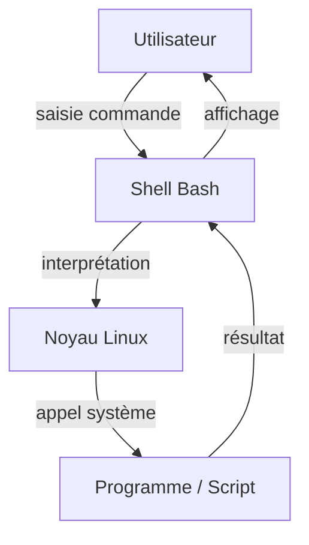
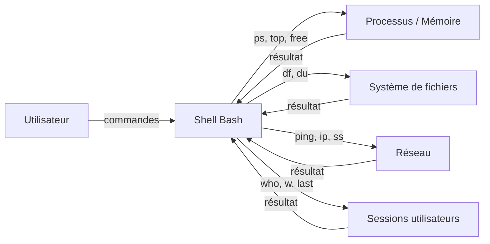
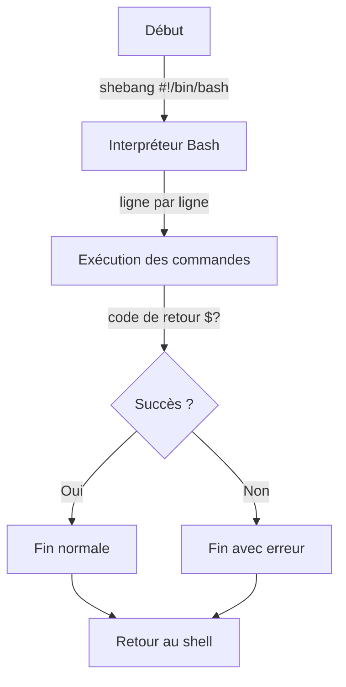
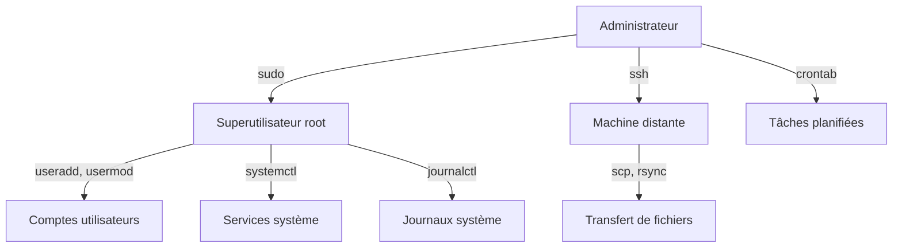
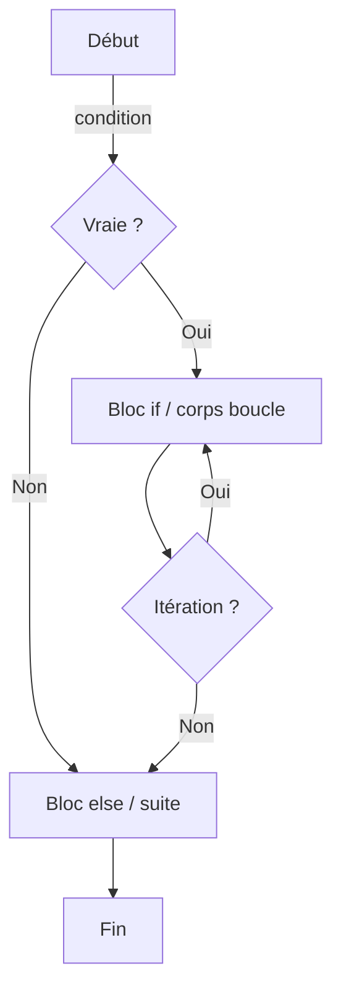

# Scripting Bash et PowerShell — JOUR 1

## Bash (1/2) — Introduction au shell et structures de contrôle (08/11/2026)

> **Fil conducteur** — Ce cours de 4 jours progresse du shell Bash sous Linux (J1-J2) vers PowerShell sous Windows (J3-J4), en passant par l'automatisation, les droits et la documentation professionnelle de scripts.

---

## Objectifs du Jour

- Comprendre l'environnement du shell Bash et son rôle d'intermédiaire entre l'utilisateur et le noyau Linux
- Maîtriser la syntaxe de base : variables, types, commandes simples et redirections
- Créer, rendre exécutable et exécuter un premier script Bash
- Utiliser les structures de contrôle : conditions (if, case) et boucles (for, while)

---

## Planning du Jour

| Chapitre | Horaires | Thème | Durée |
|----------|----------|-------|-------|
| 1 | 9h00-11h00 | Introduction au shell Bash et à son environnement | 2h |
| — | 11h00-11h15 | Pause | 15min |
| 2 | 11h15-12h00 | Syntaxe de base : variables, types, commandes simples | 45min |
| — | 12h00-13h00 | Pause déjeuner | 1h |
| 3 | 13h00-14h30 | Création et exécution d'un script | 1h30 |
| — | 14h30-14h45 | Pause | 15min |
| 4 | 14h45-16h00 | Structures de contrôle : conditions (if, case), boucles (for, while) | 1h15 |

---

## Chapitre 1 — Introduction au shell Bash et à son environnement (9h00-11h00)

### Objectifs

- Définir ce qu'est un shell et le rôle de Bash comme intermédiaire entre l'utilisateur et le noyau
- Identifier les fichiers de configuration et d'environnement du shell
- Distinguer variables shell et variables d'environnement, et utiliser `export`
- Connaître les variables d'environnement courantes : HOME, PATH, SHELL, USER, LANG

### Contenu théorique (1h45)

#### 1. Qu'est-ce que le shell Bash ? (30min)

Le **shell** est l'interpréteur de commandes qui fait l'interface entre l'utilisateur et le noyau du système d'exploitation. Il lit les commandes saisies par l'utilisateur, les interprète, puis les exécute en lançant les programmes correspondants. **Bash** (Bourne Again SHell) est le shell par défaut sur la plupart des distributions Linux. Il constitue une surcouche qui traduit les commandes texte en appels système compris par le noyau Linux.

Le noyau Linux gère directement le matériel, la mémoire, les processus et les systèmes de fichiers, mais il n'interagit pas directement avec l'utilisateur. C'est le shell qui assure ce rôle d'intermédiaire : il attend une saisie, analyse la commande, résout les chemins, lance les programmes et affiche les résultats.

```bash
echo $SHELL
# echo : affiche la valeur d'une variable ou d'une chaîne de caractères
# $SHELL : variable d'environnement contenant le chemin de l'interpréteur par défaut
ps -p $$
# ps : affiche des informations sur les processus en cours
# -p : sélectionne un processus par son identifiant (PID)
# $$ : variable spéciale contenant le PID du shell courant
```

> **Concept clé** — Le shell agit comme un intermédiaire : il traduit les commandes texte en appels système compris par le noyau Linux. Sans shell, l'utilisateur devrait interagir directement avec le noyau via des appels système de bas niveau.

> **Bon à savoir** — Bash est un shell compatible avec le shell Bourne historique (`sh`), tout en y ajoutant des fonctionnalités avancées : complétion, historique, alias, fonctions, tableaux et arithmétique intégrée.

#### 2. Fichiers de configuration et d'environnement (45min)

Lorsqu'une session shell s'ouvre, plusieurs fichiers de configuration sont lus dans un ordre précis. Ils permettent de personnaliser l'environnement de l'utilisateur : variables d'environnement, alias, fonctions, invite de commandes, etc.

| Fichier | Rôle | Moment de chargement |
|---------|------|----------------------|
| /etc/profile | Configuration système globale, valide pour tous les utilisateurs | Ouverture de session (login shell) |
| ~/.bash_profile | Configuration utilisateur spécifique aux sessions de connexion | Ouverture de session (login shell) |
| ~/.bashrc | Configuration utilisateur pour les shells interactifs non-login | Chaque nouveau shell interactif |
| ~/.bash_history | Historique des commandes exécutées par l'utilisateur | Continu, écrit à la fin de la session |

Le fichier `/etc/profile` est lu une seule fois à l'ouverture de session. Le fichier `~/.bash_profile` est lu ensuite pour l'utilisateur connecté. Si `~/.bash_profile` n'existe pas, Bash peut lire `~/.bash_login` ou `~/.profile`. Le fichier `~/.bashrc` est lu à chaque lancement d'un shell interactif (par exemple, à l'ouverture d'un nouveau terminal).

```bash
cat /etc/profile | head -20
# cat : affiche le contenu d'un fichier sur la sortie standard
# /etc/profile : fichier de configuration système globale
# head -20 : limite l'affichage aux 20 premières lignes
# | : tube (pipeline), redirige la sortie de cat vers l'entrée de head
cat ~/.bashrc
# cat : affiche le contenu du fichier de configuration utilisateur
# ~/.bashrc : fichier de configuration du shell interactif de l'utilisateur courant
```

> **Pourquoi plusieurs fichiers de configuration ?** — La distinction entre fichiers de connexion (login) et fichiers interactifs permet de séparer ce qui doit être configuré une seule fois par session (variables d'environnement, PATH) de ce qui doit être disponible à chaque nouveau terminal (alias, fonctions, invite de commandes).

> **Piège (version)** — Sur certaines distributions, `~/.bash_profile` source `~/.bashrc` s'il existe. Sur d'autres, ce n'est pas le cas. Il est recommandé de vérifier le comportement sur la cible de déploiement avant d'écrire un script portable.

#### 3. Variables shell et variables d'environnement (45min)

Bash distingue deux catégories de variables :

- Les **variables shell** (shell variables) : définies dans le shell courant, visibles uniquement dans ce shell. Elles ne sont pas transmises aux programmes lancés depuis ce shell.
- Les **variables d'environnement** (environment variables) : des variables shell qui ont été rendues accessibles aux processus enfants (child processes) grâce à la commande `export`. Tout programme ou script lancé depuis le shell hérite d'une copie de ces variables.

Cette distinction est documentée dans *The Linux Command Line - A Complete Introduction, 3e* (Shotts, William), page 144, qui précise que les variables shell sont des données placées par l'instance courante de bash, tandis que les variables d'environnement englobent tout le reste.

Pour rendre une variable accessible aux sous-processus, on utilise la commande `export` (Linux Command Line and Shell Scripting Bible, 5e, Blum & Bresnahan, pp. 154, 155, 169). Un shell enfant (subshell) hérite des variables exportées de son shell parent. Lorsqu'un subshell se termine, sa copie de l'environnement est perdue : les modifications apportées dans le subshell n'affectent pas le shell parent.

Les variables d'environnement courantes sont :

| Variable | Signification | Exemple de valeur |
|----------|---------------|-------------------|
| HOME | Répertoire personnel de l'utilisateur | /home/eleve |
| PATH | Liste des répertoires où le shell recherche les commandes | /usr/local/sbin:/usr/bin:/bin |
| SHELL | Interpréteur de commandes par défaut | /bin/bash |
| USER | Nom de l'utilisateur connecté | eleve |
| LANG | Langue et paramètres régionaux (locale) | fr_FR.UTF-8 |

```bash
echo $HOME
# echo : affiche la valeur d'une variable
# $HOME : répertoire personnel de l'utilisateur courant
echo $PATH
# $PATH : liste des répertoires de recherche des commandes, séparés par deux-points
echo $SHELL
# $SHELL : chemin de l'interpréteur de commandes par défaut
echo $USER
# $USER : nom de l'utilisateur connecté
echo $LANG
# $LANG : locale du système (langue, encodage, formats)
MON_PROJET=scripting-b2
# MON_PROJET=scripting-b2 : assigne la chaîne "scripting-b2" à la variable shell MON_PROJET
# Aucune espace n'est autorisée autour du signe =
export MON_PROJET
# export : rend la variable MON_PROJET accessible aux processus enfants (child processes)
echo $MON_PROJET
# echo : affiche la valeur de la variable dans le shell courant
```

> **Concept clé** — Sans `export`, une variable reste locale au shell courant et n'est pas visible par les scripts ou programmes qu'il lance. Avec `export`, elle devient une variable d'environnement héritée par tous les sous-processus.

> **Contre-mesure** — Pour éviter de polluer l'environnement global, n'exportez que les variables strictement nécessaires aux sous-processus. Utilisez des noms en majuscules pour les variables d'environnement afin de les distinguer visuellement des variables locales.

**Fig 1 — Environnement d'exécution d'un script Bash**



#### 4. Commandes d'information système et de surveillance (30min)

Un administrateur système doit disposer d'une vision en temps réel de l'état de la machine : utilisation du processeur, de la mémoire, de l'espace disque, liste des processus en cours, utilisateurs connectés. Les commandes présentées ci-dessous permettent d'obtenir ces informations sans installer d'outils supplémentaires, car elles font partie du ensemble de base des systèmes Linux (coreutils, procps-ng, util-linux).

##### 4.1. Informations sur les utilisateurs et les sessions (who, w, last, uptime)

La commande `who` liste les utilisateurs actuellement connectés au système, avec leur terminal, leur heure de connexion et l'adresse IP distante le cas échéant. La commande `w` fournit des informations similaires, complétées par l'activité en cours de chaque utilisateur et la charge moyenne du système. La commande `last` consulte le fichier des connexions (`/var/log/wtmp`) pour afficher l'historique des ouvertures et fermetures de session. Enfin, `uptime` indique depuis combien de temps le système fonctionne sans redémarrage, ainsi que la charge moyenne sur 1, 5 et 15 minutes.

```bash
who
# who : affiche la liste des utilisateurs connectés (nom, terminal, date/heure, hôte distant)
# Aucun flag requis : affichage par défaut des sessions actives

w
# w : affiche les utilisateurs connectés, leur activité et la charge système
# Aucun flag requis : combine qui, uptime et activité des processus

uptime
# uptime : affiche l'heure actuelle, la durée de fonctionnement et la charge moyenne
# Aucun flag requis : résultat synthétique sur une seule ligne

last | head -10
# last : lit le fichier /var/log/wtmp pour l'historique des connexions
# | : tube qui redirige la sortie de last vers l'entrée de head
# head -10 : limite l'affichage aux 10 entrées les plus récentes
```

> **Concept clé** — La charge moyenne (load average) affichée par `uptime` et `w` représente le nombre moyen de processus en attente d'exécution sur les 1, 5 et 15 dernières minutes. Une charge supérieure au nombre de cœurs du processeur indique une saturation du CPU.

> **Bon à savoir** — La commande `last` peut être vide si le fichier `/var/log/wtmp` n'existe pas ou a été purgé. Elle nécessite généralement des privilèges de lecture sur ce fichier journal.

##### 4.2. Utilisation de la mémoire et du disque (free, df, du)

La commande `free` affiche la quantité de mémoire vive (RAM) disponible, utilisée et libre, ainsi que l'espace d'échange (swap). La commande `df` (disk free) indique l'espace disque disponible sur chaque système de fichiers monté. La commande `du` (disk usage) mesure l'espace occupé par un répertoire ou un fichier spécifique.

```bash
free -h
# free : affiche l'utilisation de la mémoire et du swap
# -h : format lisible par un humain (Ko, Mo, Go au lieu d'octets bruts)

df -h
# df : affiche l'espace disque disponible sur les systèmes de fichiers montés
# -h : format lisible par un humain (Ko, Mo, Go)

du -sh /home/eleve
# du : estime l'espace disque utilisé par un fichier ou répertoire
# -s : résumé, affiche uniquement le total pour le répertoire spécifié
# -h : format lisible par un humain
# /home/eleve : répertoire dont on mesure l'occupation
```

> **Concept clé** — `df` montre l'espace disponible par système de fichiers (point de montage), tandis que `du` montre l'espace consommé par un répertoire ou fichier particulier. Ces deux commandes se complètent : `df` pour savoir s'il reste de la place, `du` pour savoir qui l'occupe.

> **Piège (version)** — Sur certains systèmes de fichiers (notamment Btrfs ou ZFS), `df` peut afficher des valeurs inattendues en raison du partage de blocs ou des instantanés (snapshots). Privilégier `du` pour une mesure précise de la consommation d'un répertoire.

##### 4.3. Gestion des processus (ps, top, kill)

Un processus est une instance d'un programme en cours d'exécution, identifiée par un PID (Process ID). La commande `ps` affiche un instantané des processus actifs. La commande `top` affiche une vue dynamique et actualisée des processus les plus consommatifs. La commande `kill` envoie un signal à un processus, par exemple pour le terminer.

```bash
ps aux
# ps : affiche un instantané des processus en cours
# a : affiche les processus de tous les utilisateurs
# u : affiche l'utilisateur propriétaire et le pourcentage de CPU/mémoire
# x : inclut les processus sans terminal associé (démons, services)

top
# top : affiche une vue dynamique triée par consommation CPU
# Aucune option requise : actualisation automatique toutes les 3 secondes
# Touche q pour quitter, touche k pour tuer un processus par son PID

kill 1234
# kill : envoie un signal à un processus identifié par son PID
# 1234 : identifiant du processus cible
# Par défaut, envoie le signal SIGTERM (15) qui demande une terminaison propre

kill -9 1234
# kill -9 : envoie le signal SIGKILL (9), terminaison immédiate et forcée
# 9 : numéro du signal SIGKILL, ne peut pas être intercepté par le processus
# À utiliser en dernier recours, car le processus ne peut pas nettoyer ses ressources
```

> **Concept clé** — Un signal est une notification asynchrone envoyée à un processus. SIGTERM (15) demande une terminaison gracieuse ; le processus peut intercepter ce signal pour fermer ses fichiers et libérer ses ressources. SIGKILL (9) force l'arrêt immédiat par le noyau, sans possibilité pour le processus de réagir.

> **Contre-mesure** — Toujours tenter `kill PID` (SIGTERM) avant d'utiliser `kill -9 PID` (SIGKILL). Le signal SIGKILL ne permet pas au processus de sauvegarder son état ni de fermer proprement ses fichiers ouverts, ce qui peut entraîner une perte de données.

#### 5. Commandes réseau et diagnostic (30min)

Les commandes réseau permettent de vérifier la connectivité, d'inspecter les interfaces, de consulter les tables de routage et de résoudre des noms de domaine. Certaines commandes classiques (`ifconfig`, `netstat`, `route`) sont progressivement remplacées par des outils plus modernes (`ip`, `ss`), mais restent présentes sur de nombreux systèmes.

##### 5.1. Test de connectivité (ping, traceroute)

La commande `ping` envoie des paquets ICMP ECHO_REQUEST à un hôte distant et attend une réponse ECHO_REPLY, permettant de vérifier qu'un hôte est joignable sur le réseau. La commande `traceroute` affiche le chemin emprunté par les paquets pour atteindre une destination, routeur par routeur.

```bash
ping -c 4 192.168.1.1
# ping : envoie des requêtes ICMP pour tester la connectivité réseau
# -c 4 : limite à 4 paquets envoyés, puis s'arrête automatiquement
# 192.168.1.1 : adresse IP de l'hôte cible

traceroute 192.168.1.1
# traceroute : affiche chaque saut (routeur) sur le chemin vers la destination
# Aucun flag requis : utilise UDP par défaut avec des TTL croissants
```

##### 5.2. Interfaces et configuration réseau (ifconfig, ip, route)

La commande `ifconfig` (interface configurer) affiche et configure les interfaces réseau. Elle est considérée comme obsolète sur les distributions modernes au profit de la commande `ip` du paquet `iproute2`. La commande `route` affiche et manipule la table de routage IP.

```bash
ifconfig
# ifconfig : affiche la configuration des interfaces réseau (adresse IP, masque, MTU)
# Aucun flag requis : liste toutes les interfaces actives

ip addr
# ip : outil moderne de gestion réseau et routage (paquet iproute2)
# addr : sous-commande affichant les adresses IP des interfaces
# Remplace ifconfig sur les systèmes récents

ip route
# ip route : affiche la table de routage IP du système
# route : sous-commande dédiée à l'affichage et à la modification des routes
```

> **Concept clé** — La commande `ip` du paquet `iproute2` unifie la gestion des adresses, des routes et des liens réseau dans un seul outil, remplaçant les commandes historiques `ifconfig`, `route` et `arp`. Sur les systèmes anciens, `ifconfig` et `route` peuvent être les seuls outils disponibles.

> **Bon à savoir** — L'option `-a` avec `ifconfig` affiche également les interfaces désactivées. Avec `ip`, la commande `ip link` affiche l'état des interfaces (up/down) indépendamment de leur configuration IP.

##### 5.3. Connexions et sockets (netstat, ss)

La commande `netstat` affiche les connexions réseau actives, les tables de routage et les statistiques d'interface. La commande `ss` (socket statistics) est son équivalent moderne, plus rapide et plus détaillé, car elle lit directement les informations du noyau via l'interface Netlink.

```bash
netstat -tuln
# netstat : affiche les connexions réseau, tables de routage et interfaces
# -t : connexions TCP uniquement
# -u : connexions UDP uniquement
# -l : écoute uniquement (listening sockets)
# -n : affichage numérique des adresses et ports (pas de résolution DNS)

ss -tuln
# ss : affiche les statistiques des sockets (remplace netstat)
# -t : TCP, -u : UDP, -l : écoute, -n : numérique
# Plus rapide que netstat car lit directement depuis le noyau
```

> **Contre-mesure** — `netstat` peut être lent sur les systèmes avec beaucoup de connexions car il interroge `/proc` pour chaque socket. Préférer `ss` pour les diagnostics rapides en production.

##### 5.4. Résolution de noms (nslookup, dig)

La commande `nslookup` et la commande `dig` (domain information groper) permettent de interroger les serveurs DNS pour résoudre un nom de domaine en adresse IP, ou inversement. `dig` est plus détaillé et plus flexible que `nslookup`.

```bash
nslookup example.com
# nslookup : interroge un serveur DNS pour résoudre un nom de domaine
# example.com : nom de domaine à résoudre
# Affiche l'adresse IP associée et le serveur DNS utilisé

dig example.com
# dig : outil avancé de requête DNS (domain information groper)
# example.com : nom de domaine à résoudre
# Affiche la réponse complète du serveur DNS, y compris les enregistrements et le temps de réponse
```

> **Concept clé** — Le DNS (Domain Name System) traduit les noms de domaine lisibles par les humains (exemple.com) en adresses IP numériques (93.184.216.34) compréhensibles par le réseau. Sans DNS, il faudrait mémoriser l'adresse IP de chaque service.

---

**Fig 5 — Topologie de surveillance système et réseau**



---

### Lab 01 — Inspection de l'environnement shell (45min)

#### Environnement

| Élément | Valeur |
|---------|--------|
| Poste | Linux (Bash) |
| Shell | /bin/bash |
| Éditeur | nano / vim |

#### Exercices

**Exercice 01 — Afficher les variables d'environnement (10min)**

```bash
env | head -20
# env : affiche toutes les variables d'environnement du processus courant
# head -20 : limite l'affichage aux 20 premières lignes pour une lecture concise
# | : tube qui redirige la sortie de env vers l'entrée de head
```

- [ ] La liste des variables d'environnement s'affiche
- [ ] Les variables HOME, PATH, SHELL, USER, LANG sont identifiables

**Exercice 02 — Créer et exporter une variable (10min)**

```bash
MON_PROJET=scripting-b2
# MON_PROJET=scripting-b2 : assigne une valeur à la variable shell MON_PROJET
# Pas d'espace autour du signe =
export MON_PROJET
# export : rend MON_PROJET accessible aux processus enfants (child processes)
echo $MON_PROJET
# echo : affiche la valeur de MON_PROJET dans le shell courant
bash -c 'echo $MON_PROJET'
# bash -c : lance un nouveau shell Bash enfant qui exécute la commande entre guillemets
# $MON_PROJET : dans le shell enfant, la variable est visible car elle a été exportée
```

- [ ] La variable MON_PROJET est créée avec la valeur scripting-b2
- [ ] La variable est exportée et visible depuis un shell enfant

**Exercice 03 — Inspecter le fichier /etc/profile (10min)**

```bash
cat /etc/profile | head -30
# cat : affiche le contenu du fichier de configuration système globale
# /etc/profile : fichier lu à l'ouverture de session pour tous les utilisateurs
# head -30 : limite l'affichage aux 30 premières lignes
```

- [ ] Le fichier /etc/profile est lisible
- [ ] Les lignes affichées concernent la configuration système (PATH, umask, etc.)

<details>
<summary>Solution — Exercices 01, 02 et 03</summary>

```bash
# Exercice 01
env | head -20

# Exercice 02
MON_PROJET=scripting-b2
export MON_PROJET
echo $MON_PROJET
bash -c 'echo $MON_PROJET'

# Exercice 03
cat /etc/profile | head -30
```

Résultat attendu pour l'exercice 02 : la valeur `scripting-b2` s'affiche deux fois, une fois dans le shell courant et une fois dans le shell enfant lancé par `bash -c`.

</details>

#### Exercices supplémentaires — Analyse des fichiers de données fictives (donnees_fictives/)

**Exercice 01b — Inspecter le fichier system.log (10min)**

Le fichier `donnees_fictives/system.log` contient des entrées de journal système simulées. Utilisez les commandes d'information système pour l'analyser.

```bash
wc -l donnees_fictives/system.log
# wc : compte les lignes, mots et octets d'un fichier
# -l : compte uniquement le nombre de lignes
# donnees_fictives/system.log : fichier de journal système fictif

head -5 donnees_fictives/system.log
# head : affiche les premières lignes d'un fichier
# -5 : limite à 5 lignes
# donnees_fictives/system.log : fichier cible

tail -5 donnees_fictives/system.log
# tail : affiche les dernières lignes d'un fichier
# -5 : limite à 5 lignes
# donnees_fictives/system.log : fichier cible
```

- [ ] Le fichier system.log contient 23 lignes
- [ ] Les 5 premières lignes s'affichent correctement
- [ ] Les 5 dernières lignes s'affichent correctement

**Exercice 02b — Lister les fichiers de données fictives (10min)**

```bash
ls -l donnees_fictives/
# ls : liste le contenu d'un répertoire
# -l : format détaillé (droits, propriétaire, taille, date)
# donnees_fictives/ : répertoire contenant les fichiers de données

du -sh donnees_fictives/
# du : estime l'espace disque utilisé
# -s : résumé, affiche uniquement le total
# -h : format lisible par un humain
# donnees_fictives/ : répertoire cible
```

- [ ] Tous les fichiers de donnees_fictives/ sont listés
- [ ] La taille totale du répertoire s'affiche

<details>
<summary>Solution — Exercices 01b et 02b</summary>

```bash
# Exercice 01b
wc -l donnees_fictives/system.log
head -5 donnees_fictives/system.log
tail -5 donnees_fictives/system.log

# Exercice 02b
ls -l donnees_fictives/
du -sh donnees_fictives/
```

Résultat attendu pour l'exercice 01b : `23 donnees_fictives/system.log`, puis les 5 premières et 5 dernières lignes du fichier.

Résultat attendu pour l'exercice 02b : liste détaillée des 6 fichiers du répertoire, puis la taille totale (ex. `4,0K donnees_fictives/`).

</details>

### Démonstration commentée

L'exécution de `env` liste l'environnement complet du processus shell courant. Chaque ligne a le format `NOM=VALEUR`. Le shell transmet cet environnement à tout programme qu'il lance, permettant ainsi aux scripts de connaître l'utilisateur (`$USER`), son répertoire (`$HOME`), son shell (`$SHELL`) et sa locale (`$LANG`). Lorsqu'une variable est exportée avec `export`, elle est copiée dans l'environnement de chaque processus enfant. Si un script modifie une variable exportée, cette modification n'affecte que la copie du script, pas le shell parent.

### Correction et résolution pas à pas

1. Ouvrez un terminal Bash.
2. Tapez `env | head -20` pour visualiser un extrait des variables d'environnement. Observez les lignes `HOME=...`, `PATH=...`, `SHELL=...`, `USER=...`, `LANG=...`.
3. Créez une variable locale avec `MON_PROJET=scripting-b2` (sans espaces autour de `=`).
4. Rendez-la accessible aux sous-processus avec `export MON_PROJET`.
5. Vérifiez dans le shell courant avec `echo $MON_PROJET`.
6. Vérifiez dans un shell enfant avec `bash -c 'echo $MON_PROJET'`. La valeur doit s'afficher, confirmant l'héritage par le processus enfant.
7. Inspectez `/etc/profile` avec `cat /etc/profile | head -30` pour voir la configuration système globale.

### Bonnes pratiques

| Pratique | Description |
|----------|-------------|
| Nommage explicite | Utiliser des noms de variables décrivant leur contenu (ex. MON_PROJET, CHEMIN_SAUVEGARDE) |
| Export sélectif | N'exporter que les variables nécessaires aux sous-processus |
| Majuscules pour l'environnement | Utiliser des noms en majuscules pour les variables d'environnement |

> **Bonnes pratiques** — Privilégiez les noms en majuscules pour les variables d'environnement afin de les distinguer des variables locales. N'exportez jamais une variable contenant des informations sensibles (mot de passe, clé API) sans réfléchir aux implications de sécurité.

**Script de correction :** `env_check.sh`

### Exercices — Chapitre 1

**Exercice 04 — Vérifier le shell courant (5min)**

```bash
echo $SHELL
# $SHELL : contient le chemin vers l'interpréteur de commandes par défaut de l'utilisateur
```

1. Quel est le chemin de votre shell par défaut ?
2. Est-ce Bash ?

<details>
<summary>Solution — Exercice 04</summary>

```bash
echo $SHELL
```

Attendu : `/bin/bash` (ou un chemin équivalent selon la distribution, par exemple `/usr/bin/bash`). Si le chemin affiché contient `bash`, le shell par défaut est bien Bash.

</details>

- [ ] Le chemin du shell est affiché
- [ ] Le shell est identifié comme Bash

**Exercice 05 — Comparer variable locale et variable d'environnement (10min)**

```bash
MA_VAR_LOCALE="visible_ici_seulement"
export MA_VAR_ENV="visible_partout"
bash -c 'echo "Locale : $MA_VAR_LOCALE"'
bash -c 'echo "Environnement : $MA_VAR_ENV"'
```

1. Quelle commande affiche une valeur et laquelle affiche une chaîne vide ?
2. Pourquoi ?

<details>
<summary>Solution — Exercice 05</summary>

La première commande `bash -c 'echo "Locale : $MA_VAR_LOCALE"'` affiche une chaîne vide car `MA_VAR_LOCALE` n'a pas été exportée : elle n'est pas transmise au shell enfant. La deuxième commande `bash -c 'echo "Environnement : $MA_VAR_ENV"'` affiche `visible_partout` car `MA_VAR_ENV` a été exportée et est donc héritée par le processus enfant.

</details>

- [ ] La différence entre variable locale et variable d'environnement est comprise
- [ ] Les deux commandes sont testées et le résultat est interprété

---

> **Ce qu'on a retenu** — Le shell Bash est l'intermédiaire entre l'utilisateur et le noyau Linux. Les fichiers de configuration (`/etc/profile`, `~/.bashrc`, `~/.bash_profile`) personnalisent l'environnement. Une variable shell reste locale tant qu'elle n'est pas exportée ; `export` la transforme en variable d'environnement héritée par les processus enfants. Les variables courantes HOME, PATH, SHELL, USER et LANG fournissent des informations essentielles sur l'environnement d'exécution.

---

## Chapitre 2 — Syntaxe de base : variables, types, commandes simples (11h15-12h00)

### Objectifs

- Déclarer et utiliser des variables en Bash sans erreur de syntaxe
- Comprendre que toutes les variables Bash sont des chaînes de caractères
- Maîtriser l'interpolation : `"$var"` vs `'$var'`
- Utiliser les commandes simples et les redirections

### Contenu théorique (40min)

#### 1. Assignation de variable et typage (25min)

En Bash, toutes les variables sont des chaînes de caractères (strings). Il n'existe pas de typage strict comme dans un langage compilé (C, Java, etc.). Une variable contenant `30` est traitée comme le texte `"30"` ; les opérations arithmétiques nécessitent une syntaxe spécifique (`$(( ))`).

L'assignation d'une variable suit une règle stricte : il ne doit **jamais** y avoir d'espace autour du signe `=`. `VAR=valeur` est correct ; `VAR = valeur` est une erreur de syntaxe que Bash interprétera comme une tentative d'exécution de la commande `VAR` avec des arguments.

```bash
NOM="Alice"
# NOM="Alice" : assigne la chaîne de caractères "Alice" à la variable NOM
# Les guillemets doubles protègent la valeur et permettent l'interpolation ultérieure
AGE=30
# AGE=30 : assigne la chaîne "30" à la variable AGE (tout est chaîne en Bash)
NOM_ESPACE="Alice Dupont"
# NOM_ESPACE="Alice Dupont" : les guillemets doubles permettent d'inclure des espaces dans la valeur
```

> **Concept clé** — En Bash, il n'y a jamais d'espace autour du signe `=` lors d'une assignation : `VAR=valeur`, jamais `VAR = valeur`. Un espace autour de `=` transforme l'assignation en tentative d'exécution de commande.

> **Piège (version)** — Si vous oubliez les guillemets autour d'une valeur contenant des espaces (`NOM=Alice Dupont`), Bash tente d'exécuter `Dupont` comme une commande avec `NOM=Alice` comme affectation temporaire, ce qui produit une erreur `command not found`.

#### 2. Interpolation et protection des variables (15min)

L'interpolation consiste à remplacer le nom d'une variable par sa valeur au sein d'une chaîne de caractères. Le comportement dépend du type de guillemets utilisé :

- Entre guillemets doubles (`"$var"`), Bash remplace `$var` par sa valeur.
- Entre guillemets simples (`'$var'`), Bash affiche le texte littéralement, sans interprétation.

```bash
NOM="test"
echo '$NOM'
# echo : affiche la chaîne passée en argument
# '$NOM' : guillemets simples, pas d'interprétation, affiche littéralement $NOM
echo "$NOM"
# echo : affiche la chaîne passée en argument
# "$NOM" : guillemets doubles, Bash remplace $NOM par sa valeur test
```

Résultat attendu :
```
$NOM
test
```

#### 3. Commandes simples et redirections (40min)

Une commande simple se compose du nom de la commande suivi d'arguments et d'options (flags). Les commandes de base du système Linux (coreutils) incluent `echo`, `printf`, `date`, `whoami`, `hostname`, `pwd`, `ls`, `cat`, etc.

Les redirections permettent de modifier l'origine ou la destination des flux de données :

- `>` : redirige la sortie standard vers un fichier (écrasement)
- `>>` : redirige la sortie standard vers un fichier (ajout à la fin)
- `<` : redirige l'entrée standard depuis un fichier
- `|` : tube (pipeline), redirige la sortie d'une commande vers l'entrée d'une autre

```bash
echo "Bonjour le monde"
# echo : affiche la chaîne de caractères sur la sortie standard
date
# date : affiche la date et l'heure système actuelles
whoami
# whoami : affiche le nom de l'utilisateur courant
hostname
# hostname : affiche le nom de la machine (hôte)
pwd
# pwd : affiche le chemin complet du répertoire de travail courant
ls -l /home
# ls : liste le contenu d'un répertoire
# -l : format détaillé (droits, propriétaire, taille, date de modification)
# /home : répertoire cible à lister
cat /etc/hostname
# cat : affiche le contenu d'un fichier sur la sortie standard
# /etc/hostname : fichier contenant le nom de la machine
```

```bash
ls -l /home > listing.txt
# ls -l : liste détaillée du répertoire /home
# > listing.txt : redirige la sortie standard vers le fichier listing.txt (écrasement si existant)
date >> listing.txt
# date : affiche la date et l'heure
# >> listing.txt : ajoute la sortie à la fin du fichier listing.txt sans écraser
wc -l < listing.txt
# wc -l : compte le nombre de lignes
# < listing.txt : redirige l'entrée standard depuis le fichier listing.txt
ls -l /home | head -5
# ls -l : liste détaillée du répertoire /home
# | : tube qui redirige la sortie de ls vers l'entrée de head
# head -5 : affiche les 5 premières lignes
```

> **Concept clé** — Les redirections `>` et `>>` agissent sur la sortie standard (stdout, descripteur de fichier 1). Le tube `|` relie la sortie standard d'une commande à l'entrée standard (stdin, descripteur de fichier 0) de la commande suivante, formant une chaîne de traitement (pipeline).

> **Bon à savoir** — Le descripteur de fichier 2 correspond à la sortie d'erreur (stderr). Pour rediriger les erreurs vers un fichier, utilisez `2> fichier` ou `2>&1` pour fusionner stderr sur stdout.

**Fig 2 — Pipeline d'écriture et d'exécution d'un script Bash**


#### 4. Commandes de lecture de fichiers (cat, less, head, tail, wc) (25min)

La lecture de fichiers est une opération fondamentale en administration système. Selon le fichier et le besoin, différentes commandes sont appropriées : `cat` pour afficher un fichier entier, `less` pour une navigation paginée, `head` et `tail` pour extraire des parties, et `wc` pour compter.

##### 4.1. Affichage complet et paginé (cat, less)

La commande `cat` (concatenate) affiche le contenu d'un fichier sur la sortie standard. Elle est adaptée aux fichiers courts. Pour les fichiers longs, `less` permet une navigation interactive page par page sans charger l'intégralité du fichier en mémoire.

```bash
cat donnees_fictives/system.log
# cat : affiche le contenu complet d'un fichier sur la sortie standard
# donnees_fictives/system.log : fichier de journal système à afficher
# Inconvénient : défile tout le contenu, inadapté aux fichiers volumineux

less donnees_fictives/system.log
# less : affiche un fichier de manière paginée, navigation interactive
# donnees_fictives/system.log : fichier à consulter
# Touches : Espace (page suivante), b (page précédente), / (recherche), q (quitter)
```

> **Concept clé** — `cat` lit et affiche le fichier d'un seul bloc, ce qui convient aux petits fichiers. `less` lit le fichier par morceaux et permet de naviguer, de rechercher et de quitter sans charger tout le contenu en mémoire, ce qui est essentiel pour les fichiers journaux volumineux.

> **Bon à savoir** — Dans `less`, la touche `/` suivie d'un motif permet de rechercher dans le fichier. La touche `n` passe à l'occurrence suivante, `N` à l'occurrence précédente.

##### 4.2. Extraction de parties de fichier (head, tail, wc)

La commande `head` affiche les premières lignes d'un fichier, `tail` les dernières lignes, et `wc` (word count) compte les lignes, mots et octets.

```bash
head -10 donnees_fictives/system.log
# head : affiche les premières lignes d'un fichier
# -10 : limite à 10 lignes
# donnees_fictives/system.log : fichier cible

tail -10 donnees_fictives/system.log
# tail : affiche les dernières lignes d'un fichier
# -10 : limite à 10 lignes
# donnees_fictives/system.log : fichier cible

tail -f donnees_fictives/system.log
# tail -f : suit le fichier en temps réel (affiche les nouvelles lignes au fur et à mesure)
# -f : mode follow, utile pour surveiller un fichier de log en cours d'écriture
# Ctrl+C pour arrêter

wc -l donnees_fictives/system.log
# wc : compte les lignes, mots et octets
# -l : compte uniquement le nombre de lignes
# donnees_fictives/system.log : fichier cible

wc -w donnees_fictives/employes.csv
# wc : compte les lignes, mots et octets
# -w : compte uniquement le nombre de mots
# donnees_fictives/employes.csv : fichier CSV des employés
```

> **Concept clé** — `tail -f` est particulièrement utile pour surveiller un fichier de journal en temps réel : chaque nouvelle ligne ajoutée au fichier s'affiche immédiatement à l'écran. C'est l'outil de prédilection pour le dépannage de services en production.

> **Piège (version)** — `wc -l` compte les caractères de retour à la ligne (`\n`). Si le dernier d'un fichier ne se termine pas par un retour à la ligne, il ne sera pas compté comme une ligne complète.

#### 5. Commandes de recherche (find, grep) (25min)

La recherche de fichiers et de contenus textuels est une tâche courante. `find` permet de localiser des fichiers selon leurs attributs (nom, taille, date, permissions), tandis que `grep` recherche des motifs textuels à l'intérieur des fichiers.

##### 5.1. Recherche de fichiers (find)

La commande `find` parcourt une arborescence de répertoires et sélectionne les fichiers correspondant à des critères de recherche.

```bash
find donnees_fictives/ -name "*.txt"
# find : recherche des fichiers dans une arborescence
# donnees_fictives/ : répertoire racine de la recherche
# -name : filtre par nom de fichier (motif avec jokers)
# "*.txt" : tous les fichiers se terminant par .txt

find donnees_fictives/ -type f -name "*.log"
# find : recherche des fichiers dans une arborescence
# donnees_fictives/ : répertoire racine
# -type f : ne sélectionne que les fichiers réguliers (exclut les répertoires)
# -name "*.log" : filtre par nom se terminant par .log

find /var/log -mtime -1
# find : recherche des fichiers modifiés récemment
# /var/log : répertoire des journaux système
# -mtime -1 : fichiers modifiés il y a moins de 24 heures
# Le signe - signifie "moins de", + signifierait "plus de"
```

> **Concept clé** — `find` est récursif par défaut : il explore le répertoire de départ et tous ses sous-répertoires. Les options `-name`, `-type`, `-mtime`, `-size`, `-user` peuvent être combinées pour affiner la recherche.

> **Bon à savoir** — L'option `-name` utilise des jokers shell (`*`, `?`, `[...]`). Pour rechercher une correspondance exacte sans joker, omettre les caractères spéciaux ou utiliser `-name "fichier_exact"`.

##### 5.2. Recherche de texte (grep)

La commande `grep` (global regular expression print) recherche des lignes contenant un motif donné dans un ou plusieurs fichiers.

```bash
grep "ERROR" donnees_fictives/system.log
# grep : recherche des lignes contenant un motif
# "ERROR" : motif à rechercher (chaîne littérale)
# donnees_fictives/system.log : fichier dans lequel chercher
# Affiche toutes les lignes contenant le mot ERROR

grep -i "error" donnees_fictives/system.log
# grep : recherche des lignes contenant un motif
# -i : insensibilité à la casse (majuscules/minuscules ignorées)
# "error" : motif à rechercher, correspond aussi à ERROR, Error, etc.

grep -c "ERROR" donnees_fictives/system.log
# grep : recherche des lignes contenant un motif
# -c : compte le nombre de lignes correspondantes au lieu de les afficher
# "ERROR" : motif à rechercher
# donnees_fictives/system.log : fichier cible

grep -n "WARN" donnees_fictives/system.log
# grep : recherche des lignes contenant un motif
# -n : affiche le numéro de ligne devant chaque résultat
# "WARN" : motif à rechercher
# donnees_fictives/system.log : fichier cible
```

> **Concept clé** — `grep` utilise des expressions régulières (regex) pour définir des motifs de recherche. Par défaut, le motif est traité comme une chaîne littérale, mais des caractères spéciaux comme `.`, `*`, `^`, `$` peuvent être utilisés pour des recherches avancées.

> **Contre-mesure** — Toujours protéger le motif entre guillemets doubles pour éviter que le shell n'interprète les caractères spéciaux (notamment `*`, `?`, `$`). Utiliser `grep -i` pour une recherche insensible à la casse.

#### 6. Commandes de traitement de texte (awk, sed, cut, sort, uniq, diff, patch) (25min)

Ces commandes permettent de transformer, extraire et comparer des données textuelles. Elles sont particulièrement puissantes lorsqu'elles sont combinées dans des pipelines.

##### 6.1. Extraction de colonnes (cut)

La commande `cut` extrait des colonnes ou des champs à partir de lignes de texte, selon un délimiteur ou des positions de caractères.

```bash
cut -d',' -f1,3 donnees_fictives/employes.csv
# cut : extrait des sections de chaque ligne d'un fichier
# -d',' : définit la virgule comme délimiteur de champs
# -f1,3 : sélectionne les champs 1 (nom) et 3 (salaire)
# donnees_fictives/employes.csv : fichier CSV des employés

cut -c1-10 donnees_fictives/noms.txt
# cut : extrait des sections de chaque ligne
# -c1-10 : extrait les caractères 1 à 10 de chaque ligne
# donnees_fictives/noms.txt : fichier contenant des noms
```

##### 6.2. Tri et dédoublement (sort, uniq)

La commande `sort` ordonne les lignes d'un fichier. La commande `uniq` supprime les lignes consécutives identiques (nécessite un tri préalable).

```bash
sort donnees_fictives/noms.txt
# sort : trie les lignes d'un fichier par ordre alphabétique
# donnees_fictives/noms.txt : fichier contenant des noms (avec doublons)

sort donnees_fictives/noms.txt | uniq
# sort : trie les lignes pour regrouper les doublons
# | : tube qui redirige la sortie de sort vers l'entrée de uniq
# uniq : supprime les lignes consécutives identiques
# Résultat : liste des noms sans doublons, chaque nom apparaissant une seule fois

sort donnees_fictives/doublons.txt | uniq -c
# uniq -c : compte le nombre d'occurrences de chaque ligne unique
# -c : préfixe chaque ligne par le nombre d'occurrences
# donnees_fictives/doublons.txt : fichier contenant des mots en doublon
```

> **Concept clé** — `uniq` ne détecte que les doublons consécutifs. Il est donc impératif de trier le fichier avec `sort` avant d'appliquer `uniq` pour éliminer tous les doublons, quelle que soit leur position dans le fichier.

##### 6.3. Éditeur de flux (sed)

La commande `sed` (stream editor) effectue des transformations sur un flux de texte, notamment des substitutions de motifs.

```bash
sed 's/Informatique/IT/g' donnees_fictives/employes.csv
# sed : éditeur de flux pour filtrer et transformer du texte
# 's/Informatique/IT/g' : commande de substitution
# s : substituer, Informatique : motif à remplacer, IT : texte de remplacement
# g : global, remplace toutes les occurrences sur chaque ligne (pas seulement la première)
# donnees_fictives/employes.csv : fichier cible
```

##### 6.4. Traitement de colonnes et rapport (awk)

La commande `awk` est un langage de programmation complet pour le traitement de texte, particulièrement adapté à l'extraction de colonnes et au calcul de totaux.

```bash
awk -F',' '{print $1, $3}' donnees_fictives/employes.csv
# awk : langage de traitement de texte orienté colonnes
# -F',' : définit la virgule comme séparateur de champs
# '{print $1, $3}' : affiche le champ 1 (nom) et le champ 3 (salaire)
# $1, $3 : références aux champs séparés par le délimiteur
# donnees_fictives/employes.csv : fichier CSV des employés

awk -F',' 'NR>1 {somme+=$3} END {print "Somme des salaires :", somme}' donnees_fictives/employes.csv
# NR : numéro de ligne courant (Number of Record)
# NR>1 : saute l'en-tête (première ligne)
# somme+=$3 : additionne le champ 3 (salaire) à chaque ligne
# END : bloc exécuté après la lecture de toutes les lignes
# print : affiche le résultat final
```

##### 6.5. Comparaison de fichiers (diff, patch)

La commande `diff` compare deux fichiers ligne par ligne et affiche les différences. La commande `patch` applique un fichier de différences (produit par `diff`) à un fichier original.

```bash
diff donnees_fictives/noms.txt donnees_fictives/doublons.txt
# diff : compare deux fichiers ligne par ligne
# donnees_fictives/noms.txt : premier fichier de référence
# donnees_fictives/doublons.txt : second fichier à comparer
# Affiche les lignes à ajouter, modifier ou supprimer pour passer de l'un à l'autre
```

> **Concept clé** — Le pipeline (`|`) permet de chaîner ces commandes pour effectuer des traitements complexes en une seule ligne. Par exemple, `sort fichier | uniq -c | sort -nr` compte les occurrences de chaque ligne et trie par fréquence décroissante.

> **Bon à savoir** — `awk` est plus puissant que `cut` car il permet des calculs arithmétiques, des conditions et des blocs de début/fin (BEGIN/END). `sed` est idéal pour des substitutions simples, tandis que `awk` convient aux traitements structurés.

---

**Fig 6 — Pipeline de traitement de texte**


---

### Lab 02 — Manipulation de variables et commandes (45min)

#### Environnement

| Élément | Valeur |
|---------|--------|
| Poste | Linux (Bash) |
| Éditeur | nano / vim |

#### Exercices

**Exercice 06 — Créer des variables et les afficher (10min)**

```bash
UTILISATEUR="admin"
# UTILISATEUR="admin" : assigne la chaîne "admin" à la variable UTILISATEUR
SERVEUR="web01"
# SERVEUR="web01" : assigne la chaîne "web01" à la variable SERVEUR
echo "L'utilisateur $UTILISATEUR est connecté sur le serveur $SERVEUR."
# echo : affiche le message avec interpolation des variables $UTILISATEUR et $SERVEUR
# Les guillemets doubles permettent l'interprétation des variables et protègent les espaces
```

- [ ] Les variables UTILISATEUR et SERVEUR sont créées
- [ ] Le message s'affiche avec les valeurs interpolées correctement

**Exercice 07 — Tester l'absence d'interprétation (10min)**

```bash
NOM="test"
echo '$NOM'
# '$NOM' : guillemets simples, pas d'interprétation, affiche littéralement $NOM
echo "$NOM"
# "$NOM" : guillemets doubles, Bash remplace $NOM par sa valeur test
```

1. Quelle est la différence entre les deux lignes ?
2. Pourquoi ?

- [ ] La différence d'interprétation est comprise
- [ ] Les deux formes sont testées

**Exercice 08 — Rediriger la sortie vers un fichier (15min)**

```bash
date > rapport.txt
# date : affiche la date et l'heure système
# > rapport.txt : redirige la sortie vers le fichier rapport.txt (écrasement)
whoami >> rapport.txt
# whoami : affiche le nom de l'utilisateur courant
# >> rapport.txt : ajoute la sortie à la fin du fichier sans écraser
cat rapport.txt
# cat : affiche le contenu du fichier rapport.txt
```

- [ ] Le fichier rapport.txt est créé avec la date
- [ ] Le nom de l'utilisateur est ajouté à la fin du fichier
- [ ] Le contenu du fichier s'affiche correctement

<details>
<summary>Solution — Exercices 06, 07 et 08</summary>

```bash
# Exercice 06
UTILISATEUR="admin"
SERVEUR="web01"
echo "L'utilisateur $UTILISATEUR est connecté sur le serveur $SERVEUR."

# Exercice 07
NOM="test"
echo '$NOM'
echo "$NOM"

# Exercice 08
date > rapport.txt
whoami >> rapport.txt
cat rapport.txt
```

Résultat attendu pour l'exercice 07 :
```
$NOM
test
```

Résultat attendu pour l'exercice 08 : le fichier `rapport.txt` contient d'abord la date et l'heure, puis le nom de l'utilisateur sur une ligne supplémentaire.

</details>

#### Exercices supplémentaires — Traitement de texte sur les données fictives (donnees_fictives/)

**Exercice 08b — Lire et compter les lignes du fichier system.log (10min)**

```bash
wc -l donnees_fictives/system.log
# wc : compte les lignes, mots et octets
# -l : compte uniquement le nombre de lignes
# donnees_fictives/system.log : fichier de journal système

head -5 donnees_fictives/system.log
# head : affiche les premières lignes d'un fichier
# -5 : limite à 5 lignes
# donnees_fictives/system.log : fichier cible
```

- [ ] Le nombre de lignes de system.log s'affiche
- [ ] Les 5 premières lignes du fichier s'affichent

**Exercice 09b — Rechercher des erreurs dans system.log avec grep (10min)**

```bash
grep "ERROR" donnees_fictives/system.log
# grep : recherche des lignes contenant un motif
# "ERROR" : motif à rechercher (majuscules)
# donnees_fictives/system.log : fichier de journal système

grep -i "error" donnees_fictives/system.log
# grep : recherche des lignes contenant un motif
# -i : insensibilité à la casse (majuscules/minuscules)
# "error" : motif à rechercher, correspond aussi à ERROR, Error
# donnees_fictives/system.log : fichier cible

grep -c "ERROR" donnees_fictives/system.log
# grep : recherche des lignes contenant un motif
# -c : compte le nombre de lignes correspondantes
# "ERROR" : motif à rechercher
# donnees_fictives/system.log : fichier cible
```

- [ ] Les lignes contenant ERROR s'affichent
- [ ] La recherche insensible à la casse trouve les mêmes lignes
- [ ] Le nombre de lignes ERROR s'affiche

**Exercice 10b — Extraire des colonnes du fichier employes.csv avec cut et awk (15min)**

```bash
cut -d',' -f1,3 donnees_fictives/employes.csv
# cut : extrait des sections de chaque ligne
# -d',' : définit la virgule comme délimiteur de champs
# -f1,3 : sélectionne les champs 1 (nom) et 3 (salaire)
# donnees_fictives/employes.csv : fichier CSV des employés

awk -F',' '{print $1, $3}' donnees_fictives/employes.csv
# awk : langage de traitement de texte orienté colonnes
# -F',' : définit la virgule comme séparateur de champs
# '{print $1, $3}' : affiche le champ 1 (nom) et le champ 3 (salaire)
# donnees_fictives/employes.csv : fichier CSV des employés
```

- [ ] Les noms et salaires s'affichent avec cut
- [ ] Les noms et salaires s'affichent avec awk
- [ ] Les deux commandes produisent le même résultat

**Exercice 11b — Trier et dédoubler le fichier noms.txt (15min)**

```bash
sort donnees_fictives/noms.txt
# sort : trie les lignes d'un fichier par ordre alphabétique
# donnees_fictives/noms.txt : fichier contenant des noms (avec doublons)

sort donnees_fictives/noms.txt | uniq
# sort : trie les lignes pour regrouper les doublons
# | : tube qui redirige la sortie de sort vers l'entrée de uniq
# uniq : supprime les lignes consécutives identiques
# donnees_fictives/noms.txt : fichier source

sort donnees_fictives/doublons.txt | uniq -c
# uniq -c : compte le nombre d'occurrences de chaque ligne unique
# -c : préfixe chaque ligne par le nombre d'occurrences
# donnees_fictives/doublons.txt : fichier contenant des mots en doublon
```

- [ ] Les noms sont triés par ordre alphabétique
- [ ] Les doublons sont supprimés après sort | uniq
- [ ] Le nombre d'occurrences de chaque mot s'affiche avec uniq -c

<details>
<summary>Solution — Exercices 08b, 09b, 10b et 11b</summary>

```bash
# Exercice 08b
wc -l donnees_fictives/system.log
head -5 donnees_fictives/system.log

# Exercice 09b
grep "ERROR" donnees_fictives/system.log
grep -i "error" donnees_fictives/system.log
grep -c "ERROR" donnees_fictives/system.log

# Exercice 10b
cut -d',' -f1,3 donnees_fictives/employes.csv
awk -F',' '{print $1, $3}' donnees_fictives/employes.csv

# Exercice 11b
sort donnees_fictives/noms.txt
sort donnees_fictives/noms.txt | uniq
sort donnees_fictives/doublons.txt | uniq -c
```

Résultat attendu pour l'exercice 09b : 5 lignes contenant ERROR dans system.log.

Résultat attendu pour l'exercice 11b : `sort | uniq` affiche 15 noms uniques (les 15 noms de la liste, sans les 5 doublons). `sort | uniq -c` affiche chaque mot de doublons.txt avec son nombre d'occurrences (pomme: 5, banane: 4, orange: 3, kiwi: 3, mangue: 3, raisin: 2).

</details>

### Démonstration commentée

L'interpolation de variable (`$NOM`) permet d'insérer la valeur d'une variable dans une chaîne entre guillemets doubles. Entre guillemets simples, l'interprétation est désactivée et `$NOM` s'afficherait littéralement. Les redirections `>` et `>>` permettent respectivement d'écraser ou d'ajouter du contenu dans un fichier, tandis que le tube `|` enchaîne plusieurs commandes pour traiter un flux de données de manière séquentielle.

### Correction et résolution pas à pas

1. Déclarez `UTILISATEUR="admin"` et `SERVEUR="web01"` sans espaces autour de `=`.
2. Affichez un message avec `echo "L'utilisateur $UTILISATEUR est connecté sur le serveur $SERVEUR."`.
3. Testez `echo '$NOM'` puis `echo "$NOM"` avec `NOM="test"` pour observer la différence d'interprétation.
4. Redirigez la sortie de `date` vers `rapport.txt` avec `>`, puis ajoutez `whoami` avec `>>`.
5. Affichez le contenu du fichier avec `cat rapport.txt`.

### Bonnes pratiques

| Pratique | Description |
|----------|-------------|
| Guillemets doubles | Encadrer les valeurs de variables pour gérer les espaces et caractères spéciaux |
| Pas d'espaces autour de = | Respecter `VAR=valeur` sans espaces |
| Redirection appropriée | Utiliser `>` pour écraser, `>>` pour ajouter, `|` pour chaîner |

> **Bonnes pratiques** — Utilisez toujours des guillemets doubles autour des variables interpolées pour éviter les erreurs liées aux espaces dans les valeurs. Préférez `>>` à `>` lorsque vous souhaitez conserver l'historique d'un fichier de log.

**Script de correction :** `vars_check.sh`

### Exercices — Chapitre 2

**Exercice 09 — Afficher des informations système (5min)**

```bash
echo "Utilisateur : $(whoami)"
# echo : affiche la chaîne
# $(whoami) : substitution de commande, exécute whoami et insère le résultat
echo "Répertoire : $(pwd)"
# $(pwd) : substitution de commande, exécute pwd et insère le chemin courant
```

1. Que fait la syntaxe `$(commande)` ?
2. Quel est l'avantage par rapport à l'utilisation de guillemets simples ?

<details>
<summary>Solution — Exercice 09</summary>

La syntaxe `$(commande)` est une substitution de commande : Bash exécute la commande entre parenthèses et remplace l'expression par le résultat de la commande. Contrairement aux guillemets simples qui affichent le texte littéralement, `$(commande)` permet d'insérer dynamiquement le résultat d'une commande dans une chaîne.

</details>

- [ ] La substitution de commande est comprise
- [ ] Les commandes whoami et pwd sont testées

---

> **Ce qu'on a retenu** — En Bash, toutes les variables sont des chaînes de caractères et l'assignation ne tolère aucun espace autour de `=`. L'interpolation fonctionne entre guillemets doubles (`"$var"`) mais est désactivée entre guillemets simples (`'$var'`). Les commandes simples (`echo`, `date`, `whoami`, `hostname`, `pwd`, `ls`, `cat`) peuvent être combinées avec des redirections (`>`, `>>`, `<`, `|`) pour diriger les flux de données.

---

## Chapitre 3 — Création et exécution d'un script (13h00-14h30)

### Objectifs

- Créer un fichier de script Bash valide avec shebang
- Rendre le script exécutable avec `chmod 755` et `chmod u+x`
- Exécuter un script de trois façons : `./script.sh`, `bash script.sh`, `source script.sh`
- Vérifier le code de retour `$?` (0 = succès, non-zéro = erreur)

### Contenu théorique (1h15)

#### 1. Le shebang et la structure d'un script (30min)

Un script Bash commence par une ligne appelée **shebang** (désignée par `#!`) qui indique au noyau quel interpréteur doit être utilisé pour exécuter le fichier. Cette ligne doit impérativement être la toute première ligne du fichier. Selon *How Linux Works, 2nd Edition* (Ward, Brian), page 251, « The #! part is called a [shebang] ».

Le shebang `#!/bin/bash` indique d'utiliser l'interpréteur Bash situé dans `/bin/bash`. Sans shebang, le shell par défaut de l'utilisateur serait utilisé, ce qui peut comporter des risques de compatibilité si le script utilise des fonctionnalités spécifiques à Bash.

```bash
#!/bin/bash
# #!/bin/bash : shebang, indique d'utiliser l'interpréteur Bash situé dans /bin/bash
# Ce script affiche un message de bienvenue et la date du jour

echo "Bienvenue dans ce script Bash"
# echo : affiche le message de bienvenue sur la sortie standard
date
# date : affiche la date et l'heure système actuelles
```

#### 2. Rendre un script exécutable avec chmod (30min)

Par défaut, un nouveau fichier créé par un utilisateur n'est pas exécutable. Il faut modifier ses droits d'accès avec la commande `chmod` (change mode). Selon *The Linux Command Line - A Complete Introduction, 3e* (Shotts, William), page 353, il faut « make it executable » avec `chmod 755`. Selon *Mastering Linux Security and Hardening* (Tevault, Donald A.), page 80, on peut aussi utiliser `chmod u+x` pour ajouter la permission d'exécution au propriétaire.

Le mode `755` signifie :
- `7` (propriétaire) : lecture (4) + écriture (2) + exécution (1) = 7
- `5` (groupe) : lecture (4) + exécution (1) = 5
- `5` (autres) : lecture (4) + exécution (1) = 5

```bash
chmod 755 mon_script.sh
# chmod : modifie les droits d'accès au fichier
# 755 : lecture/écriture/exécution pour le propriétaire, lecture/exécution pour le groupe et les autres
# mon_script.sh : fichier cible à rendre exécutable
./mon_script.sh
# ./ : exécute le script situé dans le répertoire courant
# mon_script.sh : nom du script à exécuter
```

L'exécution directe avec `./mon_script.sh` nécessite que le répertoire courant soit explicitement indiqué, car pour des raisons de sécurité, le répertoire courant n'est généralement pas inclus dans la variable `PATH`.

```bash
chmod u+x mon_script.sh
# chmod : modifie les droits d'accès au fichier
# u+x : ajoute la permission d'exécution (x) pour le propriétaire (u) du fichier
# mon_script.sh : fichier cible
```

> **Pourquoi ./ devant le nom du script ?** — Le répertoire courant n'est généralement pas dans le `PATH` pour des raisons de sécurité. `./mon_script.sh` indique explicitement d'exécuter le fichier situé dans le répertoire courant, évitant ainsi d'exécuter par erreur un programme système du même nom.

> **Bon à savoir** — `bash mon_script.sh` ne requiert pas de droits d'exécution, car c'est l'interpréteur Bash qui lit et exécute le fichier. Le shebang est alors ignoré. Cette méthode est utile pour tester un script sans le rendre exécutable, mais elle ne fonctionne que pour Bash.

#### 3. Les différentes façons d'exécuter un script (15min)

Il existe trois méthodes principales pour exécuter un script Bash :

1. `./script.sh` : exécution directe, nécessite le shebang et les droits d'exécution
2. `bash script.sh` : exécution via l'interpréteur Bash, ne nécessite pas de droits d'exécution, le shebang est ignoré
3. `source script.sh` (ou `. script.sh`) : exécution dans le shell courant, sans lancer de processus enfant. Les variables et fonctions définies dans le script restent disponibles après l'exécution.

```bash
bash mon_script.sh
# bash : invoque l'interpréteur Bash pour exécuter le fichier mon_script.sh
# mon_script.sh : fichier de script à exécuter
source mon_script.sh
# source : exécute le script dans le shell courant sans lancer de processus enfant
# mon_script.sh : fichier de script à exécuter
# Les variables définies dans le script restent accessibles après l'exécution
```

#### 4. Codes de retour et variable $? (15min)

Chaque commande ou script termine son exécution avec un **code de retour** (exit code). Selon *How Linux Works, 2nd Edition* (Ward, Brian), page 254, le code de sortie de la dernière commande détermine la façon dont le shell traite le conditionnel. Par convention :

- `0` : succès
- Toute valeur non-zéro (1 à 255) : erreur ou avertissement

La variable spéciale `$?` contient le code de retour de la dernière commande exécutée.

```bash
./mon_script.sh
# ./mon_script.sh : exécute le script situé dans le répertoire courant
echo $?
# $? : variable spéciale contenant le code de retour de la dernière commande exécutée
# 0 indique un succès, toute autre valeur indique une erreur
```

**Fig 3 — Flux de création et exécution d'un script Bash**



#### 5. Archivage et compression (tar, gzip, zip) (25min)

L'archivage consiste à regrouper plusieurs fichiers dans un seul conteneur, tandis que la compression réduit la taille des données. Ces opérations sont essentielles pour les sauvegardes, les transferts de fichiers et la distribution de logiciels.

##### 5.1. Création et extraction d'archives (tar)

La commande `tar` (tape archive) regroupe plusieurs fichiers et répertoires dans un seul fichier archive, avec ou sans compression.

```bash
tar -cvf archive.tar donnees_fictives/
# tar : crée, liste ou extrait des archives
# -c : crée une nouvelle archive
# -v : mode verbeux, affiche les fichiers traités
# -f : spécifie le nom du fichier archive
# archive.tar : nom de l'archive à créer
# donnees_fictives/ : répertoire à archiver

tar -xvf archive.tar
# tar : extrait le contenu d'une archive
# -x : extrait les fichiers de l'archive
# -v : mode verbeux
# -f : spécifie le fichier archive
# archive.tar : archive à extraire

tar -czvf archive.tar.gz donnees_fictives/
# tar : crée une archive compressée avec gzip
# -c : crée une nouvelle archive
# -z : compresse avec gzip
# -v : mode verbeux
# -f : spécifie le nom du fichier archive
# archive.tar.gz : nom de l'archive compressée
# donnees_fictives/ : répertoire à archiver et compresser

tar -tzvf archive.tar.gz
# tar : liste le contenu d'une archive compressée sans l'extraire
# -t : liste le contenu de l'archive
# -z : l'archive est compressée avec gzip
# -v : mode verbeux
# -f : spécifie le fichier archive
```

> **Concept clé** — `tar` ne compresse pas par défaut ; il regroupe simplement les fichiers. L'option `-z` ajoute la compression gzip, `-j` ajouterait la compression bzip2, et `-J` la compression xz. L'extension `.tar.gz` ou `.tgz` indique une archive tar compressée avec gzip.

> **Bon à savoir** — L'option `-t` permet de lister le contenu d'une archive sans l'extraire, utile pour vérifier ce qu'elle contient avant une restauration.

##### 5.2. Compression individuelle (gzip, zip)

La commande `gzip` compresse un fichier individuel, remplaçant l'original par une version compressée avec l'extension `.gz`. La commande `zip` crée des archives compatibles avec Windows.

```bash
gzip donnees_fictives/system.log
# gzip : compresse un fichier individuellement
# donnees_fictives/system.log : fichier à compresser
# Résultat : donnees_fictives/system.log.gz (l'original est remplacé)

gzip -d donnees_fictives/system.log.gz
# gzip -d : décompresse un fichier gzip
# -d : décompression (décompress)
# donnees_fictives/system.log.gz : fichier compressé à décompresser
# Résultat : donnees_fictives/system.log (l'original est restauré)

zip archive.zip donnees_fictives/*.txt
# zip : crée une archive compressée au format ZIP
# archive.zip : nom de l'archive à créer
# donnees_fictives/*.txt : tous les fichiers .txt du répertoire à inclure
# Format compatible avec Windows et macOS
```

> **Concept clé** — `gzip` compresse un seul fichier et le remplace par sa version compressée. Pour compresser plusieurs fichiers individuellement, il faut appliquer `gzip` à chacun. `zip` peut regrouper plusieurs fichiers dans une seule archive, comme `tar`, mais avec un format plus largement interopérable.

> **Piège (version)** — `gzip` supprime le fichier original après compression. Pour conserver l'original, utiliser l'option `-k` (keep) si disponible, ou copier le fichier avant compression.

#### 6. Gestion des utilisateurs et groupes (chown, chgrp, umask, sudo, su, passwd, useradd, usermod, userdel, groupadd, groupdel) (25min)

La gestion des utilisateurs et des groupes constitue le cœur de la sécurité et du contrôle d'accès sur un système Linux. Chaque fichier appartient à un utilisateur et à un groupe, avec des droits d'accès distincts pour le propriétaire, le groupe et les autres.

##### 6.1. Propriétaire et groupe (chown, chgrp)

La commande `chown` (change owner) modifie le propriétaire d'un fichier ou répertoire. La commande `chgrp` (change group) modifie le groupe propriétaire.

```bash
chown eleve fichier.txt
# chown : modifie le propriétaire d'un fichier
# eleve : nouveau propriétaire (nom d'utilisateur)
# fichier.txt : fichier cible

chown eleve:eleve fichier.txt
# chown : modifie le propriétaire et le groupe
# eleve:eleve : propriétaire et groupe, séparés par deux-points
# fichier.txt : fichier cible

chgrp developpeurs fichier.txt
# chgrp : modifie le groupe propriétaire d'un fichier
# developpeurs : nouveau groupe propriétaire
# fichier.txt : fichier cible
```

> **Concept clé** — Sur Linux, chaque fichier a un propriétaire (user) et un groupe propriétaire (group). Les droits d'accès sont définis séparément pour ces trois catégories : propriétaire, groupe, et autres. Seul le propriétaire du fichier ou le superutilisateur (root) peut modifier ces attributs.

> **Contre-mesure** — L'utilisation de `chown` et `chgrp` nécessite généralement des privilèges de superutilisateur (via `sudo`). Ne jamais rendre un fichier appartenant à root accessible en écriture par tous les utilisateurs.

##### 6.2. Masque de création (umask)

La commande `umask` (user mask) définit les permissions par défaut appliquées lors de la création d'un nouveau fichier ou répertoire. Elle soustrait des permissions du maximum théorique (666 pour les fichiers, 777 pour les répertoires).

```bash
umask
# umask : affiche le masque de création actuel
# Aucun flag requis : affiche la valeur octale (ex. 0022)

umask 0022
# umask : définit le masque de création
# 0022 : masque octal, retire l'écriture pour le groupe et les autres
# Résultat : fichiers créés avec 644 (rw-r--r--), répertoires avec 755 (rwxr-xr-x)
```

> **Concept clé** — Le `umask` fonctionne par soustraction : permissions maximales (666 pour un fichier, 777 pour un répertoire) moins le umask donnent les permissions effectives. Avec umask 0022, un fichier créé aura les droits 644 (666 - 022) et un répertoire 755 (777 - 022).

> **Bon à savoir** — Le `umask` s'applique uniquement aux nouvelles créations ; il ne modifie pas les fichiers existants. Pour modifier les droits d'un fichier existant, utiliser `chmod`.

##### 6.3. Élévation de privilèges (sudo, su)

La commande `sudo` (superuser do) permet d'exécuter une commande avec les privilèges d'un autre utilisateur, généralement root. La commande `su` (switch user) permet de changer d'utilisateur dans le shell courant.

```bash
sudo ls /root
# sudo : exécute une commande avec les privilèges du superutilisateur
# ls : liste le contenu d'un répertoire
# /root : répertoire personnel de root (normalement inaccessible)
# Nécessite l'authentification de l'utilisateur courant

su - utilisateur
# su : change d'utilisateur dans le shell courant
# - : charge l'environnement complet de l'utilisateur cible (comme une nouvelle connexion)
# utilisateur : nom de l'utilisateur cible
# Nécessite le mot de passe de l'utilisateur cible
```

> **Concept clé** — `sudo` est préféré à `su` dans l'administration moderne car il permet d'exécuter des commandes individuelles avec des privilèges élevés sans ouvrir une session root complète, et il journalise toutes les actions dans `/var/log/auth.log` ou via `journalctl`.

> **Contre-mesure** — Configurer `sudo` via `visudo` pour accorder des privilèges limités et spécifiques plutôt qu'un accès root complet. Éviter de partager le mot de passe root entre plusieurs administrateurs.

##### 6.4. Gestion des mots de passe et comptes (passwd, useradd, usermod, userdel)

La commande `passwd` gère les mots de passe des utilisateurs. `useradd` crée un nouveau compte, `usermod` modifie un compte existant, et `userdel` supprime un compte.

```bash
passwd
# passwd : modifie le mot de passe de l'utilisateur courant
# Aucun flag requis : demande le mot de passe actuel puis le nouveau

sudo passwd utilisateur
# passwd : modifie le mot de passe d'un autre utilisateur
# sudo : élévation de privilèges requise pour modifier un autre compte
# utilisateur : nom du compte dont le mot de passe est modifié

sudo useradd -m -s /bin/bash nouvel_utilisateur
# useradd : crée un nouveau compte utilisateur
# -m : crée le répertoire personnel (/home/nouvel_utilisateur)
# -s /bin/bash : définit le shell par défaut de l'utilisateur
# nouvel_utilisateur : nom du compte à créer

sudo usermod -aG developpeurs utilisateur
# usermod : modifie un compte utilisateur existant
# -aG : ajoute l'utilisateur au groupe supplémentaire spécifié (append Group)
# developpeurs : groupe auquel ajouter l'utilisateur
# utilisateur : nom du compte à modifier

sudo userdel -r utilisateur
# userdel : supprime un compte utilisateur
# -r : supprime également le répertoire personnel et le spool de courrier
# utilisateur : nom du compte à supprimer
```

> **Concept clé** — L'option `-aG` de `usermod` est cruciale : sans `-a`, l'option `-G` remplacerait tous les groupes supplémentaires de l'utilisateur par le seul groupe spécifié, lui retirant ses autres appartenances. Toujours utiliser `-aG` pour ajouter un groupe sans supprimer les existants.

> **Piège (version)** — `userdel` sans l'option `-r` conserve le répertoire personnel de l'utilisateur, ce qui peut laisser des fichiers orphelins sur le système. Utiliser `-r` pour une suppression complète.

##### 6.5. Gestion des groupes (groupadd, groupdel)

La commande `groupadd` crée un nouveau groupe, et `groupdel` supprime un groupe existant.

```bash
sudo groupadd developpeurs
# groupadd : crée un nouveau groupe système
# developpeurs : nom du groupe à créer

sudo groupdel developpeurs
# groupdel : supprime un groupe existant
# developpeurs : nom du groupe à supprimer
# Échoue si des utilisateurs ont ce groupe comme groupe principal
```

#### 7. Planification et services (crontab, at, systemctl, journalctl) (25min)

L'automatisation des tâches et la gestion des services sont fondamentales pour l'administration système. `crontab` planifie des tâches récurrentes, `at` planifie des tâches ponctuelles, `systemctl` gère les services systemd, et `journalctl` consulte les journaux système.

##### 7.1. Tâches récurrentes (crontab)

La commande `crontab` (cron table) permet de planifier l'exécution automatique de commandes à intervalles réguliers.

```bash
crontab -e
# crontab : édite la table de planification de l'utilisateur courant
# -e : édite (ouvre l'éditeur de texte configuré)
# Format : minute heure jour_mois mois jour_semaine commande

crontab -l
# crontab : liste les tâches planifiées de l'utilisateur courant
# -l : liste (list)
# Affiche toutes les entrées du crontab de l'utilisateur
```

Exemple d'entrée crontab :
```
0 2 * * * /home/eleve/sauvegarde.sh
# 0 2 * * * : tous les jours à 2h00 du matin
# /home/eleve/sauvegarde.sh : commande à exécuter
```

> **Concept clé** — Le format cron comporte cinq champs temporels : minute (0-59), heure (0-23), jour du mois (1-31), mois (1-12), jour de la semaine (0-7, où 0 et 7 sont dimanche). L'astérisque `*` signifie "toutes les valeurs".

> **Bon à savoir** — Chaque utilisateur a son propre crontab. Le fichier système `/etc/crontab` et le répertoire `/etc/cron.d/` contiennent les tâches planifiées au niveau système, nécessitant des privilèges root.

##### 7.2. Tâches ponctuelles (at)

La commande `at` planifie l'exécution d'une commande à une heure précise, une seule fois.

```bash
echo "/home/eleve/sauvegarde.sh" | at 02:00
# at : planifie l'exécution d'une commande à une heure donnée
# echo ... | : tube qui envoie la commande vers l'entrée standard de at
# 02:00 : heure d'exécution (format HH:MM)
# at lit la commande depuis l'entrée standard et la planifie

atq
# at : liste les tâches planifiées en attente
# Aucun flag requis : affiche les tâches avec leur numéro d'identification

atrm 5
# at : supprime une tâche planifiée
# atrm : at remove, supprime la tâche numéro 5 de la file d'attente
```

##### 7.3. Gestion des services (systemctl)

La commande `systemctl` contrôle les services et unités du gestionnaire systemd, qui est le système d'initialisation par défaut sur la plupart des distributions Linux modernes.

```bash
systemctl status sshd
# systemctl : contrôle les services et unités systemd
# status : affiche l'état détaillé d'un service
# sshd : nom du service (Secure Shell Daemon)
# Affiche si le service est actif, inactif ou en échec

systemctl start sshd
# systemctl : contrôle les services systemd
# start : démarre un service immédiatement
# sshd : nom du service à démarrer

systemctl enable sshd
# systemctl : contrôle les services systemd
# enable : active le démarrage automatique d'un service au boot
# sshd : nom du service à activer
```

> **Concept clé** — `systemctl` distingue deux actions : démarrer un service immédiatement (`start`) et l'activer pour qu'il démarre automatiquement à chaque démarrage du système (`enable`). Un service peut être démarré sans être activé, et activé sans être démarré immédiatement.

> **Bon à savoir** — `systemctl` nécessite des privilèges root pour la plupart des opérations (start, stop, enable, disable). L'option `status` peut être exécutée sans privilèges pour consulter l'état d'un service.

##### 7.4. Consultation des journaux (journalctl)

La commande `journalctl` consulte les journaux du système collectés par systemd-journald, qui centralise les logs du noyau, des services et des applications.

```bash
journalctl -u sshd
# journalctl : consulte les journaux systemd
# -u : filtre par unité (service) spécifique
# sshd : nom du service dont on consulte les journaux

journalctl -n 50
# journalctl : consulte les journaux systemd
# -n : affiche les N dernières lignes
# 50 : nombre de lignes à afficher
# Utile pour un diagnostic rapide des événements récents

journalctl --since "1 hour ago"
# journalctl : consulte les journaux systemd
# --since : affiche les entrées à partir d'une date/heure donnée
# "1 hour ago" : expressions de temps relatives supportées
```

> **Concept clé** — Contrairement aux fichiers de log traditionnels dans `/var/log/`, `journalctl` lit les journaux binaires gérés par systemd-journald. Il offre des fonctionnalités de filtrage avancées (par service, par priorité, par période) et un affichage paginé.

#### 8. Accès distant et transfert de fichiers (ssh, scp, rsync, curl, wget) (25min)

L'administration système implique fréquemment de se connecter à des machines distantes et d'y transférer des fichiers. `ssh` permet l'accès distant sécurisé, `scp` et `rsync` transfèrent des fichiers, et `curl` et `wget` téléchargent des ressources depuis le réseau.

##### 8.1. Connexion distante sécurisée (ssh)

La commande `ssh` (Secure Shell) permet d'ouvrir une session distante chiffrée sur une machine distante.

```bash
ssh utilisateur@192.168.1.10
# ssh : ouvre une session distante sécurisée (Secure Shell)
# utilisateur : nom d'utilisateur sur la machine distante
# 192.168.1.10 : adresse IP de la machine distante
# Le trafic est chiffré, protégeant le mot de passe et les données échangées

ssh utilisateur@192.168.1.10 "uptime"
# ssh : exécute une commande sur la machine distante sans ouvrir de session interactive
# "uptime" : commande à exécuter sur la machine distante
# Résultat : la sortie de la commande distante s'affiche localement
```

> **Concept clé** — SSH utilise le chiffrement asymétrique pour l'authentification et le chiffrement symétrique pour le trafic de données. Il remplace les protocoles non sécurisés comme Telnet et rsh, qui transmettaient les mots de passe en clair.

> **Contre-mesure** — Toujours utiliser des clés SSH (générées avec `ssh-keygen`) plutôt que l'authentification par mot de passe, et désauthentifier l'accès root direct via SSH dans `/etc/ssh/sshd_config`.

##### 8.2. Transfert de fichiers (scp, rsync)

La commande `scp` (secure copy) copie des fichiers entre machines via SSH. La commande `rsync` synchronise des répertoires de manière efficace, ne transférant que les différences.

```bash
scp fichier.txt utilisateur@192.168.1.10:/home/utilisateur/
# scp : copie sécurisée de fichiers entre machines (Secure Copy)
# fichier.txt : fichier source local
# utilisateur@192.168.1.10:/home/utilisateur/ : destination distante
# Le transfert est chiffré via SSH

rsync -avz donnees_fictives/ utilisateur@192.168.1.10:/home/utilisateur/sauvegarde/
# rsync : synchronise des répertoires de manière efficace
# -a : mode archive (préserve droits, dates, liens symboliques, etc.)
# -v : mode verbeux, affiche les fichiers transférés
# -z : compresse les données pendant le transfert
# donnees_fictives/ : répertoire source
# utilisateur@192.168.1.10:/home/utilisateur/sauvegarde/ : destination distante
# rsync ne transfère que les fichiers modifiés depuis la dernière synchronisation
```

> **Concept clé** — `rsync` est plus efficace que `scp` pour les synchronisations répétées car il utilise un algorithme de delta-transfert : seuls les blocs modifiés sont envoyés, pas les fichiers entiers. Il peut aussi fonctionner en local sans SSH.

##### 8.3. Téléchargement depuis le réseau (curl, wget)

La commande `curl` transfère des données depuis ou vers un serveur en supportant de nombreux protocoles (HTTP, HTTPS, FTP, etc.). La commande `wget` est un téléchargeur non interactif optimisé pour la récupération de fichiers.

```bash
curl -o page.html https://example.com
# curl : transfère des données depuis un serveur
# -o : écrit la sortie dans un fichier (output)
# page.html : nom du fichier de destination
# https://example.com : URL de la ressource à télécharger

wget https://example.com/fichier.zip
# wget : télécharge des fichiers depuis le réseau (non interactif)
# https://example.com/fichier.zip : URL du fichier à télécharger
# wget reprend automatiquement un téléchargement interrompu avec -c
```

> **Concept clé** — `curl` est un outil polyvalent adapté aux tests d'API et aux transferts complexes (entêtes, authentification, cookies). `wget` est spécialisé dans le téléchargement de fichiers, avec reprise automatique et téléchargement récursif de sites web.

> **Bon à savoir** — `curl -I` affiche uniquement les en-têtes HTTP d'une réponse, utile pour vérifier qu'un serveur est en ligne sans télécharger le contenu complet.

---

**Fig 7 — Gestion des utilisateurs, services et accès distant**



---

### Lab 03 — Premier script exécutable (45min)

#### Environnement

| Élément | Valeur |
|---------|--------|
| Poste | Linux (Bash) |
| Fichier | mon_premier_script.sh |

#### Exercices

**Exercice 10 — Créer un script avec shebang (15min)**

Créez un fichier `backup.sh` contenant :

```bash
#!/bin/bash
# #!/bin/bash : shebang, indique d'utiliser l'interpréteur Bash
echo "Début de la sauvegarde"
# echo : affiche le message de début
date
# date : affiche la date et l'heure système
echo "Sauvegarde terminée"
# echo : affiche le message de fin
```

- [ ] Le fichier backup.sh est créé avec un éditeur de texte
- [ ] La première ligne contient le shebang #!/bin/bash

**Exercice 11 — Rendre le script exécutable (15min)**

```bash
chmod 755 backup.sh
# chmod : modifie les droits d'accès au fichier
# 755 : lecture/écriture/exécution pour le propriétaire, lecture/exécution pour le groupe et les autres
# backup.sh : fichier cible à rendre exécutable
chmod u+x backup.sh
# chmod : modifie les droits d'accès au fichier
# u+x : ajoute la permission d'exécution pour le propriétaire
# backup.sh : fichier cible
ls -l backup.sh
# ls -l : affiche les droits détaillés du fichier
# backup.sh : fichier cible
```

- [ ] Le script est rendu exécutable avec chmod 755
- [ ] La permission d'exécution est ajoutée avec chmod u+x
- [ ] La commande ls -l confirme la présence du droit d'exécution (x)

**Exercice 12 — Exécuter le script de trois façons (15min)**

```bash
./backup.sh
# ./ : exécute le script situé dans le répertoire courant
# backup.sh : nom du script
bash backup.sh
# bash : invoque l'interpréteur Bash pour exécuter le fichier
# backup.sh : fichier de script à exécuter
source backup.sh
# source : exécute le script dans le shell courant sans processus enfant
# backup.sh : fichier de script à exécuter
```

- [ ] Le script s'exécute avec ./backup.sh
- [ ] Le script s'exécute avec bash backup.sh
- [ ] Le script s'exécute avec source backup.sh

**Exercice 13 — Vérifier le code de retour (10min)**

```bash
./backup.sh
# ./backup.sh : exécute le script situé dans le répertoire courant
echo $?
# $? : variable spéciale contenant le code de retour de la dernière commande
# 0 indique un succès, toute valeur non-zéro indique une erreur
```

1. Quelle valeur affiche `$?` après un succès ?
2. Quelle valeur indiquerait une erreur ?

- [ ] Le code de retour 0 est observé après succès
- [ ] La signification des codes non-zéro est comprise

<details>
<summary>Solution — Exercices 10, 11, 12 et 13</summary>

Contenu du script `backup.sh` :

```bash
#!/bin/bash
echo "Début de la sauvegarde"
date
echo "Sauvegarde terminée"
```

Commandes d'exécution :

```bash
chmod 755 backup.sh
chmod u+x backup.sh
ls -l backup.sh
./backup.sh
bash backup.sh
source backup.sh
./backup.sh
echo $?
```

Résultat attendu : le script affiche « Début de la sauvegarde », la date et l'heure, puis « Sauvegarde terminée ». La commande `echo $?` affiche `0` après un succès.

</details>

#### Exercices supplémentaires — Archivage, compression et gestion des données fictives (donnees_fictives/)

**Exercice 13b — Archiver et compresser les fichiers de données (15min)**

```bash
tar -czvf donnees_archive.tar.gz donnees_fictives/
# tar : crée une archive compressée avec gzip
# -c : crée une nouvelle archive
# -z : compresse avec gzip
# -v : mode verbeux, affiche les fichiers traités
# -f : spécifie le nom du fichier archive
# donnees_archive.tar.gz : nom de l'archive compressée à créer
# donnees_fictives/ : répertoire à archiver et compresser

tar -tzvf donnees_archive.tar.gz
# tar : liste le contenu d'une archive compressée sans l'extraire
# -t : liste le contenu de l'archive
# -z : l'archive est compressée avec gzip
# -v : mode verbeux
# -f : spécifie le fichier archive
# donnees_archive.tar.gz : archive à lister
```

- [ ] L'archive donnees_archive.tar.gz est créée
- [ ] Le contenu de l'archive s'affiche avec tar -tzvf

**Exercice 14b — Vérifier l'existence des fichiers de configuration avec test (15min)**

Le fichier `donnees_fictives/services.txt` contient une liste de chemins de fichiers de configuration système. Vérifiez quels fichiers existent sur le système.

```bash
while read FICHIER; do
    # while : lit chaque ligne du fichier services.txt
    # read : lit une ligne depuis l'entrée standard
    # FICHIER : variable contenant le chemin lu
    if [ -f "$FICHIER" ]; then
        # -f : teste si le fichier existe et est un fichier régulier
        echo "$FICHIER : présent"
    else
        echo "$FICHIER : absent"
    fi
done < donnees_fictives/services.txt
# done : termine la boucle while
# < donnees_fictives/services.txt : redirige l'entrée standard depuis le fichier
```

- [ ] Chaque fichier listé dans services.txt est testé
- [ ] Le message "présent" ou "absent" s'affiche pour chaque fichier

<details>
<summary>Solution — Exercices 13b et 14b</summary>

```bash
# Exercice 13b
tar -czvf donnees_archive.tar.gz donnees_fictives/
tar -tzvf donnees_archive.tar.gz

# Exercice 14b
while read FICHIER; do
    if [ -f "$FICHIER" ]; then
        echo "$FICHIER : présent"
    else
        echo "$FICHIER : absent"
    fi
done < donnees_fictives/services.txt
```

Résultat attendu pour l'exercice 13b : l'archive est créée avec les 6 fichiers de donnees_fictives/, puis tar -tzvf liste leur contenu.

Résultat attendu pour l'exercice 14b : pour chaque chemin dans services.txt, un message indique si le fichier est présent ou absent sur le système (ex. `/etc/passwd : présent`, `/etc/ssh/sshd_config : présent` ou absent selon le système).

</details>

### Démonstration commentée

Le shebang `#!/bin/bash` est lu par le noyau au moment de l'exécution directe (`./backup.sh`). Il désigne l'interpréteur qui traitera le reste du fichier. La commande `chmod 755` accorde les droits de lecture, écriture et exécution au propriétaire, et de lecture et exécution au groupe et aux autres. L'exécution avec `bash backup.sh` contourne le besoin de droits d'exécution car c'est Bash lui-même qui lit le fichier. La commande `source backup.sh` exécute le script dans le shell courant, ce qui rend ses variables disponibles après l'exécution. Le code de retour `$?` vaut `0` lorsque le script se termine sans erreur.

### Correction et résolution pas à pas

1. Créez `backup.sh` avec un éditeur de texte (nano ou vim).
2. Ajoutez `#!/bin/bash` en première ligne.
3. Ajoutez les commandes `echo` et `date`.
4. Enregistrez le fichier.
5. Rendez-le exécutable avec `chmod 755 backup.sh`.
6. Vérifiez les droits avec `ls -l backup.sh`.
7. Lancez le script avec `./backup.sh`, puis testez `bash backup.sh` et `source backup.sh`.
8. Vérifiez le code de retour avec `echo $?` après l'exécution.

### Bonnes pratiques

| Pratique | Description |
|----------|-------------|
| Shebang toujours présent | Commencer chaque script par `#!/bin/bash` pour garantir l'interpréteur |
| Droits restrictifs | Utiliser 755 plutôt que 777 pour limiter l'écriture au propriétaire |
| Vérification du code de retour | Tester `$?` après l'exécution d'une commande critique |

> **Bonnes pratiques** — Ne rendez jamais un script writable par tous (777) ; 755 suffit pour l'exécution tout en protégeant contre la modification non autorisée. Vérifiez systématiquement `$?` après une commande dont le succès est nécessaire à la suite du script.

**Script de correction :** `backup.sh`

### Exercices — Chapitre 3

**Exercice 14 — Créer un script qui affiche des informations système (10min)**

Créez un fichier `infos.sh` contenant :

```bash
#!/bin/bash
# #!/bin/bash : shebang, indique d'utiliser l'interpréteur Bash
echo "=== Informations système ==="
# echo : affiche un séparateur de section
echo "Utilisateur : $(whoami)"
# $(whoami) : substitution de commande, insère le nom de l'utilisateur
echo "Répertoire : $(pwd)"
# $(pwd) : substitution de commande, insère le chemin du répertoire courant
echo "Date : $(date)"
# $(date) : substitution de commande, insère la date et l'heure
echo "=== Fin ==="
```

1. Rendez le script exécutable.
2. Exécutez-le et observez le résultat.
3. Vérifiez le code de retour avec `echo $?`.

<details>
<summary>Solution — Exercice 14</summary>

```bash
chmod 755 infos.sh
./infos.sh
echo $?
```

Résultat attendu :
```
=== Informations système ===
Utilisateur : eleve
Répertoire : /home/eleve
Date : lun 8 nov 2026 14:30:00 CET
=== Fin ===
0
```

Le code de retour `0` confirme que le script s'est exécuté sans erreur.

</details>

- [ ] Le script infos.sh est créé avec le shebang
- [ ] Le script est rendu exécutable
- [ ] L'exécution affiche les informations système
- [ ] Le code de retour 0 est observé

---

> **Ce qu'on a retenu** — Un script Bash commence par un shebang `#!/bin/bash` qui désigne l'interpréteur. La commande `chmod 755` (ou `chmod u+x`) rend le script exécutable. Un script peut s'exécuter de trois façons : `./script.sh` (direct, nécessite droits + shebang), `bash script.sh` (via l'interpréteur, shebang ignoré) et `source script.sh` (dans le shell courant, variables conservées). Le code de retour `$?` vaut `0` en cas de succès et une valeur non-zéro en cas d'erreur.

---

## Chapitre 4 — Structures de contrôle : conditions (if, case), boucles (for, while) (14h45-16h00)

### Objectifs

- Utiliser les conditions `if / then / else / fi` avec `[ condition ]`
- Maîtriser les opérateurs de test : `-f`, `-d`, `-eq`, `-ne`, `-gt`, `-lt`, `-z`, `-n`
- Utiliser `case / esac` pour la correspondance de motifs
- Écrire des boucles `for` et `while`
- Utiliser `break` et `continue` pour contrôler les boucles
- Comprendre le rôle des codes de sortie dans les conditionnels

### Contenu théorique (1h00)

#### 1. Condition if / then / else / fi (30min)

La structure conditionnelle `if` permet d'exécuter un bloc de commandes uniquement si une condition est vraie. Selon *Linux Command Line and Shell Scripting Bible, 5e* (Blum & Bresnahan), page 326, les crochets `[ ]` sont une commande de test qui est un synonyme de la commande `test`. On peut enclore une condition de test dans des crochets dans une instruction `if`-`then`.

La syntaxe générale est :

```bash
if [ condition ]; then
    commandes_si_vrai
else
    commandes_si_faux
fi
```

Les crochets `[ ]` doivent être entourés d'espaces à l'intérieur (`[ "$AGE" -ge 18 ]`, pas `["$AGE" -ge 18]`). Les variables doivent être protégées par des guillemets doubles pour éviter les erreurs si la variable est vide ou contient des espaces.

Les opérateurs de test les plus courants sont :

| Opérateur | Signification | Type de comparaison |
|-----------|---------------|---------------------|
| `-f` | Le fichier existe et est un fichier régulier | Fichier |
| `-d` | Le répertoire existe | Répertoire |
| `-eq` | Égal à | Numérique |
| `-ne` | Différent de | Numérique |
| `-gt` | Strictement supérieur à | Numérique |
| `-lt` | Strictement inférieur à | Numérique |
| `-z` | La chaîne est vide | Chaîne |
| `-n` | La chaîne est non vide | Chaîne |

```bash
if [ "$AGE" -ge 18 ]; then
    echo "Vous êtes majeur."
else
    echo "Vous êtes mineur."
fi
# if : débute une condition conditionnelle
# [ "$AGE" -ge 18 ] : teste si la variable AGE est supérieure ou égale à 18
# -ge : opérateur de comparaison numérique (greater or equal)
# then : début du bloc exécuté si la condition est vraie
# else : bloc exécuté si la condition est fausse
# fi : termine la condition (mot-clé if à l'envers)
```

> **Concept clé** — Les crochets `[ ]` sont une commande de test. Il est important de mettre des espaces à l'intérieur des crochets et de protéger les variables avec des guillemets pour éviter les erreurs de syntaxe.

> **Contre-mesure** — Testez toujours l'existence d'un fichier avec `-f` avant de tenter de le lire, et l'existence d'un répertoire avec `-d` avant d'y accéder, afin d'éviter les erreurs d'exécution.

#### 2. Condition case / esac (20min)

La structure `case` permet de comparer une variable contre plusieurs motifs (patterns) et d'exécuter le bloc associé au premier motif qui correspond. Selon *Linux Command Line and Shell Scripting Bible, 5e* (Blum & Bresnahan), page 325, la commande `case` compare la variable spécifiée contre les différents motifs et exécute les commandes associées au premier motif correspondant.

```bash
case "$JOUR" in
    lundi) echo "Début de la semaine de travail" ;;
    mardi) echo "Deuxième jour de travail" ;;
    mercredi) echo "Milieu de semaine" ;;
    jeudi) echo "Quatrième jour de travail" ;;
    vendredi) echo "Dernier jour de travail" ;;
    samedi|dimanche) echo "Week-end" ;;
    *) echo "Jour non reconnu" ;;
esac
# case : sélectionne une action selon la valeur de la variable JOUR
# ) : sépare le motif du bloc d'actions
# ;; : termine chaque bloc d'actions
# | : sépare plusieurs motifs pour un même bloc (samedi ou dimanche)
# *) : motif par défaut, correspond à tous les autres cas non listés
# esac : termine la structure case (mot-clé case à l'envers)
```

Le motif `*)` agit comme une clause par défaut (équivalent du `default` dans d'autres langages). Il est recommandé de toujours inclure un motif par défaut pour gérer les valeurs imprévues.

> **Concept clé** — La structure `case` est plus lisible qu'une suite de `if`/`elif` lorsque l'on compare une même variable contre plusieurs valeurs discrètes.

> **Bon à savoir** — Le symbole `|` dans un motif de `case` permet de regrouper plusieurs valeurs qui déclenchent la même action (par exemple `samedi|dimanche`).

#### 3. Boucles for et while (30min)

La boucle `for` itère sur une liste de valeurs. Selon *Linux Command Line and Shell Scripting Bible, 5e* (Blum & Bresnahan), page 347, la boucle `for` devrait normalement itérer à travers toutes les valeurs spécifiées dans la liste.

```bash
for JOUR in lundi mardi mercredi jeudi vendredi; do
    echo "Jour : $JOUR"
done
# for : itère sur chaque valeur de la liste
# JOUR : variable de boucle qui prend successivement chaque valeur
# in : sépare la variable de boucle de la liste de valeurs
# do : début du corps de la boucle
# done : termine la boucle
```

La boucle `while` répète un bloc de commandes tant qu'une condition est vraie. Selon *Linux Command Line and Shell Scripting Bible, 5e* (Blum & Bresnahan), page 354, la boucle `while` utilise les codes de sortie, comme la condition `if`. La boucle continue tant que la commande de test retourne un code de sortie 0.

```bash
COMPTEUR=1
# COMPTEUR=1 : initialise le compteur à 1
while [ $COMPTEUR -le 5 ]; do
    echo "Itération $COMPTEUR"
    # echo : affiche la valeur actuelle du compteur
    COMPTEUR=$((COMPTEUR + 1))
    # $((...)) : évaluation arithmétique, incrémente le compteur de 1
done
# while : répète tant que la condition est vraie
# [ $COMPTEUR -le 5 ] : teste si le compteur est inférieur ou égal à 5
# -le : lower or equal (inférieur ou égal)
# do : début du corps de la boucle
# done : termine la boucle
```

Les commandes `break` et `continue` permettent de contrôler le flux d'une boucle :

- `break` : sort immédiatement de la boucle
- `continue` : passe à l'itération suivante sans exécuter le reste du corps de la boucle

> **Piège (version)** — L'arithmétique Bash utilise `$(( ))` ; oublier les parenthèses doubles ferait afficher le texte littéralement par le shell.

> **Concept clé** — Les codes de sortie jouent un rôle central dans les structures de contrôle : selon *How Linux Works, 2nd Edition* (Ward, Brian), page 254, le code de sortie de la dernière commande détermine la façon dont le shell traite le conditionnel. Une boucle `while` continue tant que sa commande de test retourne 0.

**Fig 4 — Flux de contrôle conditionnel et itératif**



#### 4. Expressions régulières et tests avancés (25min)

Les expressions régulières (regex) permettent de définir des motifs de recherche complexes dans du texte. Bash les utilise dans plusieurs contextes : `grep` pour la recherche, `sed` et `awk` pour la transformation, et les tests conditionnels avec `[[ ]]` pour la correspondance de motifs.

##### 4.1. Notions de base des expressions régulières

Une expression régulière est une suite de caractères qui définit un motif de recherche. Les caractères les plus courants sont :

| Symbole | Signification | Exemple | Correspondance |
|---------|---------------|---------|----------------|
| `.` | N'importe quel caractère unique | `c.t` | chat, cot, cut |
| `*` | Zéro ou plusieurs occurrences du caractère précédent | `ab*` | a, ab, abb, abbb |
| `+` | Une ou plusieurs occurrences du caractère précédent | `ab+` | ab, abb, abbb |
| `?` | Zéro ou une occurrence du caractère précédent | `colou?r` | color, colour |
| `^` | Début de ligne | `^ERROR` | lignes commençant par ERROR |
| `$` | Fin de ligne | `erreur$` | lignes se terminant par erreur |
| `[...]` | Un des caractères entre crochets | `[aeiou]` | une voyelle |
| `[^...]` | Aucun des caractères entre crochets | `[^0-9]` | tout sauf un chiffre |

##### 4.2. Utilisation de grep avec des expressions régulières

```bash
grep "^ERROR" donnees_fictives/system.log
# grep : recherche des lignes correspondant à un motif
# "^ERROR" : expression régulière, ^ signifie début de ligne
# donnees_fictives/system.log : fichier de journal système
# Affiche uniquement les lignes commençant par ERROR

grep -E "ERROR|WARN" donnees_fictives/system.log
# grep -E : expressions régulières étendues (extended regex)
# "ERROR|WARN" : motif correspondant à ERROR ou WARN (| = ou)
# donnees_fictives/system.log : fichier cible
# Affiche les lignes contenant ERROR ou WARN

grep -E "[0-9]+" donnees_fictives/system.log
# grep -E : expressions régulières étendues
# "[0-9]+" : une ou plusieurs chiffres
# donnees_fictives/system.log : fichier cible
# Affiche les lignes contenant au moins un chiffre
```

> **Concept clé** — Par défaut, `grep` utilise des expressions régulières de base (BRE). L'option `-E` active les expressions régulières étendues (ERE), qui simplifient l'écriture des motifs (notamment `+`, `?`, `|` sans échappement).

> **Bon à savoir** — Toujours protéger l'expression régulière entre guillemets doubles pour éviter que le shell n'interprète les caractères spéciaux comme `*`, `?`, `$`, `[`, `]`.

##### 4.3. Tests conditionnels avancés avec [[ ]]

Bash propose une syntaxe de test étendue avec `[[ ]]` qui offre des fonctionnalités supérieures aux crochets simples `[ ]`, notamment la correspondance de motifs avec `=~` (expression régulière) et les comparaisons lexicographiques.

```bash
LOG_LINE="2026-11-08 10:10:05 ERROR httpd[2340] server reached MaxRequestWorkers"
if [[ $LOG_LINE =~ ERROR ]]; then
    # [[ ]] : test conditionnel étendu de Bash
    # $LOG_LINE : variable contenant la ligne de journal
    # =~ : opérateur de correspondance avec expression régulière
    # ERROR : motif à rechercher dans la ligne
    echo "Ligne d'erreur détectée"
fi

if [[ $LOG_LINE =~ ^[0-9]{4}-[0-9]{2}-[0-9]{2} ]]; then
    # ^[0-9]{4}-[0-9]{2}-[0-9]{2} : date au format AAAA-MM-JJ en début de ligne
    # {4} : exactement 4 occurrences, {2} : exactement 2 occurrences
    echo "Format de date valide détecté"
fi
```

> **Concept clé** — `[[ ]]` est une construction propre à Bash (non portable vers `sh`). Elle offre des avantages par rapport à `[ ]` : pas besoin de protéger les variables avec des guillemets (les espaces sont gérés en interne), support des expressions régulières avec `=~`, et opérateurs logiques `&&` et `||` au lieu de `-a` et `-o`.

> **Contre-mesure** — `[[ ]]` n'est pas disponible dans les scripts POSIX (`sh`). Pour un script portable, utiliser `[ ]` avec la commande `test` ou `expr` pour les expressions régulières.

##### 4.4. Tableau récapitulatif des commandes de traitement de texte

| Commande | Rôle principal | Options courantes | Exemple d'usage |
|----------|---------------|-------------------|-----------------|
| cat | Afficher le contenu d'un fichier | -n (numéroter les lignes) | `cat fichier.txt` |
| less | Navigation paginée dans un fichier | / (recherche), q (quitter) | `less fichier.log` |
| head | Afficher les premières lignes | -n (nombre de lignes) | `head -20 fichier.txt` |
| tail | Afficher les dernières lignes | -f (suivi en temps réel) | `tail -f fichier.log` |
| wc | Compter lignes, mots, octets | -l, -w, -c | `wc -l fichier.txt` |
| find | Rechercher des fichiers | -name, -type, -mtime | `find . -name "*.log"` |
| grep | Rechercher un motif dans du texte | -i, -c, -n, -E | `grep "ERROR" fichier.log` |
| cut | Extraire des colonnes | -d (délimiteur), -f (champs) | `cut -d',' -f1 fichier.csv` |
| sort | Trier des lignes | -r (inversé), -n (numérique) | `sort fichier.txt` |
| uniq | Supprimer les doublons consécutifs | -c (compter) | `sort f | uniq -c` |
| sed | Éditeur de flux, substitutions | s/old/new/g | `sed 's/foo/bar/g' f` |
| awk | Traitement de colonnes, calculs | -F (séparateur) | `awk -F',' '{print $1}' f` |
| diff | Comparer deux fichiers | -u (format unifié) | `diff f1 f2` |
| patch | Appliquer un fichier de différences | -p1 (niveau de répertoire) | `patch < correctif.diff` |

---

**Fig 8 — Flux de traitement avec expressions régulières**


---

### Lab 04 — Conditions et boucles (45min)

#### Environnement

| Élément | Valeur |
|---------|--------|
| Poste | Linux (Bash) |
| Fichier | controle.sh |

#### Exercices

**Exercice 15 — Vérifier l'existence d'un fichier avec if (15min)**

Créez un script `verif_fichier.sh` contenant :

```bash
#!/bin/bash
# #!/bin/bash : shebang, indique d'utiliser l'interpréteur Bash
FICHIER="/etc/hostname"
# FICHIER="/etc/hostname" : assigne le chemin du fichier à vérifier
if [ -f "$FICHIER" ]; then
    # -f : teste si le fichier existe et est un fichier régulier
    # "$FICHIER" : variable protégée par des guillemets doubles
    echo "Le fichier $FICHIER existe."
else
    echo "Le fichier $FICHIER n'existe pas."
fi
# if : débute la condition
# then : début du bloc si la condition est vraie
# else : bloc si la condition est fausse
# fi : termine la condition
```

- [ ] Le script teste l'existence du fichier /etc/hostname
- [ ] Le message approprié s'affiche selon le résultat du test

**Exercice 16 — Menu de sélection avec case (15min)**

Créez un script `menu.sh` contenant :

```bash
#!/bin/bash
# #!/bin/bash : shebang, indique d'utiliser l'interpréteur Bash
read -p "Entrez un jour de la semaine : " JOUR
# read : lit une saisie clavier
# -p : affiche une invite avant la saisie
# JOUR : variable qui stocke la saisie utilisateur
case "$JOUR" in
    lundi) echo "Début de la semaine de travail" ;;
    vendredi) echo "Dernier jour de travail avant le week-end" ;;
    samedi|dimanche) echo "C'est le week-end !" ;;
    *) echo "Jour de la semaine ordinaire" ;;
esac
# case : sélectionne une action selon la valeur de JOUR
# read -p : lit une saisie clavier avec invite
# ;; : termine chaque bloc d'actions
# *) : motif par défaut pour tous les autres cas
# esac : termine la structure case
```

- [ ] Le script lit une saisie utilisateur avec read -p
- [ ] La structure case correspond la saisie à un motif
- [ ] Le message adapté s'affiche selon le jour saisi

**Exercice 17 — Boucle for sur une liste de fichiers (15min)**

```bash
for FICHIER in /etc/hostname /etc/passwd /etc/group; do
    # for : itère sur chaque fichier de la liste
    # FICHIER : variable de boucle contenant le chemin courant
    if [ -f "$FICHIER" ]; then
        # -f : teste si le fichier existe et est un fichier régulier
        echo "$FICHIER : présent"
    else
        echo "$FICHIER : absent"
    fi
done
# done : termine la boucle for
```

- [ ] La boucle itère sur chaque fichier de la liste
- [ ] Le test -f vérifie l'existence de chaque fichier
- [ ] Le résultat s'affiche pour chaque fichier

**Exercice 18 — Boucle while avec compteur (15min)**

```bash
COMPTEUR=1
# COMPTEUR=1 : initialise le compteur à 1
while [ $COMPTEUR -le 5 ]; do
    # while : répète tant que la condition est vraie
    # -le : inférieur ou égal (lower or equal)
    echo "Compteur : $COMPTEUR"
    COMPTEUR=$((COMPTEUR + 1))
    # $((...)) : évaluation arithmétique, incrémente le compteur
done
# done : termine la boucle while
```

1. Combien de fois la boucle s'exécute-t-elle ?
2. Que se passerait-il sans l'incrémentation de COMPTEUR ?

- [ ] La boucle s'exécute 5 fois puis s'arrête
- [ ] Le risque de boucle infinie est identifié

<details>
<summary>Solution — Exercices 15, 16, 17 et 18</summary>

Script `verif_fichier.sh` :

```bash
#!/bin/bash
FICHIER="/etc/hostname"
if [ -f "$FICHIER" ]; then
    echo "Le fichier $FICHIER existe."
else
    echo "Le fichier $FICHIER n'existe pas."
fi
```

Script `menu.sh` :

```bash
#!/bin/bash
read -p "Entrez un jour de la semaine : " JOUR
case "$JOUR" in
    lundi) echo "Début de la semaine de travail" ;;
    vendredi) echo "Dernier jour de travail avant le week-end" ;;
    samedi|dimanche) echo "C'est le week-end !" ;;
    *) echo "Jour de la semaine ordinaire" ;;
esac
```

Boucle for sur les fichiers :

```bash
for FICHIER in /etc/hostname /etc/passwd /etc/group; do
    if [ -f "$FICHIER" ]; then
        echo "$FICHIER : présent"
    else
        echo "$FICHIER : absent"
    fi
done
```

Boucle while avec compteur :

```bash
COMPTEUR=1
while [ $COMPTEUR -le 5 ]; do
    echo "Compteur : $COMPTEUR"
    COMPTEUR=$((COMPTEUR + 1))
done
```

Réponses aux questions de l'exercice 18 :
1. La boucle s'exécute 5 fois (compteur de 1 à 5).
2. Sans l'incrémentation de COMPTEUR, la condition resterait vraie indéfiniment : boucle infinie.

</details>

#### Exercices supplémentaires — Conditions avancées et expressions régulières sur les données fictives (donnees_fictives/)

**Exercice 19b — Filtrer les erreurs et avertissements dans system.log (15min)**

```bash
grep -E "ERROR|WARN" donnees_fictives/system.log
# grep -E : expressions régulières étendues
# "ERROR|WARN" : motif correspondant à ERROR ou WARN
# donnees_fictives/system.log : fichier de journal système
# Affiche les lignes contenant ERROR ou WARN

grep -c -E "ERROR|WARN" donnees_fictives/system.log
# grep -c : compte le nombre de lignes correspondantes
# -E : expressions régulières étendues
# "ERROR|WARN" : motif ERROR ou WARN
# donnees_fictives/system.log : fichier cible
```

- [ ] Les lignes contenant ERROR ou WARN s'affichent
- [ ] Le nombre total de lignes d'erreur et d'avertissement s'affiche

**Exercice 20b — Extraire les adresses IP du fichier reseau.txt (15min)**

Le fichier `donnees_fictives/reseau.txt` contient des entrées de journal web avec des adresses IP. Extrayez les adresses IP uniques.

```bash
cut -d' ' -f1 donnees_fictives/reseau.txt
# cut : extrait des sections de chaque ligne
# -d' ' : définit l'espace comme délimiteur de champs
# -f1 : sélectionne le premier champ (adresse IP)
# donnees_fictives/reseau.txt : fichier de journal web

cut -d' ' -f1 donnees_fictives/reseau.txt | sort | uniq
# cut : extrait les adresses IP
# | : tube qui redirige la sortie vers la commande suivante
# sort : trie les adresses IP pour regrouper les doublons
# uniq : supprime les doublons consécutifs
# Résultat : liste des adresses IP uniques présentes dans le fichier
```

- [ ] La première colonne (adresse IP) est extraite
- [ ] Les doublons sont supprimés après sort | uniq
- [ ] La liste des adresses IP uniques s'affiche

**Exercice 21b — Détecter les lignes de journal avec une date au format valide (15min)**

```bash
while read LIGNE; do
    # while : lit chaque ligne du fichier system.log
    # read : lit une ligne depuis l'entrée standard
    # LIGNE : variable contenant la ligne lue
    if [[ $LIGNE =~ ^[0-9]{4}-[0-9]{2}-[0-9]{2} ]]; then
        # [[ ]] : test conditionnel étendu de Bash
        # =~ : opérateur de correspondance avec expression régulière
        # ^[0-9]{4}-[0-9]{2}-[0-9]{2} : date AAAA-MM-JJ en début de ligne
        echo "Date valide : $LIGNE"
    fi
done < donnees_fictives/system.log
# done : termine la boucle while
# < donnees_fictives/system.log : redirige l'entrée standard depuis le fichier
```

- [ ] Chaque ligne de system.log est lue et testée
- [ ] Les lignes commençant par une date valide sont affichées
- [ ] L'expression régulière correspond au format AAAA-MM-JJ

<details>
<summary>Solution — Exercices 19b, 20b et 21b</summary>

```bash
# Exercice 19b
grep -E "ERROR|WARN" donnees_fictives/system.log
grep -c -E "ERROR|WARN" donnees_fictives/system.log

# Exercice 20b
cut -d' ' -f1 donnees_fictives/reseau.txt
cut -d' ' -f1 donnees_fictives/reseau.txt | sort | uniq

# Exercice 21b
while read LIGNE; do
    if [[ $LIGNE =~ ^[0-9]{4}-[0-9]{2}-[0-9]{2} ]]; then
        echo "Date valide : $LIGNE"
    fi
done < donnees_fictives/system.log
```

Résultat attendu pour l'exercice 19b : 11 lignes contenant ERROR ou WARN (5 ERROR + 6 WARN dans system.log).

Résultat attendu pour l'exercice 20b : 7 adresses IP uniques (192.168.1.10, 10.0.0.5, 192.168.1.50, 172.16.0.25, 192.168.1.100, 192.168.1.20, 10.0.0.99).

Résultat attendu pour l'exercice 21b : toutes les 23 lignes de system.log commencent par une date au format AAAA-MM-JJ, donc toutes sont affichées.

</details>

### Démonstration commentée

La commande `read -p` suspend l'exécution et attend une saisie utilisateur, stockée dans la variable spécifiée. La structure `if [ -f "$FICHIER" ]` teste l'existence d'un fichier régulier et affiche un message adapté. La structure `case` compare la saisie utilisateur contre plusieurs motifs et exécute le premier bloc correspondant. La boucle `for` itère sur chaque élément de la liste fournie, exécutant le corps pour chaque valeur. La boucle `while` répète le bloc tant que la condition est vraie, à condition que le compteur soit incrémenté pour éviter la boucle infinie.

### Correction et résolution pas à pas

1. Créez `verif_fichier.sh` avec le shebang et un test `if [ -f ... ]`.
2. Testez avec un fichier existant (`/etc/hostname`) puis un fichier inexistant.
3. Créez `menu.sh` avec `read -p` et une structure `case` incluant un motif `*)` par défaut.
4. Testez avec différents jours (lundi, vendredi, samedi, mardi).
5. Écrivez une boucle `for` sur une liste de fichiers système avec un test `-f` à l'intérieur.
6. Écrivez une boucle `while` avec un compteur initialisé à 1, incrémenté avec `$((COMPTEUR + 1))`, et condition `-le 5`.
7. Rendez chaque script exécutable avec `chmod 755` et testez-les.

### Bonnes pratiques

| Pratique | Description |
|----------|-------------|
| Protéger les variables | Toujours utiliser `"$VAR"` dans les tests `[ ]` |
| Indentation claire | Indenter les blocs if, for, while pour la lisibilité |
| Motif par défaut | Toujours inclure `*)` dans une structure case |
| Incrémentation | S'assurer que toute boucle while modifie sa variable de condition |

> **Bonnes pratiques** — Protégez systématiquement les variables entre guillemets dans les tests `[ ]` pour éviter les erreurs si la variable est vide ou contient des espaces. Toujours inclure un motif `*)` dans une structure `case` pour gérer les valeurs imprévues.

**Script de correction :** `controle.sh`

### Exercices — Chapitre 4

**Exercice 19 — Script combinant if et boucle for (10min)**

Écrivez un script qui parcourt une liste de répertoires et affiche pour chacun s'il existe ou non :

```bash
for REP in /home /tmp /var/log /nonexistent; do
    # for : itère sur chaque répertoire de la liste
    # REP : variable de boucle contenant le chemin courant
    if [ -d "$REP" ]; then
        # -d : teste si le répertoire existe
        echo "$REP : répertoire présent"
    else
        echo "$REP : répertoire absent"
    fi
done
# done : termine la boucle for
```

1. Quel opérateur de test utiliser pour vérifier un répertoire ?
2. Que se passe-t-il pour le répertoire `/nonexistent` ?

<details>
<summary>Solution — Exercice 19</summary>

L'opérateur de test `-d` vérifie l'existence d'un répertoire. Pour `/nonexistent`, le test échoue et le message « répertoire absent » s'affiche, car ce répertoire n'existe pas sur le système.

</details>

- [ ] L'opérateur -d est utilisé pour tester les répertoires
- [ ] Le script gère correctement les répertoires existants et inexistants

**Exercice 20 — Boucle while avec break (10min)**

Écrivez une boucle while qui affiche les nombres de 1 à 10 mais s'arrête à 5 en utilisant `break` :

```bash
COMPTEUR=1
# COMPTEUR=1 : initialise le compteur à 1
while [ $COMPTEUR -le 10 ]; do
    # while : répète tant que le compteur est inférieur ou égal à 10
    if [ $COMPTEUR -eq 5 ]; then
        # -eq : teste l'égalité numérique
        break
        # break : sort immédiatement de la boucle
    fi
    echo "Compteur : $COMPTEUR"
    COMPTEUR=$((COMPTEUR + 1))
    # $((...)) : évaluation arithmétique, incrémente le compteur
done
# done : termine la boucle while
```

1. Quel est le dernier nombre affiché ?
2. Pourquoi la boucle s'arrête-t-elle à ce point ?

<details>
<summary>Solution — Exercice 20</summary>

Le dernier nombre affiché est 4. Lorsque COMPTEUR vaut 5, la condition `[ $COMPTEUR -eq 5 ]` est vraie, la commande `break` est exécutée et la boucle se termine immédiatement. Le nombre 5 n'est donc jamais affiché.

</details>

- [ ] La commande break est comprise et utilisée correctement
- [ ] Le dernier nombre affiché est identifié (4)

---

> **Ce qu'on a retenu** — La structure `if / then / else / fi` avec `[ condition ]` permet d'exécuter du code de manière conditionnelle, avec des opérateurs de test tels que `-f`, `-d`, `-eq`, `-ne`, `-gt`, `-lt`, `-z`, `-n`. La structure `case / esac` offre une alternative lisible pour la correspondance de motifs. Les boucles `for` et `while` permettent d'itérer sur des listes ou de répéter des actions, avec `break` et `continue` pour en contrôler le flux. Les codes de retour (0 = succès, non-zéro = erreur) sous-tendent le fonctionnement des conditionnels et des boucles.

---

## Synthèse

### Couverture Jour 1

| Chapitre | Thème |
|----------|-------|
| 1 | Introduction au shell Bash et à son environnement |
| 2 | Syntaxe de base : variables, types, commandes simples |
| 3 | Création et exécution d'un script |
| 4 | Structures de contrôle : conditions (if, case), boucles (for, while) |

### Memo — Commandes essentielles

```bash
# Environnement
env                          # Affiche les variables d'environnement
echo $VAR                    # Affiche la valeur d'une variable
export VAR=valeur            # Exporte une variable vers les processus enfants
echo $SHELL                  # Affiche l'interpréteur par défaut
echo $HOME                   # Affiche le répertoire personnel
echo $PATH                   # Affiche les répertoires de recherche des commandes

# Variables et commandes
VAR="valeur"                 # Assignation sans espaces autour de =
echo "$VAR"                  # Interpolation avec guillemets doubles
echo '$VAR'                  # Pas d'interprétation avec guillemets simples
date                         # Affiche la date et l'heure
whoami                       # Affiche l'utilisateur courant
hostname                     # Affiche le nom de la machine
pwd                          # Affiche le répertoire de travail courant
ls -l                        # Liste détaillée d'un répertoire
cat fichier                  # Affiche le contenu d'un fichier

# Redirections
commande > fichier           # Redirige la sortie vers un fichier (écrasement)
commande >> fichier          # Ajoute la sortie à la fin d'un fichier
commande1 | commande2        # Tube : sortie de commande1 vers entrée de commande2

# Script
chmod 755 script.sh          # Rend le script exécutable (755)
chmod u+x script.sh          # Ajoute le droit d'exécution pour le propriétaire
./script.sh                  # Exécute le script directement
bash script.sh               # Exécute via l'interpréteur Bash
source script.sh             # Exécute dans le shell courant
$?                           # Code de retour de la dernière commande (0 = succès)

# Structures de contrôle
if [ condition ]; then ... fi        # Condition simple
case var in motif) ... ;; esac       # Sélection multi-cas
for var in liste; do ... done        # Boucle sur une liste
while [ condition ]; do ... done     # Boucle conditionnelle
read -p "invite " VAR                # Lecture clavier avec invite
break                                # Sortie immédiate d'une boucle
continue                             # Passage à l'itération suivante
```

---

## Ressources supplémentaires

### Outils utilisés

| Outil | Version | Usage |
|-------|---------|-------|
| bash | 5.x | Interpréteur de commandes et langage de script |
| coreutils | — | Commandes de base du système Linux |