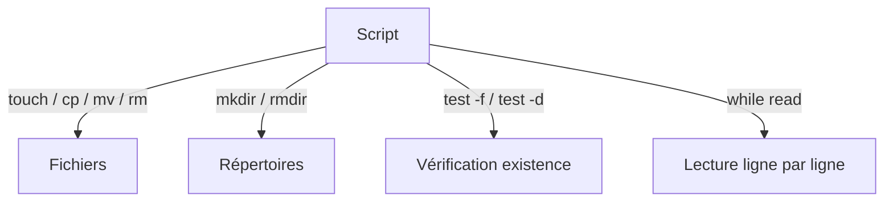
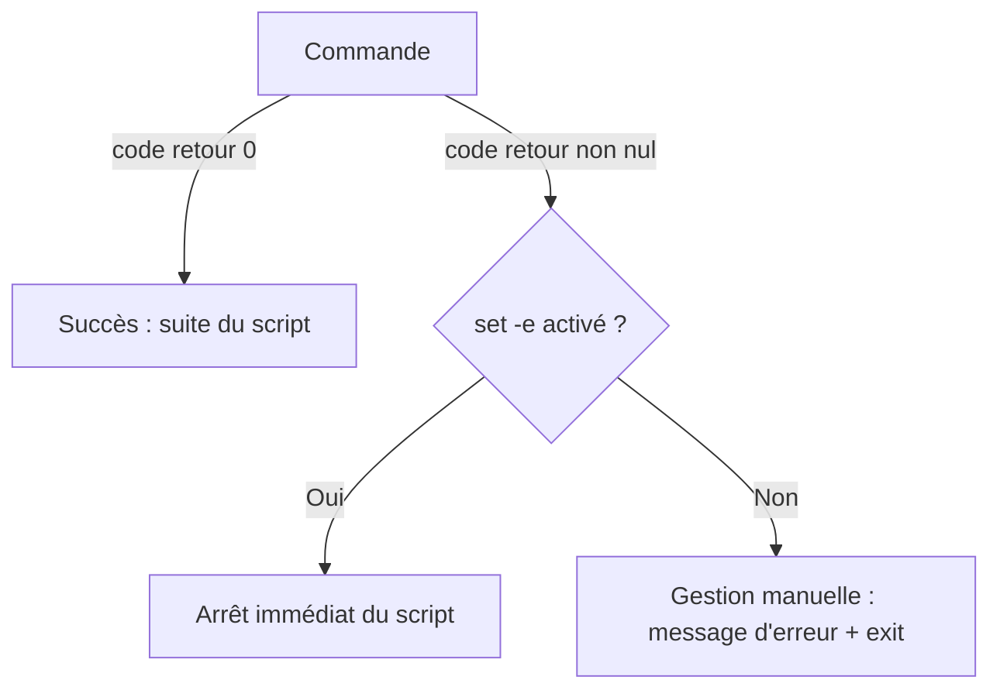
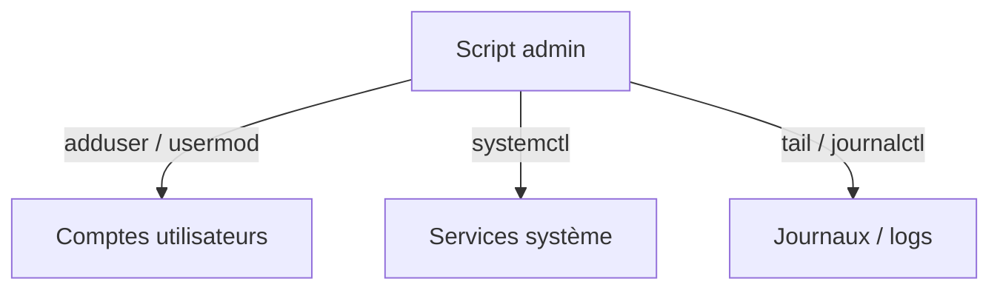
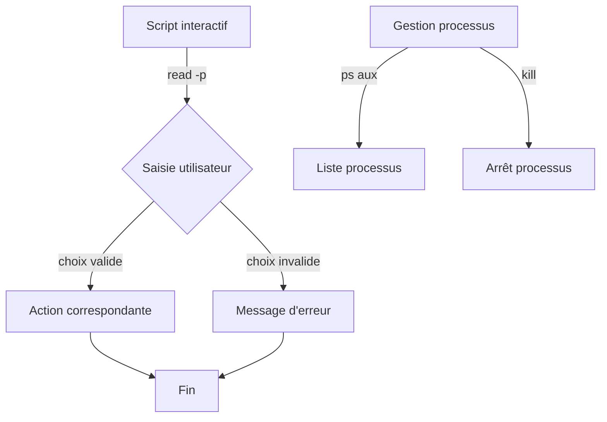

# Scripting Bash et PowerShell — JOUR 2

## Bash (2/2) — Automatisation, administration et scripts interactifs (22/09/2026)

> **Fil conducteur** — Après avoir maîtrisé les bases de Bash (J1), cette journée traite de l'automatisation système : manipulation de fichiers, gestion des erreurs, administration (utilisateurs, services, journaux), tâches planifiées (cron), scripts interactifs, processus, droits et bonnes pratiques.

---

## Objectifs du Jour

- Manipuler fichiers et répertoires via des scripts Bash
- Gérer les erreurs simplement dans un script
- Automatiser des tâches administratives (utilisateurs, services, journaux)
- Planifier des scripts avec cron
- Écrire des scripts interactifs (lecture clavier, menus)
- Gérer les processus et les droits d'accès
- Appliquer les bonnes pratiques d'écriture et de factorisation

---

## Planning du Jour

| Chapitre | Horaires | Thème | Durée |
|----------|----------|-------|-------|
| 5 | 9h00-10h30 | Manipulation de fichiers et répertoires | 1h30 |
| — | 10h30-10h45 | Pause | 15min |
| 6 | 10h45-12h00 | Gestion des erreurs simples | 1h15 |
| — | 12h00-13h00 | Pause déjeuner | 1h |
| 7 | 13h00-14h30 | Automatisation de tâches administratives : utilisateurs, services, journaux | 1h30 |
| — | 14h30-14h45 | Pause | 15min |
| 8 | 14h45-16h00 | Scripts interactifs, processus, droits, bonnes pratiques et cas pratique | 1h15 |

---

## Chapitre 5 — Manipulation de fichiers et répertoires (9h00-10h30)

### Objectifs

- Créer, copier, déplacer et supprimer fichiers et répertoires dans un script
- Vérifier l'existence d'un fichier avant traitement
- Lire et écrire des fichiers ligne par ligne

### Contenu Théorique (1h)

#### 1. Commandes de manipulation de fichiers (30min)

```bash
touch fichier.txt
# touch : crée un fichier vide ou met à jour son horodatage

cp source.txt destination.txt
# cp : copie un fichier d'une source vers une destination

mv fichier.txt nouveau_nom.txt
# mv : déplace ou renomme un fichier

rm fichier.txt
# rm : supprime un fichier
```

```bash
mkdir dossier
# mkdir : crée un répertoire

rmdir dossier
# rmdir : supprime un répertoire vide

rm -rf dossier
# rm : supprime
# -r : récursif (supprime le contenu)
# -f : forcer (sans confirmation)
```

> **Piège (version)** — `rm -rf` est irréversible et dangereux. Toujours vérifier le chemin cible avant d'exécuter dans un script.

#### 2. Vérifier l'existence d'un fichier (30min)

```bash
if [ -f /etc/passwd ]; then
    echo "Le fichier existe"
fi
# -f : teste si le chemin est un fichier régulier

if [ -d /etc ]; then
    echo "Le répertoire existe"
fi
# -d : teste si le chemin est un répertoire
```

#### 3. Lire un fichier ligne par ligne (30min)

```bash
while read -r LIGNE; do
    echo "Ligne : $LIGNE"
done < /etc/hostname
# read -r : lit une ligne sans interpréter les antislashs
# < : redirige le contenu du fichier vers la boucle
```

> **Concept clé** — L'option `-r` de `read` empêche l'interprétation des antislashs (`\`) comme caractères d'échappement, préservant le contenu brut des lignes.

**Fig 2.1** — Manipulation de fichiers et répertoires



### Lab 05 — Manipulation de fichiers (45min)

#### Environnement

| Élément | Valeur |
|---------|--------|
| Poste | Linux (Bash) |
| Répertoire de travail | /tmp/lab_scripting |

#### Exercices

**Exercice 13 — Créer et organiser des fichiers (15min)**

```bash
mkdir -p /tmp/lab_scripting/dossier_a
touch /tmp/lab_scripting/fichier1.txt
cp /tmp/lab_scripting/fichier1.txt /tmp/lab_scripting/dossier_a/
mv /tmp/lab_scripting/fichier1.txt /tmp/lab_scripting/fichier_renomme.txt
```

- [ ] Le répertoire dossier_a est créé
- [ ] Le fichier est copié puis renommé

**Exercice 14 — Vérifier l'existence avant traitement (15min)**

```bash
CIBLE="/etc/hostname"
if [ -f "$CIBLE" ]; then
    echo "Le fichier $CIBLE est présent"
else
    echo "Le fichier $CIBLE est absent"
fi
```

- [ ] La condition vérifie correctement l'existence du fichier
- [ ] Le message adapté s'affiche

<details>
<summary>Solution — Exercices 13 et 14</summary>

```bash
mkdir -p /tmp/lab_scripting/dossier_a
touch /tmp/lab_scripting/fichier1.txt
cp /tmp/lab_scripting/fichier1.txt /tmp/lab_scripting/dossier_a/
mv /tmp/lab_scripting/fichier1.txt /tmp/lab_scripting/fichier_renomme.txt
CIBLE="/etc/hostname"
if [ -f "$CIBLE" ]; then
    echo "Le fichier $CIBLE est présent"
else
    echo "Le fichier $CIBLE est absent"
fi
```

</details>

### Démonstration commentée

L'opérateur de redirection `<` envoie le contenu d'un fichier en entrée standard d'une boucle `while read`. Cela permet de traiter chaque ligne individuellement sans charger le fichier entier en mémoire.

### Correction et résolution pas à pas

1. Créez le répertoire de travail avec `mkdir -p`.
2. Créez un fichier avec `touch`.
3. Copiez-le dans un sous-répertoire avec `cp`.
4. Renommez-le avec `mv`.
5. Testez l'existence d'un fichier système avec `[ -f ]`.

### Bonnes pratiques

| Pratique | Description |
|----------|-------------|
| Vérifier avant supprimer | Tester l'existence d'un fichier avant `rm` |
| Chemins absolus | Privilégier les chemins absolus dans les scripts d'administration |

> **Bonnes pratiques** — Utilisez des chemins absolus dans les scripts d'administration pour éviter les ambiguïtés liées au répertoire courant.

**Script de correction :** `fichiers.sh`

### Exercices — Chapitre 5

**Exercice 15 — Lire un fichier ligne par ligne (10min)**

```bash
while read -r LIGNE; do
    echo "Contenu : $LIGNE"
done < /etc/hostname
```

1. Quel est le rôle de l'option `-r` ?
2. Que fait la redirection `<` ?

<details>
<summary>Solution — Exercice 15</summary>

`-r` empêche l'interprétation des antislashs. `<` redirige le contenu du fichier vers l'entrée standard de la boucle.

</details>

- [ ] L'option -r est comprise
- [ ] La redirection < est comprise

> **Ce qu'on a retenu**
> - `touch`, `cp`, `mv` et `rm` permettent de créer, copier, déplacer et supprimer des fichiers.
> - `mkdir`, `rmdir` et `rm -rf` gèrent la création et la suppression des répertoires.
> - `[ -f ]` et `[ -d ]` testent l'existence d'un fichier ou d'un répertoire avant traitement.
> - `read -r` lit une ligne sans interpréter les antislashs comme des caractères d'échappement.
> - `rm -rf` est irréversible : toujours vérifier le chemin cible avant exécution.

---

## Chapitre 6 — Gestion des erreurs simples (10h45-12h00)

### Objectifs

- Tester le code de retour d'une commande
- Utiliser `set -e` pour arrêter un script en cas d'erreur
- Afficher des messages d'erreur clairs

### Contenu Théorique (45min)

#### 1. Le code de retour $? (25min)

Chaque commande renvoie un code de retour : 0 indique le succès, toute autre valeur une erreur.

```bash
ls /fichier_inexistant
echo $?
# ls : tente de lister un fichier inexistant (échec)
# echo $? : affiche le code de retour (non-zéro en cas d'erreur)
```

#### 2. Arrêter le script en cas d'erreur avec set -e (20min)

```bash
#!/bin/bash
set -e
# set -e : arrête le script dès qu'une commande retourne une erreur

cp fichier_inexistant destination/
echo "Cette ligne ne s'exécutera jamais"
```

> **Bon à savoir** — `set -e` est utile pour éviter qu'un script continue dans un état incohérent après un échec. Cependant, certaines commandes attendues comme échouant doivent être protégées (ex: `commande || true`).

> **Piège (version)** — `set -e` ne s'applique pas aux commandes dont le code de retour est explicitement testé (dans un `if`, une boucle `while` ou précédées de `!`), ni au dernier élément d'un pipeline à moins d'activer aussi `set -o pipefail`. Une gestion d'erreur explicite reste préférable.

#### 3. Gestion conditionnelle des erreurs (20min)

```bash
if cp source.txt destination/; then
    echo "Copie réussie"
else
    echo "Échec de la copie" >&2
    exit 1
fi
# >&2 : redirige le message vers la sortie d'erreur standard
# exit 1 : termine le script avec un code d'erreur
```

**Fig 2.2** — Gestion des erreurs dans un script



### Lab 06 — Gestion des erreurs (45min)

#### Environnement

| Élément | Valeur |
|---------|--------|
| Poste | Linux (Bash) |
| Fichier | erreurs.sh |

#### Exercices

**Exercice 16 — Tester le code de retour (15min)**

```bash
ls /fichier_inexistant
CODE_RETOUR=$?
echo "Code de retour : $CODE_RETOUR"
```

- [ ] Le code de retour est non-zéro pour un fichier inexistant
- [ ] La valeur est capturée dans CODE_RETOUR

**Exercice 17 — Script avec gestion d'erreur (15min)**

```bash
#!/bin/bash
set -e
SOURCE="/etc/hostname"
DEST="/tmp/backup_hostname"
if cp "$SOURCE" "$DEST"; then
    echo "Copie réussie vers $DEST"
else
    echo "Échec de la copie" >&2
    exit 1
fi
```

- [ ] Le script quitte avec le code 1 si la copie échoue
- [ ] Le message d'erreur s'affiche sur la sortie d'erreur

<details>
<summary>Solution — Exercices 16 et 17</summary>

```bash
#!/bin/bash
set -e
SOURCE="/etc/hostname"
DEST="/tmp/backup_hostname"
if cp "$SOURCE" "$DEST"; then
    echo "Copie réussie vers $DEST"
else
    echo "Échec de la copie" >&2
    exit 1
fi
```

</details>

### Démonstration commentée

La redirection `>&2` envoie le message vers `stderr` (sortie d'erreur standard), séparant ainsi les messages d'erreur des résultats normaux (`stdout`). Cela permet de rediriger ou de filtrer les erreurs indépendamment.

### Correction et résolution pas à pas

1. Testez une commande qui échoue et affichez `$?`.
2. Ajoutez `set -e` au début d'un script.
3. Enveloppez une commande risquée dans un `if` avec message d'erreur et `exit 1`.
4. Vérifiez que le script s'arrête proprement en cas d'échec.

### Bonnes pratiques

| Pratique | Description |
|----------|-------------|
| Séparer stdout et stderr | Utiliser `>&2` pour les messages d'erreur |
| Quitter avec un code significatif | `exit 1` pour erreur, `exit 0` pour succès |

> **Bonnes pratiques** — Toujours distinguer les messages informatifs (`stdout`) des messages d'erreur (`stderr`) pour faciliter le débogage et l'automatisation.

**Script de correction :** `erreurs.sh`

### Exercices — Chapitre 6

**Exercice 18 — Protéger une commande attendue comme échouante (10min)**

```bash
grep "motif" fichier.txt || true
# grep : recherche un motif dans un fichier
# || true : si grep échoue, exécute true pour éviter l'arrêt avec set -e
```

1. Pourquoi ajouter `|| true` après `grep` ?
2. Quel serait l'effet de `set -e` sans cette protection ?

<details>
<summary>Solution — Exercice 18</summary>

`grep` renvoie un code non-zéro si le motif n'est pas trouvé. Avec `set -e`, le script s'arrêterait. `|| true` force un code de retour 0 pour continuer l'exécution.

</details>

- [ ] Le rôle de `|| true` est compris
- [ ] L'interaction avec `set -e` est identifiée

> **Ce qu'on a retenu**
> - Le code de retour `$?` vaut 0 en cas de succès et une valeur non-zéro en cas d'erreur.
> - `set -e` arrête l'exécution du script dès qu'une commande échoue.
> - `>&2` redirige les messages d'erreur vers le flux stderr, séparé de stdout.
> - `exit 1` termine le script avec un code d'erreur significatif.
> - `|| true` protège une commande attendue comme échouante contre l'arrêt provoqué par `set -e`.

---

## Chapitre 7 — Automatisation de tâches administratives : utilisateurs, services, journaux (13h00-14h30)

### Objectifs

- Automatiser la gestion d'utilisateurs et de groupes
- Gérer les services système dans un script
- Consulter et faire tourner les journaux (logs)

### Contenu Théorique (1h)

#### 1. Gestion d'utilisateurs et de groupes (30min)

```bash
adduser nouvel_utilisateur
# adduser : crée un nouveau compte utilisateur

usermod -aG groupe utilisateur
# usermod : modifie un compte utilisateur
# -aG : ajoute l'utilisateur au groupe supplémentaire (append)

groupadd nouveau_groupe
# groupadd : crée un nouveau groupe
```

> **Concept clé** — Ces commandes nécessitent des privilèges root (via `sudo`). Dans un script d'automatisation, vérifiez les droits avant exécution.

> **Bon à savoir** — `systemctl` et `journalctl` s'appuient sur systemd, l'init par défaut de la plupart des distributions Linux modernes. Certains systèmes (Alpine Linux, environnements embarqués) utilisent un autre gestionnaire de services où ces commandes sont absentes.

#### 2. Gestion des services (30min)

```bash
systemctl status ssh
# systemctl : gère les services systemd
# status : affiche l'état d'un service

systemctl start ssh
# start : lance un service

systemctl enable ssh
# enable : active le démarrage automatique au boot
```

#### 3. Consulter les journaux (30min)

```bash
tail -n 50 /var/log/syslog
# tail : affiche la fin d'un fichier
# -n 50 : limite aux 50 dernières lignes

journalctl -n 100
# journalctl : consulte les journaux systemd
# -n 100 : affiche les 100 dernières entrées
```

**Fig 2.3** — Automatisation administrative (utilisateurs, services, journaux)



### Lab 07 — Automatisation administrative (45min)

#### Environnement

| Élément | Valeur |
|---------|--------|
| Poste | Linux (Bash, sudo requis) |
| Service exemple | ssh |

#### Exercices

**Exercice 19 — Consulter le statut d'un service (15min)**

```bash
systemctl status ssh
```

- [ ] Le statut du service ssh s'affiche
- [ ] L'état (actif/inactif) est identifiable

**Exercice 20 — Lire les dernières lignes d'un journal (15min)**

```bash
journalctl -n 30
# journalctl : consulte les journaux systemd
# -n 30 : affiche les 30 dernières entrées
```

- [ ] Les 30 dernières entrées du journal s'affichent
- [ ] Les horodatages et messages sont lisibles

<details>
<summary>Solution — Exercices 19 et 20</summary>

```bash
systemctl status ssh
journalctl -n 30
```

</details>

### Démonstration commentée

`systemctl` est l'outil de gestion de systemd, l'init système des distributions Linux modernes. Il permet de démarrer, arrêter, activer et consulter l'état des services. `journalctl` centralise les journaux de tous les services systemd.

### Correction et résolution pas à pas

1. Vérifiez le statut d'un service avec `systemctl status`.
2. Démarrez un service avec `systemctl start` (si nécessaire).
3. Consultez les journaux récents avec `journalctl -n`.
4. Observez les horodatages et les niveaux de sévérité.

### Bonnes pratiques

| Pratique | Description |
|----------|-------------|
| Vérifier les privilèges | Contrôler que le script s'exécute avec sudo/root |
| Consulter avant modifier | Vérifier l'état d'un service avant d'intervenir |

> **Bonnes pratiques** — Un script d'administration doit vérifier qu'il dispose des privilèges nécessaires (`id -u` doit renvoyer 0 pour root) avant de tenter toute modification.

**Script de correction :** `admin.sh`

### Exercices — Chapitre 7

**Exercice 21 — Vérifier les privilèges root (10min)**

```bash
if [ "$(id -u)" -ne 0 ]; then
    echo "Ce script doit être exécuté en tant que root" >&2
    exit 1
fi
# id -u : renvoie l'identifiant utilisateur (0 = root)
# -ne : not equal (différent de)
```

1. Pourquoi vérifier `id -u` avant les opérations d'administration ?
2. Que retourne `id -u` pour un utilisateur standard ?

<details>
<summary>Solution — Exercice 21</summary>

`id -u` retourne 0 pour root et une valeur non-zéro pour un utilisateur standard. La vérification empêche l'exécution d'opérations privilégiées sans droits suffisants.

</details>

- [ ] La vérification des privilèges est comprise
- [ ] Le code de retour de id -u pour root est identifié (0)

> **Ce qu'on a retenu**
> - `adduser`, `usermod` et `groupadd` nécessitent des privilèges root (via `sudo`).
> - `systemctl` gère les services systemd : `status`, `start`, `enable`, etc.
> - `journalctl` consulte les journaux centralisés de tous les services systemd.
> - `id -u` retourne 0 pour l'utilisateur root et une valeur non-zéro pour un utilisateur standard.
> - Un script d'administration doit vérifier ses privilèges avant toute opération sensible.

---

## Chapitre 8 — Scripts interactifs, processus, droits, bonnes pratiques et cas pratique (14h45-16h00)

### Objectifs

- Écrire des scripts interactifs avec lecture clavier et menus
- Gérer les processus (affichage, arrêt, priorité)
- Gérer les droits et permissions dans un script
- Appliquer les bonnes pratiques d'écriture et de factorisation
- Réaliser un cas pratique Bash complet

### Contenu Théorique (45min)

#### 1. Scripts interactifs : lecture clavier et menus (25min)

```bash
read -p "Choisissez une option (1-3) : " CHOIX
case "$CHOIX" in
    1) echo "Option 1 sélectionnée" ;;
    2) echo "Option 2 sélectionnée" ;;
    3) echo "Option 3 sélectionnée" ;;
    *) echo "Option invalide" ;;
esac
# read -p : lit une saisie avec invite affichée
# case : sélectionne selon la valeur saisie
```

#### 2. Gestion des processus (20min)

```bash
ps aux
# ps : affiche les processus en cours
# a : tous les utilisateurs
# u : format utilisateur détaillé
# x : processus sans terminal

kill 1234
# kill : envoie un signal à un processus (identifié par son PID)

kill -9 1234
# -9 : signal SIGKILL (arrêt forcé, immédiat)
```

> **Bon à savoir** — `kill` sans numéro envoie SIGTERM (demande d'arrêt propre). `kill -9` force l'arrêt immédiat sans nettoyage.

#### 3. Droits et permissions (30min)

```bash
chmod 700 script_prive.sh
# chmod : modifie les droits
# 700 : lecture/écriture/exécution pour le propriétaire seulement

chown utilisateur:groupe fichier.txt
# chown : modifie le propriétaire et le groupe d'un fichier
```

> **Concept clé** — Les droits s'expriment en octal : 4 (lecture), 2 (écriture), 1 (exécution), additionnés par catégorie (propriétaire, groupe, autres).

**Fig 2.4** — Script interactif et gestion des processus



### Lab 08 — Scripts interactifs, processus et droits (45min)

#### Environnement

| Élément | Valeur |
|---------|--------|
| Poste | Linux (Bash) |
| Fichier | menu.sh |

#### Exercices

**Exercice 22 — Créer un menu interactif (20min)**

```bash
#!/bin/bash
echo "=== Menu d'administration ==="
echo "1. Afficher la date"
echo "2. Lister les processus"
echo "3. Quitter"
read -p "Votre choix : " CHOIX
case "$CHOIX" in
    1) date ;;
    2) ps aux ;;
    3) echo "Au revoir !" ; exit 0 ;;
    *) echo "Choix invalide" ;;
esac
```

- [ ] Le menu s'affiche avec les 3 options
- [ ] La saisie utilisateur déclenche l'action correspondante

**Exercice 23 — Gérer les droits d'un script (20min)**

```bash
chmod 700 menu.sh
ls -l menu.sh
# chmod 700 : seuls le propriétaire peut lire/écrire/exécuter
# ls -l : affiche les droits détaillés du fichier
```

- [ ] Le script est rendu exécutable pour le propriétaire seulement
- [ ] Les droits s'affichent avec ls -l

<details>
<summary>Solution — Exercices 22 et 23</summary>

Contenu du script `menu.sh` :

```bash
#!/bin/bash
echo "=== Menu d'administration ==="
echo "1. Afficher la date"
echo "2. Lister les processus"
echo "3. Quitter"
read -p "Votre choix : " CHOIX
case "$CHOIX" in
    1) date ;;
    2) ps aux ;;
    3) echo "Au revoir !" ; exit 0 ;;
    *) echo "Choix invalide" ;;
esac
```

Commandes d'exécution :

```bash
chmod 700 menu.sh
ls -l menu.sh
```

</details>

### Démonstration commentée

Le menu utilise `case` pour associer chaque saisie numérique à une action. `ps aux` liste tous les processus avec leur identifiant (PID), permettant d'identifier un processus avant de l'arrêter avec `kill`.

### Correction et résolution pas à pas

1. Créez un fichier `menu.sh` avec le shebang.
2. Ajoutez l'affichage du menu et `read -p` pour la saisie.
3. Ajoutez un `case` traitant chaque option.
4. Rendez le script exécutable avec `chmod 700`.
5. Testez chaque option du menu.

### Bonnes pratiques

| Pratique | Description |
|----------|-------------|
| Factoriser les tâches répétitives | Créer des fonctions pour éviter la duplication |
| Menu avec option par défaut | Traiter le cas `*)` pour les saisies invalides |
| Droits minimaux | Accorder seulement les droits nécessaires (700) |

> **Bonnes pratiques** — Factorisez le code répété en fonctions pour rendre le script lisible, maintenable et facile à tester.

### Cas pratique Bash — Sauvegarde automatisée avec rapport (45min)

#### Objectif

Écrire un script `sauvegarde.sh` qui :
1. Vérifie les privilèges root
2. Crée une archive d'un répertoire source
3. Enregistre le résultat dans un journal
4. Gère les erreurs à chaque étape

```bash
#!/bin/bash
set -e

SOURCE="/etc"
DEST="/tmp/sauvegarde_$(date +%Y%m%d).tar.gz"
LOG="/var/log/sauvegarde.log"

if [ "$(id -u)" -ne 0 ]; then
    echo "Ce script doit être exécuté en tant que root" >&2
    exit 1
fi

echo "=== Début de la sauvegarde : $(date) ===" >> "$LOG"

if tar -czf "$DEST" "$SOURCE" 2>>"$LOG"; then
    echo "Sauvegarde réussie : $DEST" >> "$LOG"
else
    echo "Échec de la sauvegarde" >&2
    exit 1
fi

echo "=== Fin de la sauvegarde : $(date) ===" >> "$LOG"
```

- [ ] Le script vérifie les privilèges root
- [ ] L'archive est créée avec tar
- [ ] Le journal est mis à jour à chaque étape

> **Concept clé** — `date +%Y%m%d` génère un horodatage au format AAAAMMJJ pour nommer les archives de façon unique.

**Script de correction :** `sauvegarde.sh`

### Exercices — Chapitre 8

**Exercice 24 — Identifier et arrêter un processus (10min)**

```bash
ps aux | grep nom_processus
kill "$PID"
# ps : liste les processus
# grep : filtre par nom de processus
# kill : envoie un signal d'arret au PID identifie (stocker le PID dans la variable $PID avant)
```

1. Comment identifier le PID d'un processus ?
2. Quelle différence entre `kill` et `kill -9` ?

<details>
<summary>Solution — Exercice 24</summary>

Le PID est identifié avec `ps aux | grep nom`. `kill` demande un arrêt propre (SIGTERM), `kill -9` force l'arrêt immédiat (SIGKILL).

</details>

- [ ] Le PID d'un processus est identifiable
- [ ] La différence SIGTERM / SIGKILL est comprise

> **Ce qu'on a retenu**
> - `read -p` et `case` permettent de construire des menus interactifs réactifs à la saisie clavier.
> - `ps aux` liste les processus avec leur identifiant (PID) ; `kill` envoie un signal d'arrêt.
> - `kill` demande un arrêt propre (SIGTERM) ; `kill -9` force l'arrêt immédiat (SIGKILL).
> - `chmod` modifie les droits d'accès (notation octale) ; `chown` modifie le propriétaire.
> - Factoriser le code en fonctions et appliquer le principe des droits minimaux améliore la maintenabilité.

---

## Synthèse

### Couverture Jour 2

| Chapitre | Thème |
|----------|-------|
| 5 | Manipulation de fichiers et répertoires |
| 6 | Gestion des erreurs simples |
| 7 | Automatisation de tâches administratives (utilisateurs, services, journaux) |
| 8 | Scripts interactifs, processus, droits, bonnes pratiques, cas pratique |

### Memo — Commandes Essentielles

```bash
# Fichiers / répertoires
touch fichier            # Crée un fichier vide
cp src dst               # Copie un fichier
mv src dst               # Déplace / renomme
rm fichier               # Supprime un fichier
mkdir dossier            # Crée un répertoire
rmdir dossier            # Supprime un répertoire vide

# Vérifications
[ -f fichier ]           # Teste si c'est un fichier
[ -d dossier ]           # Teste si c'est un répertoire

# Erreurs
echo $?                  # Code de retour
set -e                   # Arrêt en cas d'erreur
>&2                      # Redirection vers stderr

# Administration
adduser utilisateur      # Crée un utilisateur
systemctl status svc     # État d'un service
journalctl -n 50         # Dernières lignes du journal

# Interactif / processus
read -p "invite " VAR    # Lecture clavier
ps aux                   # Liste des processus
kill PID                 # Arrêt d'un processus
chmod 700 fichier        # Droits propriétaire uniquement
```

---

## Ressources supplémentaires

### Outils utilisés

| Outil | Version | Usage |
|-------|---------|-------|
| bash | 5.x | Interpréteur de commandes |
| coreutils | — | Commandes de base du système Linux |
