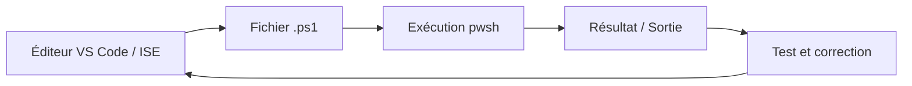
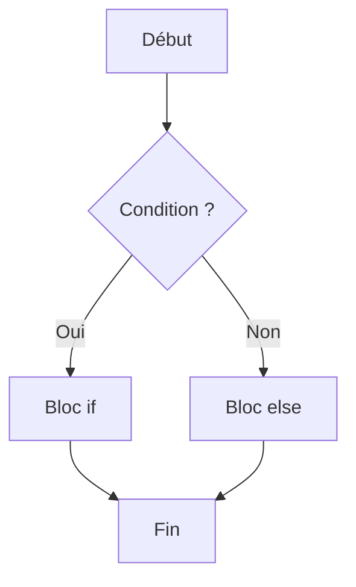

# Scripting Bash et PowerShell — JOUR 3

## PowerShell (1/2) + Python initiation — Environnement, cmdlets, exécution, structures de contrôle et Python (08/11/2026)

> **Fil conducteur** — Cette troisième journée introduit PowerShell sous Windows (chapitres 9 à 12) puis ouvre sur Python pour l'administration système sous Linux (chapitre 17, issu du module EXTRA). L'objectif est de faire comprendre la rupture de paradigme entre Bash (flux de texte) et PowerShell (objets .NET), puis de présenter Python comme un langage interprété à typage dynamique complémentaire des shells.

---

## Objectifs du Jour

- Comprendre l'environnement PowerShell et sa différence fondamentale avec Bash (manipulation d'objets .NET plutôt que de texte brut).
- Maîtriser les cmdlets de base, le pipeline d'objets, les variables, les tableaux, les hashtables et les opérateurs de comparaison.
- Savoir créer, exécuter un script PowerShell (.ps1) et gérer les politiques d'exécution (execution policy).
- Utiliser les structures de contrôle : conditions if/elseif/else, switch, boucles for, foreach, while, do-while, ainsi que break et continue.
- Comprendre ce qu'est Python, l'installer et le vérifier sur un poste Linux, écrire et exécuter un premier script Python avec shebang.

---

## Planning du Jour

| Chapitre | Horaires | Thème | Durée |
|----------|----------|-------|-------|
| 9 | 9h00-10h30 | Présentation de l'environnement PowerShell | 1h30 |
| — | 10h30-10h45 | Pause | 15min |
| 10 | 10h45-12h00 | Cmdlets, pipeline, variables et syntaxe de base | 1h15 |
| — | 12h00-13h00 | Pause déjeuner | 1h |
| 11 | 13h00-14h30 | Exécution d'un script et gestion des politiques d'exécution | 1h30 |
| — | 14h30-14h45 | Pause | 15min |
| 12 | 14h45-16h00 | Structures de contrôle | 1h15 |
| — | 16h00-16h15 | Pause | 15min |
| 17 | 16h15-17h45 | Introduction à Python pour l'administration système | 1h30 |

---

## Chapitre 9 — Présentation de l'environnement PowerShell (9h00-10h30)

### Objectifs

- Expliquer ce qu'est PowerShell et en quoi il diffère de Bash (approche par objets .NET vs approche par texte).
- Identifier les environnements d'exécution et d'édition : console PowerShell, ISE, VS Code.
- Utiliser les cmdlets de découverte : Get-Command, Get-Help, Get-Member.
- Comprendre le rôle des alias et des profils PowerShell.

### Contenu théorique (45min)

#### 1. Qu'est-ce que PowerShell ? (20min)

PowerShell est un shell d'administration système et un langage de scripting développé par Microsoft. Contrairement à Bash, qui traite les données sous forme de flux de texte, PowerShell manipule des objets .NET. Chaque commande native de PowerShell, appelée cmdlet (commande native de PowerShell, suivant la convention Verbe-Nom), produit des objets structurés que l'on peut inspecter, filtrer et formater sans recourir à l'analyse textuelle (grep, awk, cut).

| Caractéristique | Bash | PowerShell |
|-----------------|------|------------|
| Données manipulées | Flux de texte | Objets .NET |
| Extension de script | .sh | .ps1 |
| Environnement principal | Linux / Unix | Windows (et multiplateforme via PowerShell 7) |
| Cmdlet / commande | commande externe ou builtin | cmdlet Verbe-Nom |

> **Concept clé** — PowerShell manipule des objets .NET, et non du texte brut. Cela permet d'accéder directement aux propriétés d'un objet (par exemple le nom, le statut ou le nom d'affichage d'un service) sans analyser une chaîne de caractères.

> **Bon à savoir** — PowerShell existe en deux grandes familles : Windows PowerShell 5.1 (intégré à Windows, basé sur .NET Framework) et PowerShell 7+ (multiplateforme, basé sur .NET, installable sur Linux et macOS).

#### 2. Les environnements PowerShell (15min)

Trois environnements principaux sont utilisés pour écrire et exécuter du PowerShell :

- La console PowerShell (powershell.exe ou pwsh) : interface en ligne de commande interactive.
- PowerShell ISE (Integrated Scripting Environment, éditeur intégré historique de PowerShell) : éditeur graphique avec console intégrée, désormais en mode de maintenance.
- Visual Studio Code avec l'extension PowerShell : environnement de développement moderne, recommandé pour l'écriture de scripts.

#### 3. Cmdlets de base et découverte (25min)

Les cmdlets de découverte permettent d'explorer l'environnement sans connaître à l'avance le nom des commandes :

- Get-Command : liste les cmdlets, fonctions et alias disponibles.
- Get-Help : affiche l'aide détaillée d'une cmdlet.
- Get-Member : inspecte les propriétés et méthodes d'un objet.

```powershell
Get-Command
# Get-Command : cmdlet qui récupère la liste des commandes disponibles (cmdlets, fonctions, alias)
# Aucun paramètre : retourne l'ensemble des commandes de la session courante
```

```powershell
Get-Help Get-Service
# Get-Help : cmdlet qui affiche l'aide d'une commande
# Get-Service : nom de la cmdlet dont on souhaite consulter l'aide
# Pourquoi pédagogique : consulter l'aide avant d'utiliser une cmdlet inconnue évite les erreurs de syntaxe
```

```powershell
Get-Service | Get-Member
# Get-Service : liste les services du système sous forme d'objets
# | : opérateur de pipeline, transmet l'objet de sortie de Get-Service vers Get-Member
# Get-Member : inspecte les propriétés et méthodes de l'objet transmis
```

#### 4. Alias et profils (15min)

Un alias est un nom court qui fait référence à une cmdlet existante (par exemple `ls` est un alias de `Get-ChildItem`). Un profil PowerShell est un script personnel chargé automatiquement au démarrage de chaque session, utilisé pour définir des alias, des fonctions et des variables d'environnement personnalisées.

> **Piège** — Les alias sont pratiques en console interactive mais doivent être évités dans les scripts de production, car ils réduisent la lisibilité et peuvent masquer la cmdlet réelle appelée.

> **Contre-mesure** — Utiliser systématiquement le nom complet de la cmdlet (Verbe-Nom) dans les scripts, réserver les alias à l'usage interactif uniquement.

**Fig 1** — Pipeline PowerShell : de la cmdlet à l'affichage formaté


Exemple concret de pipeline :

```powershell
Get-Service | Where-Object { $_.Status -eq 'Running' } | Format-Table -AutoSize
# Get-Service : liste tous les services du système
# Where-Object : filtre les objets selon une condition
# $_.Status : propriété Status de chaque objet service transmis par le pipeline
# -eq : opérateur d'égalité PowerShell
# 'Running' : valeur de statut a comparer
# Format-Table : formate la sortie sous forme de tableau
# -AutoSize : ajuste automatiquement la largeur des colonnes
```

---

### Lab 9 — Découverte de l'environnement PowerShell (45min)

#### Environnement

| Élément | Valeur |
|---------|--------|
| Poste | Windows avec PowerShell 5.1 ou PowerShell 7+ |
| Éditeur | Console PowerShell, ISE ou VS Code |

#### Exercices (les exercices s'enchainent pour former un lab complet)

**Exercice 9.1 — Lister les cmdlets disponibles (10min)**

Utiliser Get-Command pour lister les cmdlets dont le nom commence par Get-.

```powershell
Get-Command -Name Get-*
# Get-Command : recupere les commandes disponibles
# -Name : filtre les commandes par nom
# Get-* : motif generique, l'asterisque remplace n'importe quelle suite de caracteres
```

- [ ] La commande retourne une liste de cmdlets
- [ ] On identifie au moins Get-Command, Get-Help, Get-Member

**Exercice 9.2 — Consulter l'aide d'une cmdlet (10min)**

Afficher l'aide de Get-Service et identifier ses paramètres principaux.

```powershell
Get-Help Get-Service
# Get-Help : affiche l'aide detaillee d'une cmdlet
# Get-Service : cible de l'aide
```


- [ ] L'aide s'affiche avec une description et une syntaxe
- [ ] On identifie le paramètre -Name

**Exercice 9.3 — Inspecter un objet avec Get-Member (10min)**

Afficher les propriétés d'un objet service.

```powershell
Get-Service | Get-Member
# Get-Service : produit des objets ServiceController
# Get-Member : liste les propriétés et méthodes de l'objet
```


- [ ] La liste affiche des propriétés telles que Name, Status, DisplayName

**Exercice 9.4 — Créer et utiliser un alias (10min)**

Créer un alias monService pour Get-Service et l'utiliser.

```powershell
Set-Alias -Name monService -Value Get-Service
# Set-Alias : crée ou modifie un alias
# -Name : nom de l'alias à créer
# -Value : cmdlet cible de l'alias
monService
# monService : utilise l'alias pour exécuter Get-Service
```

- [ ] L'alias est créé sans erreur
- [ ] L'exécution de monService retourne les services

**Exercice 9.5 — Localiser le profil PowerShell (5min)**

Afficher le chemin du profil courant.

```powershell
$PROFILE
# $PROFILE : variable automatique contenant le chemin du profil de l'utilisateur courant
```

- [ ] Le chemin du profil s'affiche
- [ ] On note si le fichier existe déjà

---

### Démonstration commentée

Exemple de pipeline complet avec interprétation de la sortie attendue :

```powershell
Get-Process | Where-Object { $_.CPU -gt 10 } | Sort-Object CPU -Descending | Select-Object -First 5 -Property Name, CPU
# Get-Process : liste les processus en cours d'exécution
# Where-Object : filtre les processus dont l'utilisation CPU dépasse 10 secondes
# $_.CPU : propriété CPU de chaque objet processus
# -gt : opérateur "strictement supérieur à"
# Sort-Object : trie les objets
# CPU : propriété utilisée comme clé de tri
# -Descending : ordre décroissant
# Select-Object : sélectionne un sous-ensemble d'objets et de propriétés
# -First 5 : limite aux cinq premiers résultats
# -Property Name, CPU : propriétés à afficher
```


Résultat attendu : un tableau listant les cinq processus les plus gourmands en CPU, avec leurs noms et leur temps CPU. Chaque ligne est un objet, pas une ligne de texte : on pourrait par la suite transmettre ce résultat à une autre cmdlet sans réanalyse textuelle.

---

### Correction et résolution pas à pas

<details>
<summary>Solution du Lab 9</summary>

```powershell
# Exercice 9.1
Get-Command -Name Get-*
# Exercice 9.2
Get-Help Get-Service
# Exercice 9.3
Get-Service | Get-Member
# Exercice 9.4
Set-Alias -Name monService -Value Get-Service
monService
# Exercice 9.5
$PROFILE
```

**Résolution pas à pas :**

1. **Get-Command -Name Get-*** : on interroge le registre des commandes pour ne conserver que celles dont le nom commence par Get-. L'astérisque est un caractère générique qui correspond à toute suite de caractères, y compris vide.
2. **Get-Help Get-Service** : PowerShell charge la documentation intégrée de la cmdlet. Si l'aide n'est pas installée, Get-Help propose de la télécharger en ligne avec le paramètre -Online.
3. **Get-Service | Get-Member** : le pipeline transmet chaque objet ServiceController à Get-Member, qui introspecte son type et liste propriétés (Name, Status, DisplayName…) et méthodes (Start, Stop, Pause…).
4. **Set-Alias -Name monService -Value Get-Service** : on associe le nom court monService à la cmdlet Get-Service. L'alias n'est valable que pour la session courante sauf s'il est inscrit dans le profil.
5. **$PROFILE** : cette variable automatique contient le chemin complet du fichier de profil de l'utilisateur. Si le fichier n'existe pas, il peut être créé avec New-Item.

</details>

---

### Bonnes pratiques

| Pratique | Description |
|----------|-------------|
| Nom complet des cmdlets | Utiliser Get-Service plutôt que gsv dans les scripts |
| Consultation de l'aide | Appeler Get-Help avant d'utiliser une cmdlet inconnue |
| Inspection des objets | Utiliser Get-Member pour découvrir les propriétés disponibles |

> **Bonnes pratiques** — Privilégier les noms complets de cmdlets dans les scripts pour garantir la lisibilité et la maintenabilité. Réserver les alias à la console interactive uniquement.

---

### Exercices — Chapitre 9

**Exercice 9.6 — Découverte d'une cmdlet inconnue (10min)**

Choisir une cmdlet jamais utilisée (par exemple Get-WinEvent ou Get-CimInstance), afficher son aide, puis lister ses membres avec Get-Member.

1. Quelle est la description de la cmdlet ?
2. Quelles sont ses trois principales propriétés ?

<details>
<summary>Solution</summary>

```powershell
Get-Help Get-WinEvent
Get-WinEvent -FilterHashtable @{LogName='System'; MaxEvents=5} | Get-Member
# Get-Help : affiche la documentation de Get-WinEvent
# Get-WinEvent : lit les journaux d'événements Windows (compatible PowerShell 5.1 et 7+)
# -FilterHashtable @{LogName='System'; MaxEvents=5} : filtre le journal système et limite aux 5 événements les plus récents
# Get-Member : introspecte l'objet d'événement
```

**Résolution pas à pas :**

1. Get-Help Get-WinEvent affiche la description : la cmdlet récupère les événements des journaux d'événements Windows.
2. Get-WinEvent -FilterHashtable @{LogName='System'; MaxEvents=5} produit cinq objets d'événement. Get-Member révèle leurs propriétés : Id, Level, Message, ProviderName, TimeCreated, etc.

</details>


- [ ] La description de la cmdlet est identifiée
- [ ] Au moins trois propriétés sont listées

---

### Ce qu'on a retenu

> **Ce qu'on a retenu** — PowerShell manipule des objets .NET et non du texte brut. Les cmdlets suivent la convention Verbe-Nom. Get-Command, Get-Help et Get-Member sont les cmdlets de découverte essentielles. Les alias sont réservés à l'usage interactif ; les scripts utilisent les noms complets. Le profil PowerShell personnalise chaque session au démarrage.

---

## Chapitre 10 — Cmdlets, pipeline, variables et syntaxe de base (10h45-12h00)

### Objectifs

- Maîtriser la syntaxe Verbe-Nom des cmdlets PowerShell.
- Comprendre le pipeline d'objets et son fonctionnement.
- Déclarer et utiliser des variables, des tableaux et des hashtables.
- Utiliser les opérateurs de comparaison (-eq, -ne, -gt, -lt, -like, -match).

### Contenu théorique (45min)

#### 1. Syntaxe des cmdlets Verbe-Nom (15min)

Toute cmdlet PowerShell respecte la convention Verbe-Nom (par exemple Get-Service, Stop-Process, New-Item). Le verbe indique l'action, le nom indique la cible. Get-Verb liste les verbes approuvés par Microsoft.

```powershell
Get-Verb
# Get-Verb : liste les verbes approuvés pour la dénomination des cmdlets
# Aucun paramètre : retourne l'ensemble des verbes standards
```

> **Concept clé** — La syntaxe Verbe-Nom rend les cmdlets auto-documentées : Get-Service signifie « obtenir des services », Stop-Process signifie « arrêter un processus ».

> **Bon à savoir** — Les verbes approuvés incluent Get, Set, New, Remove, Start, Stop, Out, Format, Select, Sort, Where, Invoke, etc.

#### 2. Pipeline et objets (20min)

Le pipeline (chaîne de traitement) transmet des objets d'une cmdlet à l'autre. Contrairement à Bash où le texte est analysé à chaque étape, PowerShell conserve la structure objet tout au long du pipeline.

```powershell
Get-Service | Where-Object { $_.Status -eq 'Running' } | Format-List
# Get-Service : produit des objets ServiceController
# Where-Object : filtre selon la condition entre accolades
# $_.Status : propriété Status de l'objet courant dans le pipeline
# -eq : opérateur d'égalité
# Format-List : affiche chaque propriété sur une ligne séparée
```


#### 3. Variables, types, tableaux et hashtables (20min)

Une variable se déclare avec le préfixe $. PowerShell est faiblement typé mais permet le typage explicite.

```powershell
$nom = 'Administrateur'
# $nom : déclaration d'une variable
# 'Administrateur' : valeur de type chaîne de caractères affectée

[int]$age = 35
# [int] : typage explicite de la variable en entier
# $age : nom de la variable
# 35 : valeur entière

$services = Get-Service
# $services : variable contenant le résultat d'une cmdlet (collection d'objets)
```


Tableau :

```powershell
$liste = @('Serveur01', 'Serveur02', 'Serveur03')
# @() : opérateur de création de tableau
# $liste : variable contenant le tableau
$liste[0]
# $liste[0] : accès à l'élément d'index 0 (premier élément)
```

Hashtable (table de hachée, collection de paires clé/valeur) :

```powershell
$config = @{ Serveur = 'SRV01'; Port = 8080; Actif = $true }
# @{} : opérateur de création de hashtable
# Serveur, Port, Actif : clés de la table de hachée
# 'SRV01', 8080, $true : valeurs associées
$config['Port']
# $config['Port'] : accès à la valeur associée à la clé Port
```

#### 4. Opérateurs de comparaison (20min)

PowerShell utilise des opérateurs spécifiques, distincts des symboles C-style :

| Opérateur | Signification | Exemple |
|-----------|---------------|---------|
| -eq | égal à | $a -eq $b |
| -ne | différent de | $a -ne $b |
| -gt | strictement supérieur à | $a -gt $b |
| -lt | strictement inférieur à | $a -lt $b |
| -like | correspondance avec motif générique | $nom -like 'Admin*' |
| -match | correspondance avec expression régulière | $nom -match '^Admin' |

```powershell
$statut = 'Running'
if ($statut -eq 'Running') { 'Le service est en cours d'exécution' }
# -eq : compare l'égalité de deux valeurs
# 'Running' : littéral de chaîne comparé
```

> **Piège** — L'opérateur d'égalité en PowerShell est -eq, et non = (réservé à l'affectation). Confondre les deux est une erreur fréquente pour les venus de Bash ou de C.

> **Contre-mesure** — Vérifier systématiquement que -eq est utilisé pour les comparaisons et = pour les affectations.

**Fig 2** — Flux d'écriture de script : éditeur, exécution, test



---

### Lab 10 — Manipulation de variables et pipeline (45min)

#### Environnement

| Élément | Valeur |
|---------|--------|
| Poste | Windows avec PowerShell 5.1 ou PowerShell 7+ |

#### Exercices (les exercices s'enchainent pour former un lab complet)

**Exercice 10.1 — Déclarer des variables typées (10min)**

Créer une variable entière et une variable chaîne, puis afficher leurs valeurs.

```powershell
[int]$annee = 2026
# [int] : typage explicite en entier
# $annee : nom de la variable
# 2026 : valeur affectée
[string]$utilisateur = 'Admin'
# [string] : typage explicite en chaîne de caractères
# $utilisateur : nom de la variable
# 'Admin' : valeur affectée
$annee
$utilisateur
```

- [ ] Les deux variables s'affichent correctement
- [ ] Le typage explicite est utilisé

**Exercice 10.2 — Créer un tableau et un hashtable (10min)**

Construire un tableau de serveurs et un hashtable de configuration.

```powershell
$serveurs = @('SRV01', 'SRV02', 'SRV03')
# @() : création d'un tableau indexé
# $serveurs : variable contenant le tableau
$config = @{ Environnement = 'Production'; Version = '5.1' }
# @{} : création d'une hashtable (paires clé/valeur)
# $config : variable contenant la table de hachée
$serveurs[1]
$config['Environnement']
```

- [ ] Le tableau contient trois éléments
- [ ] L'accès par index et par clé fonctionne

**Exercice 10.3 — Construire un pipeline de filtrage (15min)**

Lister les services arrêtés et les afficher sous forme de liste.

```powershell
Get-Service | Where-Object { $_.Status -eq 'Stopped' } | Format-List Name, DisplayName
# Get-Service : liste tous les services
# Where-Object : filtre les services dont le statut est Stopped
# $_.Status : propriété Status de l'objet service
# -eq : opérateur d'égalité
# Format-List : affiche chaque propriété sur une ligne
# Name, DisplayName : propriétés à afficher
```


- [ ] Seuls les services arrêtés s'affichent
- [ ] Le format est une liste, pas un tableau

**Exercice 10.4 — Utiliser les opérateurs de comparaison (10min)**

Tester plusieurs opérateurs sur des variables.

```powershell
$seuil = 50
$valeur = 75
$valeur -gt $seuil
# -gt : retourne Vrai si $valeur est strictement supérieur à $seuil
$nom = 'Administrateur'
$nom -like 'Admin*'
# -like : retourne Vrai si la chaîne correspond au motif Admin*
```

- [ ] Les opérateurs retournent des valeurs booléennes ($true / $false)

---

### Démonstration commentée

Exemple d'utilisation combinée de variables, tableau et pipeline :

```powershell
$servicesCritiques = @('Spooler', 'EventSystem')
# $servicesCritiques : tableau contenant les noms des services critiques
foreach ($nom in $servicesCritiques) {
    # foreach : itère sur chaque élément du tableau
    # $nom : variable de boucle contenant le nom courant
    $service = Get-Service -Name $nom
    # Get-Service -Name : récupère le service par son nom exact
    # $nom : valeur transmise comme paramètre de nom
    if ($service.Status -eq 'Running') {
        # -eq : compare le statut à Running
        Write-Host "$nom est en cours d'exécution"
        # Write-Host : affiche un message dans la console
        # "$nom" : interpolation de variable dans une chaîne
    }
}
```


Résultat attendu : pour chaque service du tableau, un message indique s'il est en cours d'exécution.

---

### Correction et résolution pas à pas

<details>
<summary>Solution du Lab 10</summary>

```powershell
# Exercice 10.1
[int]$annee = 2026
[string]$utilisateur = 'Admin'
$annee
$utilisateur
# Exercice 10.2
$serveurs = @('SRV01', 'SRV02', 'SRV03')
$config = @{ Environnement = 'Production'; Version = '5.1' }
$serveurs[1]
$config['Environnement']
# Exercice 10.3
Get-Service | Where-Object { $_.Status -eq 'Stopped' } | Format-List Name, DisplayName
# Exercice 10.4
$seuil = 50
$valeur = 75
$valeur -gt $seuil
$nom = 'Administrateur'
$nom -like 'Admin*'
```

**Résolution pas à pas :**

1. **[int]$annee = 2026** : le crochet [int] force le typage entier. Toute affectation ultérieure d'une valeur non convertible en entier lèvera une erreur.
2. **@('SRV01', 'SRV02', 'SRV03')** : l'opérateur @() crée un tableau indexé à partir de zéro. $serveurs[1] retourne 'SRV02'.
3. **@{ Environnement = 'Production'; Version = '5.1' }** : l'opérateur @{} crée une hashtable. L'accès se fait par clé avec $config['Environnement'].
4. **Where-Object { $_.Status -eq 'Stopped' }** : le bloc d'accolades est un scriptblock évalué pour chaque objet. $_ fait référence à l'objet courant du pipeline.
5. **-gt et -like** : -gt compare des nombres, -like effectue une correspondance de motif générique sur des chaînes.

</details>

---

### Bonnes pratiques

| Pratique | Description |
|----------|-------------|
| Typage explicite | Utiliser [int], [string] pour documenter l'intention |
| Nommage explicite | Préférer $nombreDeServices à $n |
| Pipeline d'objets | Éviter la conversion en texte tant que possible |

> **Bonnes pratiques** — Déclarer les variables avec un nom explicite et un typage approprié. Utiliser le pipeline d'objets plutôt que de parser du texte, afin de préserver la structure des données.

---

### Exercices — Chapitre 10

**Exercice 10.5 — Comparaison de chaînes et motifs (10min)**

Écrire une condition qui vérifie si une variable $nom commence par 'Test' et afficher un message adapté.

1. Quel opérateur utiliser ?
2. Quel est le résultat si $nom = 'Testeur' ?

<details>
<summary>Solution</summary>

```powershell
$nom = 'Testeur'
if ($nom -like 'Test*') {
    Write-Host "Le nom commence par Test"
}
# -like : correspondance avec motif générique
# 'Test*' : motif où l'asterisque correspond à toute suite de caractères
```

**Résolution pas à pas :**

1. L'opérateur -like est adapté pour une correspondance de motif générique sur une chaîne.
2. Si $nom = 'Testeur', la condition est vraie car 'Testeur' commence par 'Test'. Le message s'affiche.

</details>

- [ ] L'opérateur -like est identifié
- [ ] Le résultat attendu est compris

---

### Ce qu'on a retenu

> **Ce qu'on a retenu** — Les cmdlets suivent la syntaxe Verbe-Nom. Le pipeline transmet des objets, pas du texte. Les variables utilisent le préfixe $ et acceptent le typage explicite. Les tableaux s'écrivent avec @() et les hashtables avec @{}. Les opérateurs de comparaison sont -eq, -ne, -gt, -lt, -like, -match.

---

## Chapitre 11 — Exécution d'un script et gestion des politiques d'exécution (13h00-14h30)

### Objectifs

- Comprendre l'extension .ps1 et l'absence de shebang en PowerShell.
- Maîtriser les politiques d'exécution (Restricted, AllSigned, RemoteSigned, Unrestricted, Bypass).
- Exécuter un script avec .\script.ps1, l'opérateur d'appel & et le point-source ..
- Comprendre le principe des signatures de scripts.

### Contenu théorique (45min)

#### 1. Le fichier de script .ps1 (15min)

Un script PowerShell est enregistré dans un fichier d'extension .ps1. Contrairement aux scripts shell Unix, il n'utilise pas de shebang (#!) car l'interpréteur est invoqué explicitement par pwsh ou powershell.exe.

| Élément | Description |
|---------|-------------|
| Extension | .ps1 (PowerShell script) |
| Shebang | Non applicable (PowerShell) |
| Interpréteur | pwsh (PowerShell 7+) ou powershell.exe (Windows PowerShell 5.1) |

#### 2. Politiques d'exécution (25min)

La politique d'exécution (execution policy) est un mécanisme de sécurité de PowerShell qui détermine quels scripts peuvent s'exécuter et sous quelles conditions.

| Politique | Signification |
|-----------|---------------|
| Restricted | Aucun script ne peut s'exécuter (par défaut sur Windows client) |
| AllSigned | Seuls les scripts signés par un éditeur de confiance s'exécutent |
| RemoteSigned | Les scripts locaux s'exécutent ; les scripts distants doivent être signés |
| Unrestricted | Tous les scripts s'exécutent (avec avertissement pour les distants) |
| Bypass | Aucun blocage, aucun avertissement (usage automatisé) |

```powershell
Get-ExecutionPolicy
# Get-ExecutionPolicy : affiche la politique d'exécution courante
# Aucun paramètre : retourne la politique effective
```


```powershell
Set-ExecutionPolicy -ExecutionPolicy RemoteSigned -Scope CurrentUser
# Set-ExecutionPolicy : modifie la politique d'exécution
# -ExecutionPolicy : nouvelle politique à appliquer
# RemoteSigned : scripts locaux autorisés, distants doivent être signés
# -Scope CurrentUser : applique la politique uniquement à l'utilisateur courant
```


> **Concept clé** — La politique d'exécution est une barrière de sécurité, pas une mesure de chiffrement ou d'authentification. Elle empêche l'exécution accidentelle de scripts malveillants.

> **Bon à savoir** — Get-ExecutionPolicy -List affiche toutes les politiques par scope (MachinePolicy, UserPolicy, CurrentUser, LocalMachine).

#### 3. Modes d'exécution d'un script (20min)

Plusieurs façons d'exécuter un script .ps1 :

- `.\script.ps1` : exécution dans le répertoire courant (nécessite le préfixe .\ pour des raisons de sécurité).
- `& 'C:\chemin\script.ps1'` : opérateur d'appel (&), exécute le script dans un nouveau scope.
- `. 'C:\chemin\script.ps1'` : point-source (dot-sourcing), exécute le script dans le scope courant (les fonctions et variables restent disponibles après l'exécution).

```powershell
.\MonScript.ps1
# .\ : indique que le script se trouve dans le répertoire courant
# MonScript.ps1 : nom du fichier de script
```

```powershell
& 'C:\Scripts\MonScript.ps1'
# & : opérateur d'appel, exécute le script contenu dans la chaîne
# 'C:\Scripts\MonScript.ps1' : chemin complet vers le script
```

```powershell
. 'C:\Scripts\MonScript.ps1'
# . : opérateur de point-source (dot-sourcing)
# Le script s'exécute dans le scope courant, ses fonctions restent disponibles
```

> **Piège** — Le point-source (.) et l'opérateur d'appel (&) ne se comportent pas de la même manière : le point-source importe les fonctions et variables dans le scope courant, tandis que & les isole dans un scope temporaire.

> **Contre-mesure** — Utiliser & pour exécuter un script de manière isolée, et . uniquement lorsque l'on souhaite importer délibérément des fonctions dans la session courante.

#### 4. Signatures de scripts (10min)

Une signature de script permet d'authentifier l'auteur et de garantir l'intégrité du fichier. Elle est requise lorsque la politique est AllSigned ou RemoteSigned pour les scripts distants. La signature repose sur un certificat de code signing.

> **Contre-mesure** — En production, privilégier RemoteSigned avec signature des scripts internes, plutôt que Bypass qui supprime toute protection.

**Fig 3** — Politique d'exécution : flux de décision

```mermaid
flowchart TD
    A[Script .ps1] -->     B{Politique d'exécution}
    B -->|Restricted| C[Blocage total]
    B -->|RemoteSigned| D[Signature requise si distant]
    B -->|Bypass|     E[Exécution sans contrôle]
    D -->|Signe|     F[Exécution autorisée]
    D -->|Non signe| C
```

---

### Lab 11 — Exécuter un script et gérer la politique d'exécution (45min)

#### Environnement

| Élément | Valeur |
|---------|--------|
| Poste | Windows avec PowerShell 5.1 ou PowerShell 7+ |
| Droits | Utilisateur avec droits d'administrateur (pour Set-ExecutionPolicy) |

#### Exercices (les exercices s'enchainent pour former un lab complet)

**Exercice 11.1 — Consulter la politique d'exécution (10min)**

Afficher la politique courante et l'ensemble des politiques par scope.

```powershell
Get-ExecutionPolicy
# Get-ExecutionPolicy : affiche la politique effective
Get-ExecutionPolicy -List
# -List : affiche toutes les politiques par scope (MachinePolicy, UserPolicy, etc.)
```


- [ ] La politique courante s'affiche
- [ ] La liste par scope s'affiche

**Exercice 11.2 — Créer un premier script .ps1 (10min)**

Créer un fichier Bonjour.ps1 affichant un message.

```powershell
'Bonjour, ceci est un script PowerShell.'
# Chaîne de caractères affichée dans la console
# Ce contenu sera enregistré dans le fichier Bonjour.ps1
```

- [ ] Le fichier Bonjour.ps1 est créé
- [ ] Il contient une commande d'affichage

**Exercice 11.3 — Exécuter le script avec & et .\ (15min)**

Exécuter Bonjour.ps1 avec l'opérateur d'appel, puis avec le préfixe .\.

```powershell
& '.\Bonjour.ps1'
# & : opérateur d'appel, exécute le script dans un scope isolé
# '.\Bonjour.ps1' : chemin relatif vers le script
.\Bonjour.ps1
# .\ : préfixe de répertoire courant, requis pour exécuter un script local
```

- [ ] Le script s'exécute avec &
- [ ] Le script s'exécute avec .\

**Exercice 11.4 — Modifier la politique d'exécution (10min)**

Passer la politique en RemoteSigned pour l'utilisateur courant.

```powershell
Set-ExecutionPolicy -ExecutionPolicy RemoteSigned -Scope CurrentUser
# Set-ExecutionPolicy : modifie la politique
# -ExecutionPolicy RemoteSigned : nouvelle politique
# -Scope CurrentUser : portée limitée à l'utilisateur courant
Get-ExecutionPolicy
# Vérification de la nouvelle politique
```


- [ ] La politique est passée à RemoteSigned
- [ ] La vérification confirme le changement

---

### Démonstration commentée

Exemple de script complet avec point-source et opérateur d'appel :

```powershell
# Contenu de MaFonction.ps1
function Afficher-Date {
    # function : déclare une fonction nommée Afficher-Date
    Get-Date
    # Get-Date : retourne la date et l'heure courantes
}
```

```powershell
. '.\MaFonction.ps1'
# . : point-source, importe la fonction dans le scope courant
Afficher-Date
# Afficher-Date : la fonction est maintenant disponible dans la session
```

Résultat attendu : la date et l'heure courantes s'affichent. La fonction Afficher-Date reste utilisable après l'exécution du script grâce au point-source.

---

### Correction et résolution pas à pas

<details>
<summary>Solution du Lab 11</summary>

```powershell
# Exercice 11.1
Get-ExecutionPolicy
Get-ExecutionPolicy -List
# Exercice 11.2
# Contenu de Bonjour.ps1 :
'Bonjour, ceci est un script PowerShell.'
# Exercice 11.3
& '.\Bonjour.ps1'
.\Bonjour.ps1
# Exercice 11.4
Set-ExecutionPolicy -ExecutionPolicy RemoteSigned -Scope CurrentUser
Get-ExecutionPolicy
```

**Résolution pas à pas :**

1. **Get-ExecutionPolicy** : sans paramètre, retourne la politique effective (souvent Restricted sur un poste client Windows).
2. **Get-ExecutionPolicy -List** : affiche la politique pour chaque scope. Le scope le plus restrictif applicable l'emporte.
3. **Création de Bonjour.ps1** : le fichier contient une simple chaîne. PowerShell affiche toute expression non affectée à une variable.
4. **& '.\Bonjour.ps1'** : l'opérateur & exécute le script. Le chemin relatif nécessite le préfixe .\ pour éviter toute ambiguïté avec une commande externe.
5. **Set-ExecutionPolicy -Scope CurrentUser** : modifie uniquement la politique de l'utilisateur courant, stockée dans son registre personnel, sans nécessiter forcément des droits d'administrateur pour ce scope.

</details>

---

### Bonnes pratiques

| Pratique | Description |
|----------|-------------|
| Politique RemoteSigned | Utiliser RemoteSigned en production plutôt que Bypass |
| Scope CurrentUser | Appliquer les changements de politique à l'utilisateur courant |
| Opérateur d'appel | Utiliser & pour exécuter des scripts de manière isolée |

> **Bonnes pratiques** — Ne jamais utiliser Bypass sur un poste de production sans justification documentée. Préférer RemoteSigned et signer les scripts internes.

---

### Exercices — Chapitre 11

**Exercice 11.5 — Différence entre & et . (10min)**

Créer un script DefinirVariable.ps1 contenant `$maVariable = 42`, l'exécuter avec & puis avec ., et vérifier si $maVariable existe après chaque exécution.

1. Quelle est la différence de comportement ?
2. Pourquoi ?

<details>
<summary>Solution</summary>

```powershell
# Contenu de DefinirVariable.ps1
$maVariable = 42
# Exécution avec &
& '.\DefinirVariable.ps1'
$maVariable
# Exécution avec .
. '.\DefinirVariable.ps1'
$maVariable
```

**Résolution pas à pas :**

1. Avec &, le script s'exécute dans un scope isolé : $maVariable n'existe pas après l'exécution.
2. Avec . (point-source), le script s'exécute dans le scope courant : $maVariable reste disponible après l'exécution. Le point-source importe toutes les définitions du script dans la session.

</details>

- [ ] La différence de comportement est comprise
- [ ] Le rôle du scope est expliqué

---

### Ce qu'on a retenu

> **Ce qu'on a retenu** — Un script PowerShell porte l'extension .ps1 et n'utilise pas de shebang. La politique d'exécution (Restricted, AllSigned, RemoteSigned, Unrestricted, Bypass) contrôle l'exécution des scripts. Get-ExecutionPolicy et Set-ExecutionPolicy permettent de la consulter et de la modifier. L'opérateur & exécute dans un scope isolé, le point-source . importe dans le scope courant.

---

## Chapitre 12 — Structures de contrôle (14h45-16h00)

### Objectifs

- Utiliser les conditions if / elseif / else.
- Maîtriser l'instruction switch.
- Utiliser les boucles for, foreach, while et do-while.
- Utiliser break et continue pour contrôler le flux d'exécution.

### Contenu théorique (45min)

#### 1. if / elseif / else (20min)

La condition if évalue une expression booléenne et exécute un bloc si elle est vraie.

```powershell
$statut = 'Running'
if ($statut -eq 'Running') {
    # -eq : opérateur d'égalité
    Write-Host 'Le service est en cours d'exécution'
} elseif ($statut -eq 'Stopped') {
    # elseif : condition alternative si la première est fausse
    Write-Host 'Le service est arrêté'
} else {
    # else : bloc par défaut si aucune condition n'est vraie
    Write-Host 'Statut inconnu'
}
```

> **Concept clé** — Les opérateurs de comparaison en PowerShell (-eq, -ne, -gt, -lt, -like, -match) retournent des valeurs booléennes ($true ou $false).

#### 2. switch (15min)

L'instruction switch compare une valeur à plusieurs motifs et exécute le bloc correspondant.

```powershell
$code = 404
switch ($code) {
    200 { 'Requête réussie' }
    404 { 'Ressource introuvable' }
    500 { 'Erreur serveur' }
    default { 'Code non géré' }
    # default : bloc exécuté si aucun motif ne correspond
}
```

#### 3. Boucles for, foreach, while, do-while (25min)

Boucle for avec compteur :

```powershell
for ($i = 0; $i -lt 5; $i++) {
    # $i = 0 : initialisation
    # $i -lt 5 : condition de continuation
    # $i++ : incrémentation après chaque itération
    Write-Host "Iteration $i"
}
```

Boucle foreach sur une collection :

```powershell
$services = Get-Service | Select-Object -First 3
foreach ($s in $services) {
    # foreach : itère sur chaque élément de la collection
    # $s : variable de boucle contenant l'élément courant
    Write-Host $s.Name
}
```


Boucle while :

```powershell
$compteur = 0
while ($compteur -lt 3) {
    # while : répète tant que la condition est vraie
    Write-Host "Compteur : $compteur"
    $compteur++
}
```

Boucle do-while :

```powershell
$compteur = 0
do {
    # do : exécute le bloc au moins une fois
    Write-Host "Do-while : $compteur"
    $compteur++
} while ($compteur -lt 3)
# while : condition évaluée après l'exécution du bloc
```

#### 4. break et continue (15min)

break interrompt immédiatement la boucle. continue passe à l'itération suivante.

```powershell
for ($i = 0; $i -lt 10; $i++) {
    if ($i -eq 5) { break }
    # break : sort de la boucle immédiatement
    if ($i -eq 2) { continue }
    # continue : saute au reste de l'itération courante
    Write-Host $i
}
```

> **Piège** — Une boucle while sans condition de sortie ou avec une condition toujours vraie crée une boucle infinie, bloquant la session PowerShell.

> **Contre-mesure** — Toujours prévoir une modification de la variable de condition à l'intérieur du bloc, et tester la boucle avec des valeurs limites avant exécution.

**Fig 4** — Flux de contrôle : condition if/else et boucle



---

### Lab 12 — Structures de contrôle (45min)

#### Environnement

| Élément | Valeur |
|---------|--------|
| Poste | Windows avec PowerShell 5.1 ou PowerShell 7+ |

#### Exercices (les exercices s'enchainent pour former un lab complet)

**Exercice 12.1 — Condition if/elseif/else (10min)**

Écrire un script qui affiche un message selon le statut d'un service.

```powershell
$statut = 'Stopped'
if ($statut -eq 'Running') {
    Write-Host 'Service en cours d'exécution'
} elseif ($statut -eq 'Stopped') {
    Write-Host 'Service arrêté'
} else {
    Write-Host 'Autre statut'
}
```

- [ ] Le message correspond au statut testé
- [ ] Les trois branches (if, elseif, else) sont présentes

**Exercice 12.2 — Instruction switch (10min)**

Utiliser switch pour afficher un libellé selon un code HTTP.

```powershell
$codeHttp = 404
switch ($codeHttp) {
    200 { Write-Host 'OK' }
    404 { Write-Host 'Non trouvé' }
    default { Write-Host 'Autre code' }
}
```

- [ ] Le code 404 affiche 'Non trouvé'
- [ ] Le bloc default est présent

**Exercice 12.3 — Boucle foreach sur un tableau (15min)**

Itérer sur un tableau de noms de services et afficher chacun.

```powershell
$noms = @('Spooler', 'EventSystem', 'Schedule')
foreach ($nom in $noms) {
    # $nom : élément courant du tableau
    Write-Host "Service : $nom"
}
```

- [ ] Chaque nom de service s'affiche
- [ ] La boucle foreach est utilisée


**Exercice 12.4 — Boucle while avec break et continue (10min)**

Écrire une boucle qui s'arrête à une valeur donnée et saute certaines itérations.

```powershell
$i = 0
while ($i -lt 10) {
    $i++
    if ($i -eq 3) { continue }
    if ($i -eq 7) { break }
    Write-Host $i
}
```

- [ ] L'itération 3 est sautée
- [ ] La boucle s'arrête à 7

---

### Démonstration commentée

Exemple combinant switch et boucle foreach :

```powershell
$services = Get-Service | Select-Object -First 5 -Property Name, Status
foreach ($s in $services) {
    switch ($s.Status) {
        'Running' { Write-Host "$($s.Name) : actif" }
        'Stopped' { Write-Host "$($s.Name) : arrêté" }
        default { Write-Host "$($s.Name) : autre statut" }
    }
    # $($s.Name) : expression sous-ensemble pour interpolation dans une chaîne
}
```


Résultat attendu : pour chacun des cinq premiers services, un message indique son statut (actif, arrêté ou autre).

---

### Correction et résolution pas à pas

<details>
<summary>Solution du Lab 12</summary>

```powershell
# Exercice 12.1
$statut = 'Stopped'
if ($statut -eq 'Running') {
    Write-Host 'Service en cours d'exécution'
} elseif ($statut -eq 'Stopped') {
    Write-Host 'Service arrêté'
} else {
    Write-Host 'Autre statut'
}
# Exercice 12.2
$codeHttp = 404
switch ($codeHttp) {
    200 { Write-Host 'OK' }
    404 { Write-Host 'Non trouvé' }
    default { Write-Host 'Autre code' }
}
# Exercice 12.3
$noms = @('Spooler', 'EventSystem', 'Schedule')
foreach ($nom in $noms) {
    Write-Host "Service : $nom"
}
# Exercice 12.4
$i = 0
while ($i -lt 10) {
    $i++
    if ($i -eq 3) { continue }
    if ($i -eq 7) { break }
    Write-Host $i
}
```

**Résolution pas à pas :**

1. **if/elseif/else** : chaque branche est évaluée dans l'ordre. Seul le premier bloc dont la condition est vraie s'exécute.
2. **switch** : la valeur de $codeHttp est comparée à chaque motif. 404 correspond au second bloc, qui affiche 'Non trouvé'.
3. **foreach** : $noms contient trois chaînes. Chaque itération affecte l'élément courant à $nom et affiche le message.
4. **while avec continue et break** : $i est incrémenté en début de boucle. À 3, continue saute l'affichage. À 7, break interrompt la boucle. Les valeurs affichées sont 1, 2, 4, 5, 6.

</details>

---

### Bonnes pratiques

| Pratique | Description |
|----------|-------------|
| Condition de sortie | Prévoir toujours une condition de sortie dans les boucles |
| default dans switch | Prévoir un bloc default pour les cas non gérés |
| break et continue | Utiliser avec parcimonie pour préserver la lisibilité |

> **Bonnes pratiques** — Éviter les boucles infinies en vérifiant que la variable de condition est modifiée à chaque itération. Utiliser default dans switch pour traiter explicitement les cas imprévus.

---

### Exercices — Chapitre 12

**Exercice 12.5 — Boucle for avec condition (10min)**

Écrire une boucle for qui affiche uniquement les nombres pairs de 0 à 10.

1. Quelle condition utiliser pour tester la parité ?
2. Quel opérateur de comparaison ?

<details>
<summary>Solution</summary>

```powershell
for ($i = 0; $i -le 10; $i++) {
    if ($i % 2 -eq 0) {
        # % : opérateur modulo, retourne le reste de la division
        # -eq : opérateur d'égalité
        Write-Host $i
    }
}
```

**Résolution pas à pas :**

1. L'opérateur modulo % retourne le reste de la division. Si $i % 2 -eq 0, le nombre est pair.
2. L'opérateur -eq teste l'égalité avec 0. La boucle affiche 0, 2, 4, 6, 8, 10.

</details>

- [ ] La boucle affiche uniquement les nombres pairs
- [ ] L'opérateur modulo est compris

---

### Ce qu'on a retenu

> **Ce qu'on a retenu** — Les conditions utilisent if/elseif/else avec les opérateurs -eq, -ne, -gt, -lt. switch compare une valeur à plusieurs motifs avec un bloc default optionnel. Les boucles for, foreach, while et do-while permettent l'itération. break interrompt une boucle, continue passe à l'itération suivante. Toujours prévoir une condition de sortie pour éviter les boucles infinies.

---

## Chapitre 17 — Introduction à Python pour l'administration système (16h15-17h45)

### Objectifs

- Comprendre ce qu'est Python et sa différence avec Bash.
- Installer et vérifier Python sur un poste Linux.
- Écrire et exécuter un premier script Python avec shebang.
- Manipuler des variables et les types de base (chaîne, entier, flottant, booléen, liste, dictionnaire).

### Contenu théorique (45min)

#### 1. Qu'est-ce que Python ? (30min)

Python est un langage de programmation interprété, de haut niveau, à typage dynamique. Contrairement à Bash qui traite tout comme du texte, Python manipule des objets typés. Le code source est compilé en bytecode puis exécuté par la machine virtuelle Python.

```bash
python3 --version
# python3 : lance l'interpréteur Python 3
# --version : affiche le numéro de version de Python
```

> **Concept clé** — Python est un langage interprété : le code source est compilé en bytecode puis exécuté par la machine virtuelle Python, sans étape de compilation explicite vers du code machine.

> **Bon à savoir** — Python est préinstallé sur la plupart des distributions Linux modernes ; la commande `which python3` permet de localiser l'interpréteur sur le poste.

#### 2. Installation et vérification (15min)

Sur une distribution Linux moderne, Python 3 est généralement déjà présent. On vérifie sa présence et sa version :

```bash
which python3
# which : localise l'exécutable d'une commande dans le PATH
# python3 : nom de l'interpréteur Python 3 à localiser
python3 --version
# --version : affiche le numéro de version (ex. Python 3.12.x)
```

Si Python n'est pas installé, il peut être ajouté avec le gestionnaire de paquets de la distribution (par exemple `apt install python3` sur Debian/Ubuntu).

#### 3. Shebang et premier script Python (30min)

Un script Python commence par une ligne appelée **shebang** (désignée par `#!`) qui indique au noyau quel interpréteur doit être utilisé pour exécuter le fichier. Cette ligne doit impérativement être la toute première ligne du fichier. Le shebang `#!/usr/bin/env python3` utilise la variable d'environnement PATH pour localiser l'interpréteur, ce qui rend le script portable d'un poste à l'autre.

```python
#!/usr/bin/env python3
# #!/usr/bin/env python3 : shebang indiquant l'interpréteur Python via le PATH
print("Bonjour, administration système")
# print : affiche une chaîne de caractères sur la sortie standard
```

> **Concept clé** — Le shebang avec `env` est préférable à un chemin fixe (comme `#!/usr/bin/python3`) car il s'adapte à l'installation de Python sur chaque poste.

> **Bon à savoir** — Pour rendre le script exécutable, on utilise `chmod 755` (lecture/écriture/exécution pour le propriétaire, lecture/exécution pour le groupe et les autres), puis on le lance avec `./script.py`.

**Fig 5** — Flux d'exécution d'un script Python

```mermaid
flowchart TD
    A[Code source .py] -->|interpréteur| B[Bytecode Python]
    B -->|machine virtuelle|     C[Exécution]
    C -->|résultat| D[Sortie standard]
```

#### 4. Variables et types de base (25min)

En Python, une variable se crée par simple affectation, sans déclaration de type explicite (typage dynamique). Les types de base incluent :

- `str` : chaîne de caractères
- `int` : entier
- `float` : nombre à virgule flottante
- `bool` : booléen (True / False)
- `list` : liste ordonnée et modifiable
- `dict` : dictionnaire (paires clé/valeur)

```python
nom = "Admin"
# nom : variable de type str (chaîne de caractères)
version = 3
# version : variable de type int (entier)
prix = 19.99
# prix : variable de type float (nombre à virgule flottante)
actif = True
# actif : variable de type bool (booléen)
serveurs = ['SRV01', 'SRV02', 'SRV03']
# serveurs : variable de type list (liste de chaînes)
config = {'Serveur': 'SRV01', 'Port': 8080}
# config : variable de type dict (dictionnaire clé/valeur)
print(f"Utilisateur : {nom}, Python : {version}, Actif : {actif}")
# print : affiche le résultat
# f"..." : f-string, permet l'interpolation de variables avec les accolades {}
```

---

### Lab 17 — Premier script Python (45min)

#### Environnement

| Élément | Valeur |
|---------|--------|
| Poste | Linux |
| Interpréteur | Python 3 |
| Répertoire de travail | /tmp/lab_python |

#### Exercices (les exercices s'enchainent pour former un lab complet)

**Exercice 17.1 — Vérifier la version de Python (10min)**

Vérifier que Python 3 est installé et afficher sa version.

```bash
python3 --version
# python3 : lance l'interpréteur Python 3
# --version : affiche le numéro de version
```

- [ ] La version de Python s'affiche correctement (ex. Python 3.x.y)
- [ ] L'interpréteur est localisé dans le PATH

**Exercice 17.2 — Créer et exécuter un premier script (15min)**

Créer un fichier hello.py avec un shebang, le rendre exécutable et l'exécuter.

```bash
nano hello.py
# nano : éditeur de texte en mode terminal
# hello.py : nom du fichier script Python
```

```python
#!/usr/bin/env python3
# #!/usr/bin/env python3 : shebang indiquant l'interpréteur Python via le PATH
print("Bonjour, monde")
# print : affiche une chaîne de caractères sur la sortie standard
```

```bash
chmod 755 hello.py
# chmod : modifie les droits d'accès au fichier
# 755 : lecture/écriture/exécution pour le propriétaire, lecture/exécution pour le groupe et les autres
# hello.py : fichier cible à rendre exécutable
./hello.py
# ./ : exécute le script depuis le répertoire courant
# hello.py : nom du script à exécuter
```

- [ ] Le fichier hello.py est créé avec le shebang
- [ ] Le script est rendu exécutable avec chmod 755
- [ ] L'exécution affiche "Bonjour, monde"

**Exercice 17.3 — Afficher des variables avec une f-string (10min)**

Déclarer des variables et les afficher avec une f-string.

```python
nom = "Admin"
version = 3
print(f"Utilisateur : {nom}, Python : {version}")
# nom : variable de type str
# version : variable de type int
# print : affiche la chaîne formatée
# f"..." : f-string avec interpolation des variables {nom} et {version}
```

- [ ] Les variables s'affichent correctement
- [ ] La f-string interpole les valeurs

**Exercice 17.4 — Manipuler les types de base (15min)**

Créer des variables de chaque type de base et afficher leur type avec `type()`.

```python
chaine = "Serveur01"
entier = 42
flottant = 3.14
booleen = True
liste = ['SRV01', 'SRV02']
dictionnaire = {'nom': 'SRV01', 'ip': '10.0.0.1'}
print(type(chaine))
print(type(entier))
print(type(flottant))
print(type(booleen))
print(type(liste))
print(type(dictionnaire))
# type() : retourne le type d'un objet
# chaine, entier, flottant, booleen, liste, dictionnaire : variables de types str, int, float, bool, list, dict
```

- [ ] Chaque variable est créée avec le type approprié
- [ ] La fonction type() affiche le type de chaque variable

**Exercice 17.5 — Script complet combinant shebang, variables et types (15min)**

Créer un script infos.py qui affiche des informations système de manière formatée.

```python
#!/usr/bin/env python3
# #!/usr/bin/env python3 : shebang indiquant l'interpréteur Python via le PATH
import os
# import os : importe le module d'interaction avec le système d'exploitation

utilisateur = os.getenv('USER', 'inconnu')
# os.getenv() : lit une variable d'environnement, avec une valeur par défaut si absente
# 'USER' : nom de la variable d'environnement contenant l'utilisateur courant
# 'inconnu' : valeur par défaut si la variable n'est pas définie

repertoire = os.getcwd()
# os.getcwd() : retourne le répertoire de travail courant

print(f"Utilisateur : {utilisateur}")
print(f"Répertoire : {repertoire}")
print(f"Types : str={type(utilisateur).__name__}, str={type(repertoire).__name__}")
# type(...).__name__ : retourne le nom du type de l'objet
```

```bash
chmod 755 infos.py
./infos.py
```

- [ ] Le script infos.py s'exécute sans erreur
- [ ] L'utilisateur et le répertoire courant s'affichent

---

### Démonstration commentée

Le shebang `#!/usr/bin/env python3` permet au noyau Linux de trouver l'interpréteur Python via la variable d'environnement PATH, rendant le script portable. Le bloc `with` (vu dans le module EXTRA, chapitre 18) garantit la fermeture automatique des fichiers, évitant les fuites de descripteurs de fichier. L'interpolation avec f-strings (`f"..."`) est la méthode moderne et lisible pour insérer des variables dans une chaîne de caractères en Python.

---

### Correction et résolution pas à pas

<details>
<summary>Solution du Lab 17</summary>

```python
# Exercice 17.1
# python3 --version

# Exercice 17.2
#!/usr/bin/env python3
print("Bonjour, monde")

# Exercice 17.3
nom = "Admin"
version = 3
print(f"Utilisateur : {nom}, Python : {version}")

# Exercice 17.4
chaine = "Serveur01"
entier = 42
flottant = 3.14
booleen = True
liste = ['SRV01', 'SRV02']
dictionnaire = {'nom': 'SRV01', 'ip': '10.0.0.1'}
print(type(chaine))
print(type(entier))
print(type(flottant))
print(type(booleen))
print(type(liste))
print(type(dictionnaire))

# Exercice 17.5
#!/usr/bin/env python3
import os
utilisateur = os.getenv('USER', 'inconnu')
repertoire = os.getcwd()
print(f"Utilisateur : {utilisateur}")
print(f"Répertoire : {repertoire}")
print(f"Types : str={type(utilisateur).__name__}, str={type(repertoire).__name__}")
```

**Résolution pas à pas :**

1. **python3 --version** : interroge l'interpréteur pour afficher sa version. Confirme que Python 3 est disponible sur le poste.
2. **Shebang `#!/usr/bin/env python3`** : première ligne du script, indique au noyau d'utiliser l'interpréteur Python trouvé dans le PATH.
3. **chmod 755 hello.py** : rend le script exécutable. Le préfixe `./` est requis car le répertoire courant n'est généralement pas dans le PATH.
4. **f-string** : `f"Utilisateur : {nom}"` remplace `{nom}` par la valeur de la variable au moment de l'affichage.
5. **type()** : retourne le type de l'objet (str, int, float, bool, list, dict), utile pour vérifier le typage dynamique.
6. **os.getenv('USER', 'inconnu')** : lit la variable d'environnement USER avec une valeur de secours, évitant une erreur si la variable est absente.
7. **os.getcwd()** : retourne le répertoire de travail courant du processus Python.

</details>

---

### Bonnes pratiques

| Pratique | Description |
|----------|-------------|
| Shebang | Toujours commencer par `#!/usr/bin/env python3` |
| Droits | `chmod 755` pour rendre le script exécutable |
| f-strings | Préférer les f-strings à la concaténation pour l'interpolation |
| Valeur par défaut | Utiliser `os.getenv('VAR', 'défaut')` pour les variables d'environnement |

> **Bonnes pratiques** — Le shebang avec `env` est préférable à un chemin fixe car il s'adapte à l'installation de Python sur chaque poste. Toujours rendre le script exécutable avec `chmod 755` avant de le lancer avec `./`.

---

### Exercices — Chapitre 17

**Exercice 17.6 — Script de lecture d'un fichier avec gestion d'erreur (10min)**

Écrire un script qui tente d'ouvrir un fichier et affiche un message si le fichier n'existe pas, en utilisant `try/except`.

1. Quelle exception est levée si le fichier n'existe pas ?
2. Quel bloc s'exécute en cas d'erreur ?

<details>
<summary>Solution</summary>

```python
#!/usr/bin/env python3
chemin = '/tmp/fichier_inexistant.txt'
try:
    with open(chemin, 'r') as f:
        print(f.read())
except FileNotFoundError:
    # FileNotFoundError : exception levée lorsque le fichier n'existe pas
    print(f"Le fichier {chemin} n'existe pas")
# try : bloc contenant le code susceptible de lever une exception
# except : bloc exécuté si l'exception spécifiée se produit
# with : garantit la fermeture automatique du fichier
# open(chemin, 'r') : ouvre le fichier en lecture
```

**Résolution pas à pas :**

1. L'exception levée est `FileNotFoundError` lorsque le fichier n'existe pas.
2. Le bloc `except FileNotFoundError` s'exécute et affiche le message d'erreur, évitant l'arrêt brutal du script.

</details>

- [ ] L'exception FileNotFoundError est identifiée
- [ ] Le bloc except s'exécute en cas d'erreur

---

### Ce qu'on a retenu

> **Ce qu'on a retenu** — Python est un langage interprété à typage dynamique. Le shebang `#!/usr/bin/env python3` rend le script portable. `chmod 755` rend le script exécutable. Les types de base sont str, int, float, bool, list et dict. Les f-strings permettent l'interpolation de variables. `try/except` gère les erreurs de manière contrôlée.

---

## Synthèse

### Couverture Jour 3

| Chapitre | Thème |
|----------|-------|
| 9 | Présentation de l'environnement PowerShell |
| 10 | Cmdlets, pipeline, variables et syntaxe de base |
| 11 | Exécution d'un script et gestion des politiques d'exécution |
| 12 | Structures de contrôle |
| 17 | Introduction à Python pour l'administration système |

### Mémo — Commandes Essentielles

```powershell
# Découverte PowerShell
Get-Command -Name Get-*   # Liste les cmdlets par motif de nom
Get-Help Get-Service      # Affiche l'aide d'une cmdlet
Get-Member                # Introspecte les propriétés d'un objet
Get-Verb                  # Liste les verbes approuvés

# Variables et données PowerShell
$nom = 'Valeur'           # Déclaration de variable
[int]$age = 35            # Typage explicite
@()                       # Création de tableau
@{ }                      # Création de hashtable

# Pipeline et comparaison PowerShell
Where-Object { condition } # Filtre des objets
Format-Table -AutoSize    # Affichage en tableau ajusté
-eq, -ne, -gt, -lt        # Opérateurs de comparaison
-like, -match             # Correspondance de motif

# Exécution et sécurité PowerShell
Get-ExecutionPolicy       # Consulte la politique d'exécution
Set-ExecutionPolicy -ExecutionPolicy RemoteSigned -Scope CurrentUser  # Modifie la politique
& '.\script.ps1'          # Exécute un script (opérateur d'appel)
. '.\script.ps1'          # Point-source (import dans le scope courant)

# Structures de contrôle PowerShell
if / elseif / else        # Condition
switch                    # Sélection multiple
for / foreach / while / do-while  # Boucles
break, continue           # Contrôle de flux d'exécution
```

```python
# Python
python3 --version         # Affiche la version de Python
which python3             # Localise l'interpréteur Python
#!/usr/bin/env python3    # Shebang portable
print("message")          # Affiche sur la sortie standard
chmod 755 script.py       # Rend le script exécutable
./script.py               # Exécute le script
type(objet)               # Retourne le type d'un objet
f"{var}"                  # f-string avec interpolation
try/except                # Gestion d'erreurs
import os                 # Module d'interaction avec le système
os.getenv('VAR', 'défaut')# Lit une variable d'environnement
os.getcwd()               # Retourne le répertoire courant
```

---

## Ressources supplémentaires

### Outils utilisés

| Outil | Version | Usage |
|-------|---------|-------|
| PowerShell | 7+ | Environnement de scripting et d'administration système |