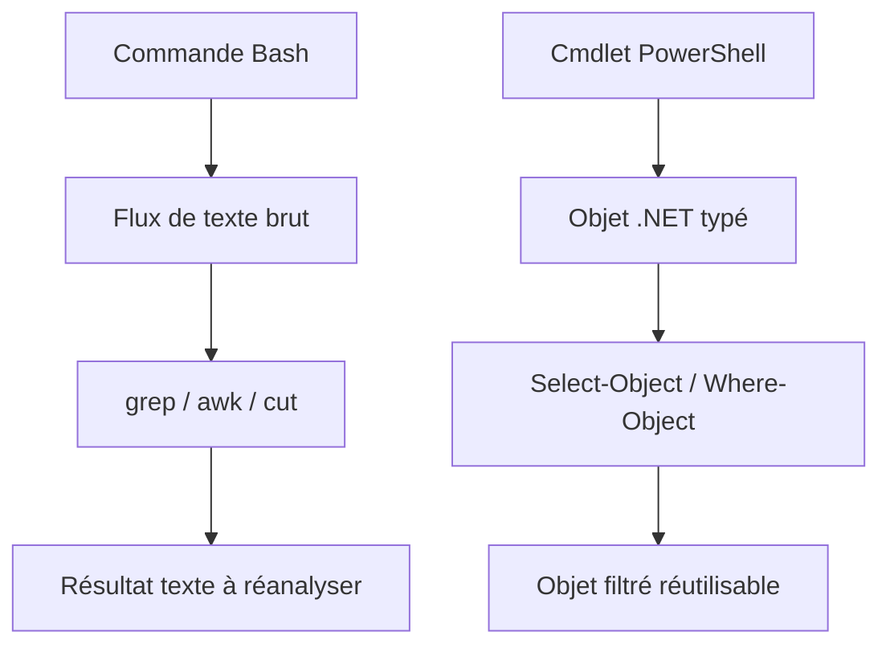
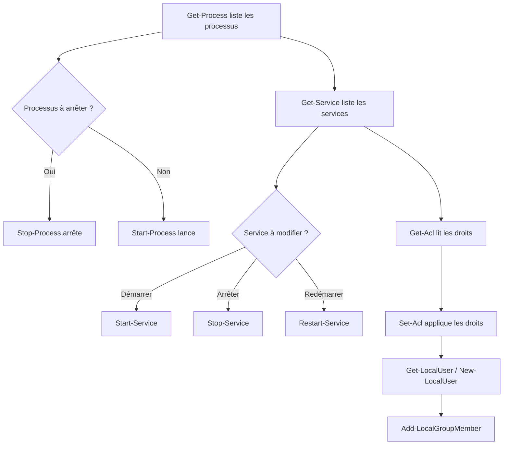
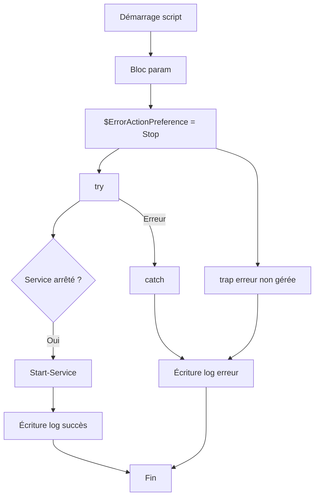

# Scripting Bash et PowerShell — JOUR 4

## PowerShell (2/2) — Fichiers, objets, processus, droits et cas pratique (08/11/2026)

---

## Objectifs du Jour

- Maîtriser la manipulation de fichiers et dossiers avec les cmdlets New-Item, Copy-Item, Move-Item, Rename-Item, Remove-Item, Test-Path et Get-ChildItem.
- Comprendre le modèle objet de PowerShell et utiliser Get-Member, Select-Object, Where-Object, ForEach-Object, Format-*, Export-Csv et ConvertTo-Json.
- Gérer les processus, les services, les listes de contrôle d'accès (ACL) et les utilisateurs/groupes locaux.
- Concevoir un script PowerShell complet avec un bloc param, une gestion d'erreurs (try/catch, trap, $ErrorActionPreference) et une journalisation dans un fichier.

---

## Planning du Jour

| Chapitre | Horaires | Thème | Durée |
|----------|----------|-------|-------|
| 13 | 9h00-10h30 | Manipulation de fichiers et dossiers | 1h30 |
| — | 10h30-10h45 | Pause | 15min |
| 14 | 10h45-12h00 | Notions d'objets PowerShell (approche objet VS Bash) | 1h15 |
| — | 12h00-13h00 | Pause déjeuner | 1h |
| 15 | 13h00-14h30 | Gestion des processus et des droits | 1h30 |
| — | 14h30-14h45 | Pause | 15min |
| 16 | 14h45-16h00 | Cas pratique PowerShell | 1h15 |

---

## Chapitre 13 — Manipulation de fichiers et dossiers (9h00-10h30)

### Objectifs

- Créer et supprimer des fichiers et dossiers avec New-Item et Remove-Item en précisant le type d'item (-ItemType).
- Vérifier l'existence d'un chemin avec Test-Path et lister le contenu d'un répertoire avec Get-ChildItem.
- Copier, déplacer, renommer des items et gérer la lecture/écriture de contenu (Copy-Item, Move-Item, Rename-Item, Get-Content, Set-Content, Add-Content) en maîtrisant l'encodage UTF-8.

### Contenu Théorique (45min)

#### 1. Création et suppression d'items (New-Item, Remove-Item) (15min)

La cmdlet New-Item crée un nouvel élément dans le système de fichiers : un fichier, un dossier ou un lien symbolique, selon la valeur du paramètre -ItemType. Remove-Item supprime un élément de manière définitive.

```powershell
# Création d'un dossier de travail
New-Item -Path 'C:\Travail\Rapports' -ItemType Directory
# New-Item : crée un nouvel élément dans le système de fichiers
# -Path : chemin de l'élément à créer
# 'C:\Travail\Rapports' : chemin cible du dossier
# -ItemType Directory : précise qu'il s'agit d'un répertoire (valeurs possibles : File, Directory, SymbolicLink)

# Création d'un fichier texte
New-Item -Path 'C:\Travail\Rapports\journal.txt' -ItemType File
# -ItemType File : précise qu'il s'agit d'un fichier texte
```

```powershell
# Suppression définitive du fichier
Remove-Item -Path 'C:\Travail\Rapports\journal.txt'
# Remove-Item : supprime l'élément situé au chemin indiqué
# -Path : cible de la suppression
# Piège : la suppression est définitive, sans passage par la corbeille
```

> **Concept clé** — New-Item distingue le type d'élément à créer via le paramètre -ItemType (File, Directory, SymbolicLink). Sans ce paramètre, PowerShell tente de déduire le type, ce qui peut conduire à des résultats inattendus. Il est donc recommandé de toujours expliciter -ItemType dans un script d'administration.

> **Bon à savoir** — Remove-Item accepte le paramètre -Recurse pour supprimer un dossier et tout son contenu de manière récursive, et -Force pour supprimer des fichiers en lecture seule ou masqués. L'utilisation combinée de -Recurse et -Force doit être réservée aux cas où la suppression totale est réellement souhaitée.

#### 2. Copie, déplacement et renommage (Copy-Item, Move-Item, Rename-Item) (15min)

Ces trois cmdlets permettent de réorganiser le système de fichiers sans en modifier le contenu. Copy-Item duplique l'élément source vers une destination, Move-Item le déplace (copie puis suppression de l'original), et Rename-Item modifie uniquement son nom.

```powershell
# Copie du fichier vers une destination
Copy-Item -Path 'C:\Travail\Rapports\journal.txt' -Destination 'C:\Sauvegarde\journal.txt'
# Copy-Item : duplique un fichier ou un dossier vers une nouvelle destination
# -Path : chemin de l'élément source
# -Destination : chemin de l'élément cible
```

```powershell
# Déplacement du fichier vers une archive
Move-Item -Path 'C:\Travail\Rapports\journal.txt' -Destination 'C:\Archive\journal.txt'
# Move-Item : déplace un élément d'un emplacement à un autre (équivalent d'un copier-supprimer)
# L'original n'existe plus dans le répertoire source après le déplacement
```

```powershell
# Renommage du fichier sans déplacement
Rename-Item -Path 'C:\Archive\journal.txt' -NewName 'journal_2026.txt'
# Rename-Item : renomme un élément sans le déplacer
# -NewName : nouveau nom de l'élément, le chemin du dossier reste inchangé
```

> **Piège** — Si le fichier de destination existe déjà, Copy-Item et Move-Item peuvent lever une erreur ou écraser le fichier selon les paramètres et la version de PowerShell. Utiliser -Force pour forcer l'écrasement en connaissance de cause.

> **Contre-mesure** — Toujours vérifier l'existence de la destination avec Test-Path avant une copie ou un déplacement, ou utiliser -Force en connaissance de cause. Le paramètre -WhatIf permet également de prévisualiser l'effet de la commande sans l'exécuter.

#### 3. Vérification et listage (Test-Path, Get-ChildItem) (15min)

Test-Path détermine si un chemin existe et retourne une valeur booléenne. Get-ChildItem liste le contenu d'un répertoire (fichiers et sous-dossiers) sous forme d'objets.

```powershell
# Vérification de l'existence d'un fichier
Test-Path -Path 'C:\Travail\Rapports\journal.txt'
# Test-Path : retourne Vrai ($true) si le chemin existe, Faux ($false) sinon
# -Path : chemin à vérifier
# Résultat attendu : Vrai ($true) si le fichier existe, Faux ($false) sinon
```

```powershell
# Listage du contenu d'un répertoire
Get-ChildItem -Path 'C:\Travail\Rapports'
# Get-ChildItem : liste les éléments d'un répertoire (fichiers et dossiers)
# -Path : répertoire à lister
# Retourne des objets FileInfo et DirectoryInfo dont les propriétés (Name, Length, CreationTime) sont accessibles
```

> **Concept clé** — Test-Path retourne une valeur booléenne, directement utilisable dans une condition if. Get-ChildItem retourne des objets, pas du texte : leurs propriétés (Name, Length, CreationTime) sont accessibles via Get-Member, ce qui illustre l'approche objet de PowerShell.

#### 4. Lecture et écriture de contenu, encodage UTF-8 (Get-Content, Set-Content, Add-Content) (15min)

Get-Content lit le contenu d'un fichier et le retourne ligne par ligne. Set-Content écrit (ou écrase) le contenu d'un fichier. Add-Content ajoute du contenu à la fin d'un fichier existant sans l'écraser.

```powershell
# Lecture du contenu d'un fichier
Get-Content -Path 'C:\Travail\Rapports\journal.txt'
# Get-Content : lit le contenu d'un fichier et le retourne ligne par ligne
# -Path : chemin du fichier à lire
# Résultat attendu : chaque ligne du fichier s'affiche dans la console
```

```powershell
# Écriture (écrasement) du contenu d'un fichier
Set-Content -Path 'C:\Travail\Rapports\journal.txt' -Value 'Première ligne de rapport.' -Encoding UTF8
# Set-Content : écrit le contenu dans un fichier, en écrasant l'existant s'il est présent
# -Value : contenu à écrire dans le fichier
# -Encoding UTF8 : force l'encodage UTF-8 (sans BOM dans PowerShell 7+)
```

```powershell
# Ajout de contenu à la fin du fichier sans écrasement
Add-Content -Path 'C:\Travail\Rapports\journal.txt' -Value 'Deuxième ligne ajoutée.' -Encoding UTF8
# Add-Content : ajoute du contenu à la fin du fichier existant
# Contrairement à Set-Content, Add-Content préserve le contenu déjà présent
# -Encoding UTF8 : force l'encodage UTF-8 (sans BOM dans PowerShell 7+)
```

L'encodage des fichiers texte est un enjeu d'administration système. Par défaut, PowerShell peut utiliser l'encodage historique de Windows (UTF-16 LE avec BOM ou ANSI selon la version). Pour garantir l'interopérabilité, notamment avec Linux et les outils modernes, il est recommandé d'utiliser l'encodage UTF-8 sans BOM via le paramètre -Encoding. L'encodage UTF-8 constitue le standard universel pour l'échange de fichiers texte entre systèmes hétérogènes (voir The Linux Command Line, William Shotts, p. 261, qui présente UTF-8 comme l'encodage de référence des environnements Linux modernes).

```powershell
# Écriture avec encodage UTF-8 explicite
Set-Content -Path 'C:\Travail\Rapports\journal.txt' -Value 'Rapport UTF-8.' -Encoding UTF8
# -Encoding UTF8 : force l'encodage UTF-8 (sans BOM dans PowerShell 7+)
# Garantit l'interopérabilité avec les outils Linux et les applications modernes
```

> **Bon à savoir** — Dans PowerShell 7+, -Encoding UTF8 produit un fichier UTF-8 sans marque BOM (Byte Order Mark), ce qui facilite les échanges avec des outils Linux. Dans Windows PowerShell 5.1, UTF8 peut inclure un BOM ; utiliser utf8NoBOM pour l'éviter.

> **Piège** — Un fichier encodé en UTF-16 lu par un outil s'attendant à de l'UTF-8 affichera des caractères illisibles (mojibake). Toujours vérifier l'encodage avant d'échanger des fichiers entre systèmes.

**Fig 1 — Flux de manipulation de fichiers et dossiers**


Exemple concret de séquence complète :

```powershell
# Création d'un dossier de travail
New-Item -Path 'C:\Travail\Rapport' -ItemType Directory
# New-Item : crée le répertoire de travail
# -ItemType Directory : précise qu'il s'agit d'un dossier

# Vérification de l'existence du dossier
if (Test-Path -Path 'C:\Travail\Rapport') {
    Write-Host 'Le dossier existe.'
}
# Test-Path : retourne $true si le chemin existe
# Write-Host : affiche un message à la console

# Création d'un fichier et écriture de la première ligne
Set-Content -Path 'C:\Travail\Rapport\journal.txt' -Value 'Début du rapport.' -Encoding UTF8
# Set-Content : crée le fichier et écrit la première ligne
# -Encoding UTF8 : encodage UTF-8 sans BOM (PowerShell 7+)

# Ajout d'une ligne supplémentaire à la fin du fichier
Add-Content -Path 'C:\Travail\Rapport\journal.txt' -Value 'Étape suivante.' -Encoding UTF8
# Add-Content : ajoute du contenu sans écraser l'existant

# Lecture et affichage du contenu complet du fichier
Get-Content -Path 'C:\Travail\Rapport\journal.txt'
# Get-Content : affiche chaque ligne du fichier dans la console

# Copie de sauvegarde du fichier
Copy-Item -Path 'C:\Travail\Rapport\journal.txt' -Destination 'C:\Sauvegarde\journal.txt'
# Copy-Item : duplique le fichier vers le dossier de sauvegarde

# Suppression du fichier original du dossier de travail
Remove-Item -Path 'C:\Travail\Rapport\journal.txt'
# Remove-Item : supprime définitivement le fichier original
```

Résultat attendu : le fichier journal.txt est créé, lu, copié, puis supprimé du dossier de travail. La copie de sauvegarde persiste dans C:\Sauvegarde.


---

### Lab 13 — Manipulation de fichiers et dossiers (45min)

#### Environnement

| Élément | Valeur |
|---------|--------|
| Poste | Windows avec PowerShell 5.1 ou PowerShell 7+ |
| Répertoire de travail | C:\Travail\Lab13 (à créer) |
| Prérequis | Droits d'écriture sur C:\Travail |

#### Exercices (les exercices s'enchaînent pour former un lab complet)

**Exercice 13.1 — Créer un dossier et vérifier son existence (10min)**

Créer le répertoire C:\Travail\Lab13, puis vérifier qu'il existe avec Test-Path.

```powershell
# Création du répertoire de travail du lab
New-Item -Path 'C:\Travail\Lab13' -ItemType Directory
# New-Item : crée un nouvel élément dans le système de fichiers
# -Path : chemin de l'élément à créer
# 'C:\Travail\Lab13' : chemin cible du répertoire
# -ItemType Directory : précise qu'il s'agit d'un dossier

# Vérification de l'existence du répertoire
Test-Path -Path 'C:\Travail\Lab13'
# Test-Path : détermine si un chemin existe
# -Path : chemin à vérifier
# Retourne Vrai ($true) si le chemin existe, Faux ($false) sinon
# Résultat attendu : Vrai ($true)
```

- [ ] Le dossier C:\Travail\Lab13 est créé
- [ ] Test-Path retourne $true

**Exercice 13.2 — Créer, copier et déplacer un fichier (15min)**

Créer un fichier texte dans Lab13, en faire une copie dans un sous-dossier Sauvegarde, puis déplacer l'original vers un sous-dossier Archive.

```powershell
# Création du fichier texte avec encodage UTF-8
Set-Content -Path 'C:\Travail\Lab13\note.txt' -Value 'Contenu de test.' -Encoding UTF8
# Set-Content : crée le fichier et y écrit le contenu
# -Path : chemin du fichier à créer
# -Value : contenu à écrire dans le fichier
# -Encoding UTF8 : encodage UTF-8 sans BOM (PowerShell 7+)

# Création du sous-dossier Sauvegarde
New-Item -Path 'C:\Travail\Lab13\Sauvegarde' -ItemType Directory
# New-Item : crée le sous-dossier de sauvegarde
# -ItemType Directory : précise qu'il s'agit d'un dossier

# Copie du fichier vers le sous-dossier Sauvegarde
Copy-Item -Path 'C:\Travail\Lab13\note.txt' -Destination 'C:\Travail\Lab13\Sauvegarde\note.txt'
# Copy-Item : duplique un fichier ou un dossier vers une nouvelle destination
# -Path : chemin de l'élément source
# -Destination : chemin de l'élément cible
# L'original reste présent dans Lab13 après la copie

# Création du sous-dossier Archive
New-Item -Path 'C:\Travail\Lab13\Archive' -ItemType Directory
# New-Item : crée le sous-dossier d'archive
# -ItemType Directory : précise qu'il s'agit d'un dossier

# Déplacement de l'original vers le sous-dossier Archive
Move-Item -Path 'C:\Travail\Lab13\note.txt' -Destination 'C:\Travail\Lab13\Archive\note.txt'
# Move-Item : déplace un élément d'un emplacement à un autre
# -Path : chemin de l'élément source à déplacer
# -Destination : chemin de l'élément cible
# Après le déplacement, l'original n'existe plus dans Lab13
```

- [ ] Le fichier note.txt existe dans le sous-dossier Sauvegarde
- [ ] Le fichier note.txt a été déplacé dans Archive (plus présent dans Lab13)

**Exercice 13.3 — Renommer et supprimer (10min)**

Renommer le fichier déplacé dans Archive, puis le supprimer définitivement.

```powershell
# Renommage du fichier déplacé dans Archive
Rename-Item -Path 'C:\Travail\Lab13\Archive\note.txt' -NewName 'note_archive.txt'
# Rename-Item : renomme un élément sans le déplacer
# -Path : chemin de l'élément à renommer
# -NewName : nouveau nom de l'élément
# Le chemin du dossier reste inchangé, seul le nom change

# Suppression définitive du fichier renommé
Remove-Item -Path 'C:\Travail\Lab13\Archive\note_archive.txt'
# Remove-Item : supprime l'élément situé au chemin indiqué
# -Path : cible de la suppression
# La suppression est définitive, sans passage par la corbeille
```

- [ ] Le fichier est renommé en note_archive.txt
- [ ] Le fichier est supprimé (Test-Path retourne $false)

**Exercice 13.4 — Lister, lire et ajouter du contenu (10min)**

Lister le contenu de Lab13, créer un fichier de rapport, y ajouter plusieurs lignes et en afficher le contenu.

```powershell
# Listage du contenu de Lab13
Get-ChildItem -Path 'C:\Travail\Lab13'
# Get-ChildItem : liste les éléments d'un répertoire (fichiers et dossiers)
# -Path : répertoire à lister
# Retourne des objets FileInfo et DirectoryInfo
# Résultat attendu : affichage des sous-dossiers Sauvegarde et Archive

# Création d'un fichier de rapport avec première ligne
Set-Content -Path 'C:\Travail\Lab13\rapport.txt' -Value 'Ligne 1 du rapport.' -Encoding UTF8
# Set-Content : crée le fichier et écrit la première ligne
# -Encoding UTF8 : encodage UTF-8 sans BOM (PowerShell 7+)

# Ajout de lignes supplémentaires à la fin du fichier
Add-Content -Path 'C:\Travail\Lab13\rapport.txt' -Value 'Ligne 2 ajoutée.' -Encoding UTF8
# Add-Content : ajoute du contenu à la fin du fichier existant sans écraser
Add-Content -Path 'C:\Travail\Lab13\rapport.txt' -Value 'Ligne 3 ajoutée.' -Encoding UTF8

# Lecture et affichage du contenu complet du fichier
Get-Content -Path 'C:\Travail\Lab13\rapport.txt'
# Get-Content : lit le contenu d'un fichier et l'affiche ligne par ligne
# Résultat attendu : affichage des trois lignes du rapport
```

- [ ] Le listage affiche les sous-dossiers Sauvegarde et Archive
- [ ] Le fichier rapport.txt contient trois lignes
- [ ] L'encodage du fichier est UTF-8


---

### Démonstration commentée

Exemple de séquence complète avec interprétation ligne par ligne :

```powershell
# 1. Création de l'arborescence de démonstration
New-Item -Path 'C:\Demo\Logs' -ItemType Directory
# New-Item : crée le répertoire de destination pour les journaux
# -Path : chemin du répertoire à créer
# -ItemType Directory : précise qu'il s'agit d'un dossier

# 2. Écriture de la première entrée du journal d'activité
Set-Content -Path 'C:\Demo\Logs\activite.log' -Value "$(Get-Date) : démarrage du service." -Encoding UTF8
# Set-Content : crée le fichier et écrit la première ligne, en écrasant l'existant
# -Path : chemin du fichier cible
# -Value : contenu à écrire, ici une chaîne avec opérateur de sous-expression
# $(Get-Date) : opérateur de sous-expression, exécute Get-Date et insère le résultat (date et heure courantes)
# -Encoding UTF8 : encodage UTF-8 sans BOM (PowerShell 7+)

# 3. Ajout d'une deuxième entrée à la fin du journal
Add-Content -Path 'C:\Demo\Logs\activite.log' -Value "$(Get-Date) : opération terminée." -Encoding UTF8
# Add-Content : ajoute du contenu à la fin du fichier sans écraser l'existant
# -Path : chemin du fichier cible
# -Value : contenu à ajouter, avec horodatage
# -Encoding UTF8 : encodage UTF-8 sans BOM (PowerShell 7+)

# 4. Lecture et affichage du contenu complet du journal
Get-Content -Path 'C:\Demo\Logs\activite.log'
# Get-Content : lit le contenu du fichier et l'affiche ligne par ligne dans la console
# -Path : chemin du fichier à lire
# Résultat attendu : deux lignes horodatées s'affichent

# 5. Sauvegarde du journal avant nettoyage
Copy-Item -Path 'C:\Demo\Logs\activite.log' -Destination 'C:\Demo\Logs\activite.bak'
# Copy-Item : duplique le fichier journal vers une copie de sauvegarde
# -Path : chemin de l'élément source
# -Destination : chemin de l'élément cible (copie de sauvegarde)
# L'original activite.log existe toujours après cette opération

# 6. Suppression du fichier original après sauvegarde
Remove-Item -Path 'C:\Demo\Logs\activite.log'
# Remove-Item : supprime définitivement le fichier original
# -Path : cible de la suppression
# La suppression est définitive, sans passage par la corbeille
```

Résultat attendu : le fichier activite.log contient deux lignes horodatées (démarrage et opération terminée), puis est copié en activite.bak avant d'être supprimé. La sauvegarde activite.bak persiste dans C:\Demo\Logs.

Interprétation ligne par ligne :
1. New-Item crée le répertoire C:\Demo\Logs qui servira de conteneur aux journaux.
2. Set-Content crée activite.log et y écrit la première ligne horodatée. L'opérateur $(Get-Date) est évalué avant l'assignation, produisant une date au format local.
3. Add-Content ajoute une deuxième ligne à la fin du fichier sans effacer la première, grâce à l'ajout en mode append.
4. Get-Content lit et affiche les deux lignes du journal, confirmant que l'écriture et l'ajout ont fonctionné.
5. Copy-Item duplique activite.log en activite.bak, constituant une sauvegarde avant toute modification destructive.
6. Remove-Item supprime activite.log de manière définitive. Seul activite.bak persiste, démontrant la séparation entre copie et suppression.


---

### Correction et résolution pas à pas

<details>
<summary>Solution du Lab 13</summary>

```powershell
# Exercice 13.1 — Créer un dossier et vérifier son existence
New-Item -Path 'C:\Travail\Lab13' -ItemType Directory
# New-Item : crée le répertoire de travail
# -Path : chemin du répertoire à créer
# -ItemType Directory : précise qu'il s'agit d'un dossier

Test-Path -Path 'C:\Travail\Lab13'
# Test-Path : vérifie l'existence du répertoire
# -Path : chemin à vérifier
# Résultat attendu : Vrai ($true)

# Exercice 13.2 — Créer, copier et déplacer un fichier
Set-Content -Path 'C:\Travail\Lab13\note.txt' -Value 'Contenu de test.' -Encoding UTF8
# Set-Content : crée le fichier et écrit le contenu
# -Path : chemin du fichier
# -Value : contenu à écrire
# -Encoding UTF8 : encodage UTF-8 sans BOM (PowerShell 7+)

New-Item -Path 'C:\Travail\Lab13\Sauvegarde' -ItemType Directory
# New-Item : crée le sous-dossier Sauvegarde
# -ItemType Directory : précise qu'il s'agit d'un dossier

Copy-Item -Path 'C:\Travail\Lab13\note.txt' -Destination 'C:\Travail\Lab13\Sauvegarde\note.txt'
# Copy-Item : duplique le fichier vers Sauvegarde
# -Path : chemin de l'élément source
# -Destination : chemin de l'élément cible

New-Item -Path 'C:\Travail\Lab13\Archive' -ItemType Directory
# New-Item : crée le sous-dossier Archive
# -ItemType Directory : précise qu'il s'agit d'un dossier

Move-Item -Path 'C:\Travail\Lab13\note.txt' -Destination 'C:\Travail\Lab13\Archive\note.txt'
# Move-Item : déplace l'original vers Archive
# -Path : chemin de l'élément source
# -Destination : chemin de l'élément cible

# Exercice 13.3 — Renommer et supprimer
Rename-Item -Path 'C:\Travail\Lab13\Archive\note.txt' -NewName 'note_archive.txt'
# Rename-Item : renomme le fichier sans le déplacer
# -Path : chemin de l'élément à renommer
# -NewName : nouveau nom de l'élément

Remove-Item -Path 'C:\Travail\Lab13\Archive\note_archive.txt'
# Remove-Item : supprime définitivement le fichier
# -Path : cible de la suppression

# Exercice 13.4 — Lister, lire et ajouter du contenu
Get-ChildItem -Path 'C:\Travail\Lab13'
# Get-ChildItem : liste les éléments du répertoire
# -Path : répertoire à lister

Set-Content -Path 'C:\Travail\Lab13\rapport.txt' -Value 'Ligne 1 du rapport.' -Encoding UTF8
# Set-Content : crée le fichier de rapport et écrit la première ligne

Add-Content -Path 'C:\Travail\Lab13\rapport.txt' -Value 'Ligne 2 ajoutée.' -Encoding UTF8
# Add-Content : ajoute une ligne à la fin sans écraser

Add-Content -Path 'C:\Travail\Lab13\rapport.txt' -Value 'Ligne 3 ajoutée.' -Encoding UTF8
# Add-Content : ajoute une deuxième ligne à la fin sans écraser

Get-Content -Path 'C:\Travail\Lab13\rapport.txt'
# Get-Content : lit et affiche le contenu complet du fichier
```

</details>

**Résolution pas à pas :**

1. **New-Item -Path 'C:\Travail\Lab13' -ItemType Directory** : crée le répertoire de travail du lab. Le paramètre -ItemType Directory indique explicitement qu'il s'agit d'un dossier, évitant toute ambiguïté sur le type d'élément créé.
2. **Test-Path -Path 'C:\Travail\Lab13'** : retourne $true si le chemin existe. Cette valeur booléenne est directement utilisable dans une condition if pour conditionner la suite du traitement.
3. **Set-Content -Path 'C:\Travail\Lab13\note.txt' -Value 'Contenu de test.' -Encoding UTF8** : crée le fichier note.txt et y écrit la première ligne. L'option -Encoding UTF8 garantit un encodage interopérable, sans BOM dans PowerShell 7+.
4. **New-Item -Path 'C:\Travail\Lab13\Sauvegarde' -ItemType Directory** : crée le sous-dossier Sauvegarde qui recevra la copie du fichier.
5. **Copy-Item -Path 'C:\Travail\Lab13\note.txt' -Destination 'C:\Travail\Lab13\Sauvegarde\note.txt'** : duplique le fichier vers Sauvegarde. L'original reste intact dans Lab13, ce qui distingue la copie du déplacement.
6. **New-Item -Path 'C:\Travail\Lab13\Archive' -ItemType Directory** : crée le sous-dossier Archive qui recevra l'original déplacé.
7. **Move-Item -Path 'C:\Travail\Lab13\note.txt' -Destination 'C:\Travail\Lab13\Archive\note.txt'** : déplace l'original vers Archive. Après cette opération, le fichier n'existe plus dans Lab13 mais uniquement dans Archive.
8. **Rename-Item -Path 'C:\Travail\Lab13\Archive\note.txt' -NewName 'note_archive.txt'** : modifie uniquement le nom du fichier. Le chemin du dossier (Archive) reste inchangé, seul le nom de l'élément est modifié.
9. **Remove-Item -Path 'C:\Travail\Lab13\Archive\note_archive.txt'** : supprime définitivement le fichier. Contrairement à une suppression via l'explorateur Windows, le fichier ne passe pas par la corbeille ; l'opération est irréversible.
10. **Get-ChildItem -Path 'C:\Travail\Lab13'** : liste le contenu du répertoire de travail. Retourne des objets FileInfo et DirectoryInfo dont les propriétés (Name, Length, CreationTime) sont introspectables avec Get-Member.
11. **Set-Content -Path 'C:\Travail\Lab13\rapport.txt' -Value 'Ligne 1 du rapport.' -Encoding UTF8** : crée le fichier rapport.txt et écrit la première ligne en encodage UTF-8.
12. **Add-Content -Path 'C:\Travail\Lab13\rapport.txt' -Value 'Ligne 2 ajoutée.' -Encoding UTF8** : ajoute une deuxième ligne à la fin du fichier sans écraser le contenu existant.
13. **Add-Content -Path 'C:\Travail\Lab13\rapport.txt' -Value 'Ligne 3 ajoutée.' -Encoding UTF8** : ajoute une troisième ligne à la fin du fichier, préservant les deux lignes précédentes.
14. **Get-Content -Path 'C:\Travail\Lab13\rapport.txt'** : lit et affiche les trois lignes du fichier, confirmant que l'ajout sélectif a fonctionné comme attendu.


---
### Bonnes pratiques

| Pratique | Description |
|----------|-------------|
| Vérification avant suppression | Utiliser Test-Path avant Remove-Item pour éviter les erreurs |
| Encodage UTF-8 | Privilégier -Encoding UTF8 pour l'interopérabilité |
| Paramètre -WhatIf | Utiliser -WhatIf pour prévisualiser une suppression ou un déplacement |
| Chemins absolus | Préférer les chemins absolus dans les scripts d'administration |
| Séparation copie/suppression | Privilégier Copy-Item puis Remove-Item plutôt qu'un déplacement non vérifié |

Script de vérification avant suppression sécurisée :

```powershell
# Vérification de l'existence avant suppression sécurisée
$chemin = 'C:\Travail\Lab13\note.txt'
if (Test-Path -Path $chemin) {
    Remove-Item -Path $chemin -WhatIf
    # -WhatIf : prévisualise l'effet de la suppression sans l'exécuter
    # Retirer -WhatIf pour effectuer la suppression effective
} else {
    Write-Host 'Le fichier n'existe pas, aucune suppression nécessaire.'
}
# Test-Path : vérifie l'existence du fichier avant toute tentative de suppression
# Remove-Item -WhatIf : affiche ce qui se passerait sans supprimer réellement
# Write-Host : informe l'utilisateur lorsque le fichier est absent
```

> **Bonnes pratiques** — Avant toute suppression ou modification en masse, utiliser le paramètre -WhatIf (disponible sur Remove-Item, Move-Item, Copy-Item) pour prévisualiser l'effet de la commande sans l'exécuter. Privilégier l'encodage UTF-8 pour garantir la lisibilité des fichiers sur différents systèmes. Toujours vérifier l'existence d'un chemin avec Test-Path avant d'appliquer Remove-Item, afin d'éviter les erreurs d'exécution et de traiter explicitement le cas où l'élément est absent.

---

### Exercices — Chapitre 13

**Exercice 13.5 — Vérification d'existence conditionnelle (10min)**

Écrire une condition qui crée un fichier uniquement s'il n'existe pas déjà, puis affiche un message confirmant la création ou l'existence.

1. Quelle cmdlet utiliser pour tester l'existence ?
2. Quelle cmdlet utiliser pour créer le fichier sans écraser l'existant ?

<details>
<summary>Solution</summary>

```powershell
$chemin = 'C:\Travail\Lab13\conditionnel.txt'
if (-not (Test-Path -Path $chemin)) {
    Set-Content -Path $chemin -Value 'Fichier créé conditionnellement.' -Encoding UTF8
    Write-Host 'Fichier créé.'
} else {
    Write-Host 'Le fichier existe déjà.'
}
# -not : opérateur de négation booléenne
# Test-Path : retourne $true si le fichier existe, $false sinon
# Set-Content : crée le fichier et y écrit le contenu
# -Encoding UTF8 : encodage UTF-8 sans BOM (PowerShell 7+)
# Write-Host : affiche un message d'information à la console
```

**Résolution pas à pas :**

1. L'opérateur -not inverse le résultat de Test-Path. Si le fichier n'existe pas, Test-Path retourne $false, et -not le transforme en $true, déclenchant l'exécution du bloc if.
2. Set-Content crée le fichier et y écrit le contenu. L'option -Encoding UTF8 garantit un encodage interopérable.
3. Si le fichier existait déjà, Test-Path retourne $true, -not le transforme en $false, et le bloc else s'exécute : un message d'information s'affiche sans écraser le fichier existant.
4. Write-Host affiche le message de confirmation approprié selon la branche exécutée (création ou existence déjà avérée).

</details>

---


---

### Ce qu'on a retenu

> **Ce qu'on a retenu** — New-Item crée des fichiers et dossiers selon le paramètre -ItemType (File, Directory, SymbolicLink). Test-Path vérifie l'existence d'un chemin et retourne une valeur booléenne ($true/$false) directement utilisable dans une condition. Get-ChildItem liste le contenu d'un répertoire sous forme d'objets (FileInfo, DirectoryInfo), introspectables avec Get-Member. Copy-Item, Move-Item, Rename-Item et Remove-Item permettent de dupliquer, déplacer, renommer et supprimer des éléments ; la suppression par Remove-Item est définitive, sans passage par la corbeille. Get-Content, Set-Content et Add-Content gèrent la lecture et l'écriture de contenu, avec le paramètre -Encoding UTF8 pour maîtriser l'encodage des fichiers texte et garantir l'interopérabilité entre systèmes.

---

## Chapitre 14 — Notions d'objets PowerShell (10h45-12h00)

### Objectifs

- Comprendre que PowerShell manipule des objets .NET typés et non du texte brut, contrairement à Bash qui traite des flux de caractères.
- Inspecter les membres d'un objet (propriétés et méthodes) avec Get-Member, et transformer des objets avec Select-Object, Where-Object et ForEach-Object.
- Formater l'affichage avec Format-Table, Format-List et Format-Wide, et sérialiser des objets vers CSV et JSON avec Export-Csv et ConvertTo-Json.

### Contenu Théorique (45min)

#### 1. Tout est objet : propriétés, méthodes et introspection avec Get-Member (15min)

Dans PowerShell, chaque commande (cmdlet) retourne un objet .NET typé, et non une chaîne de caractères. Un objet est une structure de données composée de propriétés (données décrivant l'objet) et de méthodes (actions que l'objet peut exécuter). Par exemple, un objet représentant un service Windows possède une propriété `Status` (état du service) et une méthode `Stop()` (arrêter le service).

Contrairement à Bash, où la sortie d'une commande est du texte qu'il faut analyser avec des outils comme `grep`, `awk` ou `cut` (voir The Linux Command Line, William Shotts, p. 281, qui présente ces outils comme des programmes permettant de découper et recombiner des colonnes de texte), PowerShell préserve la structure des données tout au long du pipeline. Chaque objet conserve ses propriétés, accessibles par leur nom, sans dépendre de la position d'une colonne dans un affichage.

La cmdlet `Get-Member` permet l'introspection : elle liste tous les membres (propriétés et méthodes) d'un objet transmis par le pipeline.

```powershell
Get-Service | Get-Member
# Get-Service : retourne des objets ServiceController représentant les services du système
# Get-Member : introspecte l'objet transmis et liste ses propriétés et méthodes
# Résultat attendu : affiche Name, Status, DisplayName (propriétés) et Start, Stop, Pause (méthodes)
```

Pour accéder à une propriété d'un objet, on utilise la notation pointée :

```powershell
$service = Get-Service -Name 'Spooler'
# Get-Service -Name : récupère l'objet ServiceController du service dont le nom est Spooler
# $service : variable stockant l'objet service
$service.Status
# .Status : accède à la propriété Status de l'objet stocké dans $service
# Résultat attendu : Running ou Stopped, selon l'état du service
```

Pour appeler une méthode, on utilise également la notation pointée suivie de parenthèses :

```powershell
$service = Get-Service -Name 'Spooler'
$service.Stop()
# .Stop() : appelle la méthode Stop de l'objet service pour l'arrêter
# Les parenthèses indiquent qu'il s'agit d'une méthode (action) et non d'une propriété (donnée)
```

> **Concept clé** — En PowerShell, tout est objet. Une commande ne retourne pas du texte à analyser, mais un objet structuré dont les propriétés et méthodes sont directement accessibles par leur nom. Cela élimine le besoin de parser du texte avec grep, awk ou cut, et rend les scripts plus robustes face aux changements de format d'affichage.

> **Bon à savoir** — `Get-Member` accepte le paramètre `-MemberType` pour filtrer les membres affichés. `-MemberType Property` n'affiche que les propriétés, et `-MemberType Method` n'affiche que les méthodes.

#### 2. Sélection, filtrage et itération : Select-Object, Where-Object, ForEach-Object (15min)

Le pipeline PowerShell transporte des objets d'une cmdlet à l'autre. Trois cmdlets permettent de transformer ces objets :

- `Select-Object` choisit un sous-ensemble de propriétés (projection).
- `Where-Object` filtre les objets selon une condition (sélection).
- `ForEach-Object` exécute une action sur chaque objet du pipeline (itération).

Dans `Where-Object` et `ForEach-Object`, la variable automatique `$_` représente l'objet courant traité par le scriptblock (bloc de script délimité par des accolades `{ }`).

```powershell
Get-Service | Select-Object -Property Name, Status, DisplayName
# Get-Service : retourne les objets ServiceController de tous les services
# Select-Object : sélectionne uniquement les propriétés indiquées, créant un nouvel objet allégé
# -Property : liste des propriétés à conserver dans l'objet de sortie
```

```powershell
Get-Service | Where-Object { $_.Status -eq 'Running' }
# Where-Object : filtre les objets selon la condition évaluée dans le scriptblock
# $_.Status : propriété Status de l'objet courant (représenté par $_)
# -eq : opérateur d'égalité PowerShell (équivalent de == dans d'autres langages)
# Le scriptblock { $_.Status -eq 'Running' } est évalué pour chaque objet ; seuls ceux qui retournent $true passent le filtre
```

```powershell
Get-Service | Where-Object { $_.Status -eq 'Running' } | ForEach-Object { Write-Host $_.DisplayName }
# ForEach-Object : exécute le scriptblock pour chaque objet transmis par le pipeline
# Write-Host : affiche une chaîne de caractères à la console, sans formatter d'objet
# $_.DisplayName : propriété nom d'affichage de l'objet courant
```

> **Piège** — La variable `$_` ne fait référence qu'à l'objet courant dans le scriptblock immédiat. Dans des pipelines imbriqués ou complexes, il est recommandé de nommer explicitement l'objet courant avec un paramètre nommé (par exemple `ForEach-Object -Process { $service = $_ }`) pour éviter toute ambiguïté.

> **Contre-mesure** — Toujours placer les opérations de sélection (`Select-Object`), de filtrage (`Where-Object`) et de traitement (`ForEach-Object`) avant toute cmdlet de formatage (`Format-*`), afin de préserver les objets exploitables par la suite.

#### 3. Formatage et export : Format-*, Export-Csv, ConvertTo-Json (15min)

Les cmdlets `Format-Table`, `Format-List` et `Format-Wide` modifient uniquement la représentation visuelle des objets à l'écran. Elles ne modifient pas l'objet sous-jacent, mais elles transforment l'objet en un objet de formatage qui ne peut plus être transmis utilement à d'autres cmdlets. Elles doivent donc toujours être placées en fin de pipeline.

`Export-Csv` sérialise les objets vers un fichier CSV (Comma-Separated Values, valeurs séparées par des virgules), lisible par des tableurs. `ConvertTo-Json` sérialise les objets vers une chaîne JSON (JavaScript Object Notation, notation d'objets JavaScript), adaptée à l'échange de données avec des applications web ou des API.

```powershell
Get-Service | Select-Object -First 5 -Property Name, Status | Format-Table -AutoSize
# Format-Table : affiche les objets sous forme de tableau à colonnes
# -AutoSize : ajuste automatiquement la largeur des colonnes au contenu des données
# -First 5 : limite le traitement aux cinq premiers objets du pipeline
```

```powershell
Get-Service -Name 'Spooler' | Format-List Name, Status, DisplayName
# Format-List : affiche chaque propriété sélectionnée sur une ligne séparée, utile pour une lecture détaillée
```

```powershell
Get-Service | Select-Object -First 3 -Property Name, Status | Format-Wide
# Format-Wide : affiche une seule propriété sur plusieurs colonnes, pour un affichage compact
```

```powershell
Get-Service | Select-Object -First 5 -Property Name, Status | Export-Csv -Path 'C:\Travail\services.csv' -NoTypeInformation -Encoding UTF8
# Export-Csv : sérialise les objets vers un fichier CSV
# -Path : chemin du fichier de sortie
# -NoTypeInformation : omet l'en-tête de type (.NET type) dans le fichier CSV, pour un fichier plus propre
# -Encoding UTF8 : force l'encodage UTF-8 du fichier de sortie (sans BOM dans PowerShell 7+)
```

```powershell
Get-Service | Select-Object -First 3 -Property Name, Status | ConvertTo-Json
# ConvertTo-Json : transforme les objets en une chaîne JSON structurée
# Résultat attendu : une représentation JSON des trois premiers services, exploitable par des applications tierces
```

**Fig 2 — Approche objet PowerShell VS flux de texte Bash**



Exemple concret comparant les deux approches pour extraire les services en cours d'exécution :

```powershell
# Approche PowerShell (objets) — robuste, indépendante de l'affichage
Get-Service | Where-Object { $_.Status -eq 'Running' } | Select-Object -Property Name, DisplayName
# Les objets ServiceController conservent leurs propriétés, directement exploitables par une cmdlet suivante

# Approche équivalente en Bash (texte) — fragile, dépend du format d'affichage
# systemctl --type=service --state=running | awk '{print $1, $2}'
# Le texte doit être réanalysé à chaque étape ; aucune structure n'est préservée
# MARQUAGE : commande Bash, fournie à titre de comparaison uniquement
```

Résultat attendu : PowerShell retourne des objets avec les propriétés `Name` et `DisplayName`, exploitables par une cmdlet suivante. Bash retourne du texte qui doit être reparsé à chaque étape, rendant le script vulnérable à tout changement de format de sortie.

---

### Lab 14 — Notions d'objets PowerShell (45min)

#### Environnement

| Élément | Valeur |
|---------|--------|
| Poste | Windows avec PowerShell 5.1 ou PowerShell 7+ |
| Répertoire de travail | C:\Travail\Lab14 (à créer) |
| Prérequis | Droits de lecture sur les services et processus du système |


#### Exercices (les exercices s'enchaînent pour former un lab complet)

**Exercice 14.1 — Inspecter un objet avec Get-Member (10min)**

Lister les propriétés et méthodes d'un objet service, puis filtrer uniquement les propriétés.

```powershell
# Introspection complète de l'objet service Spooler
Get-Service -Name 'Spooler' | Get-Member
# Get-Service -Name : récupère l'objet ServiceController du service Spooler
# Get-Member : liste tous les membres (propriétés et méthodes) de l'objet
# Résultat attendu : Name, Status, DisplayName (propriétés), Start, Stop, Pause (méthodes)

# Introspection filtrée : uniquement les propriétés
Get-Service -Name 'Spooler' | Get-Member -MemberType Property
# -MemberType Property : filtre pour n'afficher que les propriétés de l'objet
```

- [ ] La liste affiche des propriétés telles que Name, Status, DisplayName
- [ ] La liste affiche des méthodes telles que Start, Stop

**Exercice 14.2 — Sélectionner et filtrer des objets (15min)**

Sélectionner les propriétés Name et Status des cinq premiers services, puis filtrer uniquement ceux qui sont en cours d'exécution.

```powershell
# Sélection des cinq premiers services avec leurs propriétés Name et Status
Get-Service | Select-Object -First 5 -Property Name, Status
# Select-Object -First 5 : limite le pipeline aux cinq premiers objets
# -Property Name, Status : conserve uniquement ces deux propriétés dans l'objet de sortie

# Filtrage des services en cours d'exécution
Get-Service | Where-Object { $_.Status -eq 'Running' } | Select-Object -Property Name, DisplayName
# Where-Object : filtre les objets dont la propriété Status vaut 'Running'
# $_.Status : propriété Status de l'objet courant dans le pipeline
# -eq : opérateur d'égalité PowerShell
```

- [ ] Cinq services s'affichent avec Name et Status
- [ ] Seuls les services Running apparaissent après le filtrage

**Exercice 14.3 — Itérer et formater (10min)**

Itérer sur les trois premiers services et afficher leur nom d'affichage, puis afficher une liste détaillée.

```powershell
# Itération sur les trois premiers services pour afficher leur nom d'affichage
Get-Service | Select-Object -First 3 | ForEach-Object { Write-Host $_.DisplayName }
# ForEach-Object : exécute le scriptblock pour chaque objet transmis
# Write-Host : affiche le nom d'affichage de chaque service à la console
# $_.DisplayName : propriété nom d'affichage de l'objet courant

# Affichage détaillé sous forme de liste
Get-Service | Select-Object -First 3 -Property Name, Status, DisplayName | Format-List
# Format-List : affiche chaque propriété sélectionnée sur une ligne séparée
```

- [ ] Trois noms d'affichage s'affichent à la console
- [ ] Le format détaillé présente chaque propriété sur une ligne séparée

**Exercice 14.4 — Exporter vers CSV et JSON (10min)**

Exporter les cinq premiers services vers un fichier CSV et afficher trois services au format JSON.

```powershell
# Création du répertoire de travail du lab s'il n'existe pas
if (-not (Test-Path -Path 'C:\Travail\Lab14')) {
    New-Item -Path 'C:\Travail\Lab14' -ItemType Directory
}
# Test-Path : vérifie l'existence du répertoire
# -not : opérateur de négation booléenne
# New-Item -ItemType Directory : crée le répertoire s'il est absent

# Export des cinq premiers services vers un fichier CSV
Get-Service | Select-Object -First 5 -Property Name, Status, DisplayName | Export-Csv -Path 'C:\Travail\Lab14\services.csv' -NoTypeInformation -Encoding UTF8
# Export-Csv : sérialise les objets vers un fichier CSV
# -Path : chemin du fichier de sortie
# -NoTypeInformation : omet l'en-tête de type .NET dans le CSV
# -Encoding UTF8 : encodage UTF-8 du fichier (sans BOM dans PowerShell 7+)

# Affichage de trois services au format JSON
Get-Service | Select-Object -First 3 -Property Name, Status | ConvertTo-Json
# ConvertTo-Json : transforme les objets en une chaîne JSON structurée
```

- [ ] Le fichier services.csv est créé et contient les données des cinq premiers services
- [ ] La sortie JSON s'affiche dans la console avec les trois premiers services

---

### Démonstration commentée

Exemple de pipeline complet d'objets, de la sélection à l'export :

```powershell
# 1. Récupération des processus utilisant plus de 50 Mo de mémoire privée
$processus = Get-Process | Where-Object { $_.PM -gt 50MB } | Select-Object -Property Name, PM, CPU
# Get-Process : retourne des objets Process représentant les processus en cours
# Where-Object { $_.PM -gt 50MB } : filtre les processus dont la mémoire privée (PM) dépasse 50 Mo
# $_.PM : propriété Private Memory (mémoire privée) du processus courant
# -gt : opérateur "strictement supérieur à" PowerShell
# 50MB : suffixe de taille compris par PowerShell (50 mégaoctets)
# Select-Object -Property Name, PM, CPU : conserve uniquement ces trois propriétés

# 2. Tri des processus par consommation mémoire décroissante
$processus | Sort-Object PM -Descending | Format-Table -AutoSize
# Sort-Object : trie les objets selon la propriété indiquée
# PM : propriété de tri (mémoire privée)
# -Descending : ordre décroissant (du plus gourmand au moins gourmand)
# Format-Table -AutoSize : affiche le résultat sous forme de tableau avec colonnes ajustées

# 3. Sérialisation des mêmes objets au format JSON
$processus | ConvertTo-Json
# ConvertTo-Json : transforme la collection d'objets en une chaîne JSON
# Chaque étape préserve la structure objet ; aucune conversion en texte intermédiaire
```

Résultat attendu : un tableau des processus utilisant plus de 50 Mo de mémoire, trié par consommation décroissante, puis une représentation JSON des mêmes données. Chaque étape préserve la structure objet, permettant de réutiliser les données sans les reparser.

Interprétation ligne par ligne :
1. `Get-Process` récupère la liste de tous les processus sous forme d'objets `System.Diagnostics.Process`.
2. `Where-Object { $_.PM -gt 50MB }` évalue la condition pour chaque processus et ne conserve que ceux dont la mémoire privée dépasse 50 Mo.
3. `Select-Object -Property Name, PM, CPU` projette chaque objet sur un sous-ensemble de trois propriétés, allégeant les données transportées.
4. `Sort-Object PM -Descending` ordonne les objets par consommation mémoire décroissante, sans altérer leurs propriétés.
5. `Format-Table -AutoSize` produit un affichage tabulaire lisible, placé en fin de pipeline pour ne pas altérer les objets destinés à l'export.
6. `ConvertTo-Json` sérialise les mêmes objets en JSON, démontrant que la structure objet a été préservée tout au long du traitement.

---

### Correction et résolution pas à pas

<details>
<summary>Solution du Lab 14</summary>

```powershell
# Exercice 14.1 — Inspecter un objet avec Get-Member
Get-Service -Name 'Spooler' | Get-Member
# Get-Service -Name : récupère l'objet ServiceController du service Spooler
# Get-Member : introspecte l'objet et liste ses membres

Get-Service -Name 'Spooler' | Get-Member -MemberType Property
# -MemberType Property : filtre pour n'afficher que les propriétés

# Exercice 14.2 — Sélectionner et filtrer des objets
Get-Service | Select-Object -First 5 -Property Name, Status
# Select-Object -First 5 : limite aux cinq premiers objets
# -Property Name, Status : propriétés à conserver

Get-Service | Where-Object { $_.Status -eq 'Running' } | Select-Object -Property Name, DisplayName
# Where-Object : filtre selon $_.Status -eq 'Running'
# $_.Status : propriété Status de l'objet courant
# -eq : opérateur d'égalité

# Exercice 14.3 — Itérer et formater
Get-Service | Select-Object -First 3 | ForEach-Object { Write-Host $_.DisplayName }
# ForEach-Object : exécute Write-Host pour chaque objet
# $_.DisplayName : propriété nom d'affichage

Get-Service | Select-Object -First 3 -Property Name, Status, DisplayName | Format-List
# Format-List : affiche chaque propriété sur une ligne séparée

# Exercice 14.4 — Exporter vers CSV et JSON
if (-not (Test-Path -Path 'C:\Travail\Lab14')) {
    New-Item -Path 'C:\Travail\Lab14' -ItemType Directory
}
# Test-Path : vérifie l'existence du répertoire
# -not : opérateur de négation
# New-Item -ItemType Directory : crée le répertoire

Get-Service | Select-Object -First 5 -Property Name, Status, DisplayName | Export-Csv -Path 'C:\Travail\Lab14\services.csv' -NoTypeInformation -Encoding UTF8
# Export-Csv : sérialise vers un fichier CSV
# -NoTypeInformation : omet l'en-tête de type .NET
# -Encoding UTF8 : encodage UTF-8

Get-Service | Select-Object -First 3 -Property Name, Status | ConvertTo-Json
# ConvertTo-Json : transforme les objets en chaîne JSON
```

</details>

**Résolution pas à pas :**

1. **Get-Member** : introspecte l'objet `ServiceController` et liste ses propriétés (`Name`, `Status`, `DisplayName`, `ServiceType`) et ses méthodes (`Start`, `Stop`, `Pause`, `Continue`, `WaitForStatus`). Cette étape permet de découvrir la structure de l'objet avant de l'exploiter.
2. **Select-Object -First 5 -Property Name, Status** : conserve uniquement les cinq premiers objets et les deux propriétés demandées. Le reste de l'objet est ignoré pour la sortie, mais l'objet reste typé et exploitable.
3. **Where-Object { $_.Status -eq 'Running' }** : le scriptblock est évalué pour chaque objet transmis. `$_` fait référence à l'objet courant. Seuls les objets dont la propriété `Status` vaut `'Running'` passent le filtre et sont transmis à la cmdlet suivante.
4. **ForEach-Object { Write-Host $_.DisplayName }** : exécute le scriptblock pour chaque objet. `Write-Host` affiche le nom d'affichage sans produire d'objet formaté, ce qui convient à un affichage simple à l'écran.
5. **Format-List** : affiche chaque propriété sélectionnée sur une ligne séparée, offrant une lecture détaillée des propriétés de chaque objet.
6. **Export-Csv -NoTypeInformation -Encoding UTF8** : produit un fichier CSV lisible par des tableurs, encodé en UTF-8 pour l'interopérabilité. L'option `-NoTypeInformation` omet l'en-tête de type .NET pour un fichier plus propre.
7. **ConvertTo-Json** : transforme les objets en une chaîne JSON, utile pour l'échange avec des applications web ou des API. La structure des données est préservée dans le format d'échange.

---

### Bonnes pratiques

| Pratique | Description |
|----------|-------------|
| Format-* en fin de pipeline | Placer les cmdlets de formatage en dernière position, car elles transforment les objets en objets de formatage inutilisables par la suite |
| Préserver les objets | Éviter de convertir les objets en texte avant le dernier moment ; privilégier les opérations sur les propriétés nommées |
| -NoTypeInformation | Utiliser avec `Export-Csv` pour produire un fichier CSV propre, sans en-tête de type .NET |
| Encodage UTF-8 | Utiliser `-Encoding UTF8` avec `Export-Csv` pour garantir l'interopérabilité entre systèmes |
| Propriétés nommées | Référencer les propriétés par leur nom (`$_.Status`) plutôt que par leur position textuelle, pour rendre les scripts robustes |

Script de vérification de l'intégrité des objets avant export :

```powershell
# Vérification que les objets conservent leurs propriétés avant export
$services = Get-Service | Select-Object -First 5 -Property Name, Status, DisplayName
# Get-Service : retourne les objets ServiceController
# Select-Object : projette sur un sous-ensemble de propriétés

# Vérification de l'intégrité des objets
$services | Get-Member -MemberType Property
# Get-Member -MemberType Property : confirme que les propriétés sont bien présentes

# Export uniquement si des objets sont présents
if (@($services).Count -gt 0) {
    $services | Export-Csv -Path 'C:\Travail\Lab14\services_verifie.csv' -NoTypeInformation -Encoding UTF8
    # Export-Csv : exporte les objets vérifiés vers un fichier CSV
    # -Path : chemin du fichier de sortie
    # -NoTypeInformation : omet l'en-tête de type .NET
    # -Encoding UTF8 : encodage UTF-8
    Write-Host "Export effectué : $($services.Count) services exportés."
    # Write-Host : affiche un message de confirmation
    # $services.Count : nombre d'objets dans la collection
} else {
    Write-Host "Aucun service à exporter."
}
# @($services).Count : nombre d'objets dans la collection (l'opérateur @() force un tableau, même avec un seul objet en PowerShell 5.1)
# if / else : conditionnelle pour n'exporter que si des objets sont présents
```

> **Bonnes pratiques** — Les cmdlets `Format-*` ne doivent apparaître qu'en fin de pipeline, car elles transforment les objets en objets de formatage inutilisables par les cmdlets suivantes. Pour produire des fichiers d'échange, préférer `Export-Csv` ou `ConvertTo-Json` qui préservent la structure des données. Toujours référencer les propriétés par leur nom plutôt que par leur position, afin de rendre les scripts indépendants du format d'affichage.

---

### Exercices — Chapitre 14

**Exercice 14.5 — Comparaison objet PowerShell vs texte Bash (10min)**

Expliquer pourquoi l'approche objet de PowerShell est plus robuste que l'approche texte de Bash pour extraire le nom des services arrêtés.

1. Quel est l'avantage de manipuler des objets plutôt que du texte ?
2. Quel risque existe-t-il si le format de sortie texte change ?

<details>
<summary>Solution</summary>

```powershell
# Approche PowerShell (robuste) — référence la propriété par son nom
Get-Service | Where-Object { $_.Status -eq 'Stopped' } | Select-Object -Property Name
# L'objet ServiceController possède une propriété Status typée, indépendante de l'affichage
# $_.Status : propriété Status de l'objet courant
# -eq : opérateur d'égalité
```

**Résolution pas à pas :**

1. L'avantage de l'approche objet est que la propriété `Status` est accessible directement par son nom, quel que soit le mode d'affichage. On n'a pas besoin de connaître la position d'une colonne dans un tableau de texte. La propriété est typée, ce qui rend la comparaison fiable.
2. En Bash, l'analyse de texte (par exemple avec `awk`) dépend de la position des colonnes dans la sortie. Si le format de sortie de la commande change (ajout d'une colonne, modification de l'espacement, changement de langue), le script casse car il référence des positions textuelles, pas des propriétés nommées. En PowerShell, le script reste valide car il référence des propriétés nommées de l'objet, indépendamment de leur représentation visuelle.

</details>

---

### Ce qu'on a retenu

> **Ce qu'on a retenu** — PowerShell manipule des objets .NET typés, et non du texte brut. `Get-Member` introspecte les propriétés et méthodes d'un objet. `Select-Object` sélectionne des propriétés, `Where-Object` filtre selon une condition, `ForEach-Object` itère sur chaque objet. `Format-*` modifie uniquement l'affichage et doit être placé en fin de pipeline. `Export-Csv` et `ConvertTo-Json` sérialisent les objets vers des formats d'échange. Contrairement à Bash, l'approche objet préserve la structure des données tout au long du pipeline, rendant les scripts plus robustes et indépendants du format d'affichage.

---

## Chapitre 15 — Gestion des processus et des droits (13h00-14h30)

### Objectifs

- Lister, démarrer et arrêter des processus avec Get-Process, Start-Process et Stop-Process.
- Gérer les services Windows avec Get-Service, Start-Service, Stop-Service et Restart-Service.
- Lire et modifier les listes de contrôle d'accès (ACL) avec Get-Acl et Set-Acl, et gérer les utilisateurs et groupes locaux avec Get-LocalUser, New-LocalUser et Add-LocalGroupMember.

### Contenu Théorique (45min)

#### 1. Gestion des processus (Get-Process, Start-Process, Stop-Process) (15min)

En administration système, un processus est un programme en cours d'exécution, identifié par un identifiant unique (PID, Process Identifier). Sous Linux, la commande `ps` permet d'en dresser l'instantané et `kill` d'en demander l'arrêt (The Linux Command Line, William Shotts, p. 128 et p. 137). PowerShell applique la même logique avec une approche objet : Get-Process retourne des objets System.Diagnostics.Process, Start-Process lance un nouveau processus, et Stop-Process en interrompt l'exécution.

```powershell
# Liste des processus dont le nom est notepad
Get-Process -Name 'notepad'
# Get-Process : retourne les objets Process représentant les processus en cours d'exécution
# -Name : filtre les processus par leur nom (ici le Bloc-notes)
# Retourne des objets System.Diagnostics.Process avec les propriétés Name, Id, PM, CPU, WS
```

```powershell
# Lancement d'une nouvelle instance du Bloc-notes
Start-Process -FilePath 'notepad.exe'
# Start-Process : lance un nouveau processus sur le système
# -FilePath : chemin ou nom de l'exécutable à lancer (ici notepad.exe)
# Le processus s'exécute de manière indépendante de la console PowerShell
```

```powershell
# Arrêt du processus notepad transmis par le pipeline
Get-Process -Name 'notepad' | Stop-Process
# Stop-Process : arrête immédiatement le processus transmis par le pipeline
# L'arrêt est immédiat, sans enregistrement des données non sauvegardées
# Cette commande nécessite des droits suffisants sur le processus cible
```

> **Concept clé** — Get-Process retourne des objets Process dont les propriétés (Name, Id, CPU, PM, WS) sont directement accessibles par leur nom, sans analyse de texte. Stop-Process interrompt l'exécution immédiatement, ce qui peut entraîner la perte de données non sauvegardées.

> **Bon à savoir** — Sous Linux, l'équivalent de Get-Process est `ps`, et celui de Stop-Process est `kill` (The Linux Command Line, William Shotts, p. 128 et p. 137). PowerShell préserve cependant la structure objet des processus, contrairement au flux de texte produit par `ps`.

> **Piège** — Arrêter un processus système critique (par exemple lsass.exe ou winlogon.exe) peut rendre le système instable ou provoquer un redémarrage intempestif. Toujours identifier le processus et son PID avant de l'arrêter.

> **Contre-mesure** — Utiliser Get-Process pour identifier le processus et son identifiant (PID) avant d'appeler Stop-Process. Éviter d'arrêter des processus dont le nom est inconnu ou dont l'importance système n'est pas établie.

#### 2. Gestion des services (Get-Service, Start-Service, Stop-Service, Restart-Service) (15min)

Un service est un programme qui s'exécute en arrière-plan, souvent indépendamment de toute session utilisateur ouverte. Sous Linux, les services sont gérés par systemd (systemctl) ; sous Windows, ils sont représentés par des objets ServiceController manipulables avec Get-Service, Start-Service, Stop-Service et Restart-Service.

```powershell
# Récupération du service d'impression Spooler
Get-Service -Name 'Spooler'
# Get-Service : retourne l'objet ServiceController du service spécifié
# -Name : nom interne du service à récupérer
# Retourne les propriétés Name, Status, DisplayName, etc.
```

```powershell
# Démarrage du service Spooler s'il est arrêté
Start-Service -Name 'Spooler'
# Start-Service : démarre le service spécifié s'il est actuellement arrêté
# -Name : nom interne du service à démarrer
# Ne produit aucune erreur si le service est déjà en cours d'exécution
```

```powershell
# Arrêt du service Spooler s'il est en cours d'exécution
Stop-Service -Name 'Spooler'
# Stop-Service : arrête le service spécifié s'il est en cours d'exécution
# -Name : nom interne du service à arrêter
# L'arrêt peut prendre quelques instants si des dépendances existent
```

```powershell
# Arrêt puis redémarrage du service Spooler
Restart-Service -Name 'Spooler'
# Restart-Service : arrête puis redémarre le service spécifié
# -Name : nom interne du service à redémarrer
# Équivalent à un Stop-Service suivi d'un Start-Service
```

> **Bon à savoir** — Get-Service accepte le paramètre -DisplayName pour rechercher un service par son nom d'affichage plutôt que par son nom de service interne.

> **Piège** — Arrêter un service critique (par exemple le service de mise à jour Windows ou le service de sécurité) peut perturber le fonctionnement du système. Vérifier les dépendances du service avant de l'arrêter.

> **Contre-mesure** — Toujours consulter l'état du service avec Get-Service avant d'appliquer Start-Service, Stop-Service ou Restart-Service, et documenter les services modifiés dans un script d'administration.

#### 3. Listes de contrôle d'accès (ACL) avec Get-Acl et Set-Acl (15min)

Une ACL (Access Control List, liste de contrôle d'accès) définit quels utilisateurs ou groupes possèdent quels droits (lecture, écriture, exécution) sur un fichier ou un dossier. Sous Linux, les droits s'administrent avec chmod et chown (The Linux Command Line, William Shotts, p. 14 et p. 125), et les ACL étendues avec setfacl/getfacl. PowerShell propose Get-Acl pour lire l'ACL et Set-Acl pour l'appliquer après modification.

```powershell
# Lecture de l'ACL d'un fichier
$acl = Get-Acl -Path 'C:\Travail\Lab13\rapport.txt'
# Get-Acl : lit la liste de contrôle d'accès d'un fichier ou dossier
# -Path : chemin de la cible dont on lit les droits
# $acl : objet System.Security.AccessControl.FileSecurity contenant le propriétaire et les règles d'accès
```

```powershell
# Affichage du propriétaire du fichier
$acl.Owner
# .Owner : propriété contenant le nom du compte propriétaire du fichier
# Résultat attendu : le nom du compte utilisateur propriétaire (ex. BUILTIN\Administrators)
```

```powershell
# Application d'une ACL modifiée sur le fichier
$acl | Set-Acl -Path 'C:\Travail\Lab13\rapport.txt'
# Set-Acl : applique une liste de contrôle d'accès modifiée à un fichier ou dossier
# -Path : cible sur laquelle appliquer l'ACL
# L'objet ACL modifié est réinjecté sur la cible via le pipeline
```

> **Concept clé** — Get-Acl retourne un objet System.Security.AccessControl.FileSecurity contenant le propriétaire et les règles d'accès. Set-Acl applique une version modifiée de cet objet à la cible. La modification des ACL nécessite des droits suffisants (généralement administrateur ou propriétaire).

> **Piège** — Set-Acl remplace l'intégralité de l'ACL de la cible par l'objet fourni. Toute règle d'accès non présente dans l'objet modifié est perdue. Toujours conserver une copie de l'ACL originale avant modification.

> **Contre-mesure** — Lire l'ACL avec Get-Acl dans une variable, modifier uniquement les règles nécessaires, puis appliquer avec Set-Acl. Tester sur un fichier non critique avant d'appliquer sur des données de production.

#### 4. Utilisateurs et groupes locaux (Get-LocalUser, New-LocalUser, Add-LocalGroupMember) (15min)

PowerShell permet de gérer les comptes d'utilisateurs locaux et les groupes locaux d'une machine Windows. Sous Linux, l'équivalent s'effectue avec useradd, usermod et groupadd. Les cmdlets PowerShell appartiennent au module Microsoft.PowerShell.LocalAccounts.

```powershell
# Listage des comptes d'utilisateurs locaux
Get-LocalUser
# Get-LocalUser : liste les comptes d'utilisateurs locaux de la machine
# Retourne des objets contenant Name, Enabled, LastLogon, PasswordExpires, etc.
```

```powershell
# Création d'un nouvel utilisateur local
New-LocalUser -Name 'LabUtilisateur' -Password (Read-Host -AsSecureString -Prompt 'Mot de passe pour LabUtilisateur')
# New-LocalUser : crée un nouveau compte utilisateur local
# -Name : nom du compte à créer
# -Password : mot de passe sous forme de chaîne sécurisée (SecureString)
# Read-Host -AsSecureString : saisit le mot de passe sans l'afficher à l'écran
# -Prompt : message affiché à l'utilisateur lors de la saisie
```

```powershell
# Ajout de l'utilisateur au groupe Utilisateurs
Add-LocalGroupMember -Group 'Utilisateurs' -Member 'LabUtilisateur'
# Add-LocalGroupMember : ajoute un utilisateur à un groupe local
# -Group : nom du groupe cible
# -Member : utilisateur à ajouter au groupe
# L'utilisateur hérite des droits associés au groupe
```

> **Bon à savoir** — Les cmdlets Get-LocalUser, New-LocalUser et Add-LocalGroupMember nécessitent le module Microsoft.PowerShell.LocalAccounts, disponible par défaut sur Windows 10/11 et Windows Server.

> **Piège** — New-LocalUser requiert un mot de passe complexe respectant la stratégie de mots de passe de la machine. Un mot de passe trop simple provoquera une erreur de création.

> **Contre-mesure** — Vérifier la stratégie de mots de passe avant de créer un utilisateur, ou utiliser un mot de passe respectant les exigences de complexité (majuscules, minuscules, chiffres, caractères spéciaux).

**Fig 3 — Gestion des processus et des droits**



Exemple concret de gestion d'un processus et de ses droits :

```powershell
# Lancement d'un processus de test
Start-Process -FilePath 'notepad.exe'
# Start-Process : lance l'exécutable notepad.exe (Bloc-notes)

# Identification du processus lancé
$p = Get-Process -Name 'notepad'
# Get-Process : récupère l'objet Process du Bloc-notes
# $p : variable stockant l'objet processus

# Lecture de l'ACL d'un fichier associé
$acl = Get-Acl -Path 'C:\Travail\Lab13\rapport.txt'
# Get-Acl : lit la liste de contrôle d'accès du fichier
# $acl : objet contenant les règles d'accès et le propriétaire

# Affichage du propriétaire du fichier
$acl.Owner
# .Owner : propriété contenant le nom du propriétaire du fichier
```

Résultat attendu : le Bloc-notes est lancé, l'objet Process est récupéré dans $p, et le propriétaire du fichier rapport.txt s'affiche.


---

### Lab 15 — Gestion des processus et des droits (45min)

#### Environnement

| Élément | Valeur |
|---------|--------|
| Poste | Windows avec PowerShell 5.1 ou PowerShell 7+ |
| Répertoire de travail | C:\Travail\Lab15 (à créer) |
| Droits | Utilisateur avec droits suffisants pour modifier les ACL et les comptes locaux |


#### Exercices (les exercices s'enchaînent pour former un lab complet)

**Exercice 15.1 — Lister et arrêter un processus (10min)**

Lancer le Bloc-notes, l'identifier avec Get-Process, puis l'arrêter avec Stop-Process.

```powershell
# Lancement du Bloc-notes
Start-Process -FilePath 'notepad.exe'
# Start-Process : lance l'exécutable notepad.exe
# -FilePath : chemin ou nom de l'exécutable à lancer

# Identification du processus
Get-Process -Name 'notepad'
# Get-Process : liste le processus notepad et ses propriétés (Id, CPU, PM)
# -Name : filtre les processus par nom

# Arrêt du processus
Get-Process -Name 'notepad' | Stop-Process
# Stop-Process : arrête le processus transmis par le pipeline
# L'arrêt est immédiat, sans enregistrement des données non sauvegardées
```

- [ ] Le processus notepad est lancé
- [ ] Get-Process retourne les informations du processus
- [ ] Le processus est arrêté (plus retourné par Get-Process)


**Exercice 15.2 — Gérer l'état d'un service (15min)**

Vérifier l'état du service Spooler, l'arrêter, puis le redémarrer.

```powershell
# Vérification de l'état du service
Get-Service -Name 'Spooler' | Select-Object -Property Name, Status, DisplayName
# Get-Service : récupère l'objet ServiceController du service Spooler
# -Name : nom interne du service
# Select-Object : sélectionne les propriétés à afficher
# -Property Name, Status, DisplayName : propriétés à conserver

# Arrêt du service
Stop-Service -Name 'Spooler'
# Stop-Service : arrête le service s'il est en cours d'exécution
# -Name : nom interne du service à arrêter

# Redémarrage du service
Start-Service -Name 'Spooler'
# Start-Service : démarre le service s'il est arrêté
# -Name : nom interne du service à démarrer
```

- [ ] L'état initial du service s'affiche
- [ ] Le service est arrêté puis redémarré


**Exercice 15.3 — Lire et afficher une ACL (10min)**

Lire l'ACL d'un fichier et afficher son propriétaire.

```powershell
# Lecture de l'ACL du fichier
$acl = Get-Acl -Path 'C:\Travail\Lab13\rapport.txt'
# Get-Acl : lit la liste de contrôle d'accès du fichier
# -Path : chemin du fichier cible
# $acl : objet contenant les règles d'accès et le propriétaire

# Affichage du propriétaire
$acl.Owner
# .Owner : propriété contenant le nom du propriétaire du fichier
# Résultat attendu : le nom du compte propriétaire s'affiche
```

- [ ] L'ACL est lue sans erreur
- [ ] Le nom du propriétaire s'affiche


**Exercice 15.4 — Créer un utilisateur local et l'ajouter à un groupe (10min)**

Créer un utilisateur local et l'ajouter au groupe Utilisateurs.

```powershell
# Création de l'utilisateur local
New-LocalUser -Name 'LabUtilisateur' -Password (Read-Host -AsSecureString -Prompt 'Mot de passe pour LabUtilisateur')
# New-LocalUser : crée un compte utilisateur local
# -Name : nom du compte à créer
# -Password : mot de passe sous forme de chaîne sécurisée (SecureString)
# Read-Host -AsSecureString : saisit le mot de passe de manière masquée
# -Prompt : message affiché lors de la saisie

# Ajout au groupe Utilisateurs
Add-LocalGroupMember -Group 'Utilisateurs' -Member 'LabUtilisateur'
# Add-LocalGroupMember : ajoute l'utilisateur au groupe local
# -Group : nom du groupe cible
# -Member : utilisateur à ajouter
```

- [ ] L'utilisateur LabUtilisateur est créé
- [ ] L'utilisateur est membre du groupe Utilisateurs


---

### Démonstration commentée

Exemple de gestion complète d'un processus avec vérification des droits :

```powershell
# 1. Lancement d'un processus de test
Start-Process -FilePath 'notepad.exe'
# Start-Process : lance une nouvelle instance du Bloc-notes
# -FilePath : nom de l'exécutable à lancer

# 2. Récupération de l'objet processus
$processus = Get-Process -Name 'notepad'
# Get-Process : récupère l'objet System.Diagnostics.Process du Bloc-notes
# -Name : filtre par nom de processus
# $processus : variable stockant l'objet processus

# 3. Affichage des propriétés principales
$processus | Select-Object -Property Name, Id, PM, CPU
# Select-Object : projette l'objet sur un sous-ensemble de propriétés
# -Property Name, Id, PM, CPU : propriétés à afficher (nom, PID, mémoire privée, CPU)
# PM : mémoire privée consommée par le processus
# CPU : temps processeur consommé

# 4. Arrêt propre du processus
$processus | Stop-Process
# Stop-Process : arrête le processus, libérant les ressources associées
# L'arrêt est immédiat, sans enregistrement des données non sauvegardées
```

Résultat attendu : le Bloc-notes est lancé, ses propriétés (nom, identifiant, mémoire, CPU) s'affichent, puis le processus est arrêté. L'objet processus conserve ses informations jusqu'à l'arrêt.

Interprétation ligne par ligne :
1. Start-Process lance une nouvelle instance du Bloc-notes, qui s'exécute indépendamment de la console PowerShell.
2. Get-Process récupère l'objet Process correspondant, dont les propriétés Id (identifiant du processus), PM (mémoire privée) et CPU (temps processeur) sont accessibles par leur nom.
3. Select-Object projette l'objet sur les quatre propriétés demandées pour un affichage lisible.
4. Stop-Process interrompt immédiatement le processus. Le Bloc-notes se ferme sans enregistrement des documents ouverts.


---

### Correction et résolution pas à pas

<details>
<summary>Solution du Lab 15</summary>

```powershell
# Exercice 15.1 — Lister et arrêter un processus
Start-Process -FilePath 'notepad.exe'
# Start-Process : lance le Bloc-notes
# -FilePath : nom de l'exécutable à lancer

Get-Process -Name 'notepad'
# Get-Process : liste le processus notepad
# -Name : filtre par nom de processus

Get-Process -Name 'notepad' | Stop-Process
# Stop-Process : arrête le processus transmis par le pipeline

# Exercice 15.2 — Gérer l'état d'un service
Get-Service -Name 'Spooler' | Select-Object -Property Name, Status, DisplayName
# Get-Service : récupère l'objet service
# Select-Object : sélectionne les propriétés à afficher

Stop-Service -Name 'Spooler'
# Stop-Service : arrête le service

Start-Service -Name 'Spooler'
# Start-Service : démarre le service

# Exercice 15.3 — Lire et afficher une ACL
$acl = Get-Acl -Path 'C:\Travail\Lab13\rapport.txt'
# Get-Acl : lit la liste de contrôle d'accès
# -Path : chemin du fichier cible

$acl.Owner
# .Owner : affiche le nom du propriétaire

# Exercice 15.4 — Créer un utilisateur local et l'ajouter à un groupe
New-LocalUser -Name 'LabUtilisateur' -Password (Read-Host -AsSecureString -Prompt 'Mot de passe pour LabUtilisateur')
# New-LocalUser : crée un compte utilisateur local
# -Name : nom du compte
# -Password : mot de passe sécurisé (SecureString)

Add-LocalGroupMember -Group 'Utilisateurs' -Member 'LabUtilisateur'
# Add-LocalGroupMember : ajoute l'utilisateur au groupe
# -Group : nom du groupe cible
# -Member : utilisateur à ajouter
```

</details>

**Résolution pas à pas :**

1. **Start-Process -FilePath 'notepad.exe'** : lance une nouvelle instance du Bloc-notes. Le processus s'exécute de manière indépendante de la console PowerShell.
2. **Get-Process -Name 'notepad'** : retourne l'objet Process correspondant. Ses propriétés Id (identifiant du processus), PM (mémoire privée) et CPU (temps processeur) sont accessibles par leur nom.
3. **Stop-Process** : interrompt immédiatement le processus. Le Bloc-notes se ferme sans enregistrement des documents ouverts. Cette opération est irréversible pour la session en cours.
4. **Get-Service -Name 'Spooler'** : récupère l'objet ServiceController du service d'impression. La propriété Status indique Running ou Stopped.
5. **Stop-Service puis Start-Service** : modifient l'état du service. Stop-Service arrête le service, Start-Service le redémarre. Ces opérations nécessitent des droits suffisants sur le service.
6. **Get-Acl** : lit l'objet FileSecurity contenant le propriétaire et les règles d'accès du fichier. La propriété .Owner retourne le nom du compte propriétaire.
7. **New-LocalUser** : crée un compte local. Le mot de passe est saisi de manière sécurisée avec Read-Host -AsSecureString pour ne pas l'afficher en clair. Le mot de passe doit respecter la stratégie de complexité de la machine.
8. **Add-LocalGroupMember** : ajoute le nouvel utilisateur au groupe local Utilisateurs, lui conférant les droits associés à ce groupe.


---
### Bonnes pratiques

| Pratique | Description |
|----------|-------------|
| Vérification avant arrêt | Utiliser Get-Process avant Stop-Process pour identifier le processus et éviter d'interrompre un processus critique |
| Droits suffisants | Vérifier que le compte exécutant dispose des droits pour modifier les ACL et les comptes locaux |
| Mot de passe sécurisé | Utiliser Read-Host -AsSecureString pour saisir les mots de passe sans les afficher en clair |
| Sauvegarde de l'ACL | Conserver une copie de l'ACL originale avant toute modification avec Set-Acl |
| État du service | Consulter Get-Service avant d'appliquer Start-Service, Stop-Service ou Restart-Service |

Script de vérification des droits avant modification d'ACL :

```powershell
# Vérification des droits avant modification d'ACL
$chemin = 'C:\Travail\Lab13\rapport.txt'
if (-not (Test-Path -Path $chemin)) {
    Write-Host 'Le fichier n'existe pas.'
    exit
}
$acl = Get-Acl -Path $chemin
# Get-Acl : lit la liste de contrôle d'accès du fichier
# -Path : chemin du fichier cible
Write-Host "Propriétaire actuel : $($acl.Owner)"
# $acl.Owner : propriété contenant le nom du propriétaire
# Vérifier que le compte courant est propriétaire ou administrateur avant Set-Acl
# Test-Path : vérifie l'existence du fichier avant toute opération
# Write-Host : affiche le nom du propriétaire à l'écran
```

> **Bonnes pratiques** — Ne jamais arrêter un processus sans l'avoir d'abord identifié avec Get-Process, afin d'éviter d'interrompre un processus système critique. Pour la création d'utilisateurs, toujours saisir le mot de passe de manière sécurisée et respecter la stratégie de complexité de la machine. Avant d'appliquer Set-Acl, conserver une copie de l'ACL originale pour pouvoir revenir en arrière en cas d'erreur.

---

### Exercices — Chapitre 15

**Exercice 15.5 — Processus et droits : analyse d'arrêt (10min)**

Expliquer pourquoi arrêter un processus avec Stop-Process est plus radical que fermer une application normalement, et quel risque cela présente pour les données.

1. Quelle est la différence entre Stop-Process et une fermeture normale ?
2. Quel type de données peut être perdu ?

<details>
<summary>Solution</summary>

```powershell
# Arrêt immédiat d'un processus
Get-Process -Name 'notepad' | Stop-Process
# Stop-Process : envoie un signal d'arrêt immédiat au processus
# L'arrêt est immédiat, sans enregistrement des données non sauvegardées
```

**Résolution pas à pas :**

1. Une fermeture normale (via l'interface utilisateur) permet à l'application d'enregistrer ses données et de se terminer proprement. Stop-Process interrompt le processus immédiatement, sans lui laisser le temps d'enregistrer son état.
2. Les données non sauvegardées dans l'application (par exemple un document non enregistré dans le Bloc-notes) sont perdues définitivement. Il est donc recommandé de privilégier la fermeture normale lorsque c'est possible, et de réserver Stop-Process aux cas où l'application ne répond plus.

</details>


---

### Ce qu'on a retenu

> **Ce qu'on a retenu** — Get-Process liste les processus sous forme d'objets Process, et Stop-Process les arrête immédiatement. Start-Process lance un nouveau processus. Get-Service, Start-Service, Stop-Service et Restart-Service gèrent l'état des services Windows. Get-Acl lit la liste de contrôle d'accès d'un fichier, et Set-Acl l'applique après modification. New-LocalUser crée un compte local, et Add-LocalGroupMember l'ajoute à un groupe. L'arrêt d'un processus est radical et peut entraîner la perte de données non sauvegardées. Toutes ces commandes PowerShell sont spécifiques à Windows et nécessitent une machine virtuelle Windows Server pour être testées.

---

## Chapitre 16 — Cas pratique PowerShell (14h45-16h00)

### Objectifs

- Concevoir un script PowerShell complet avec un bloc param déclarant des paramètres nommés typés.
- Gérer les erreurs avec try/catch, trap et la variable $ErrorActionPreference.
- Implémenter une journalisation dans un fichier avec horodatage et automatiser la vérification et le démarrage d'un service Windows.

### Contenu Théorique (45min)

#### 1. Bloc param et paramètres nommés (15min)

Un script PowerShell peut déclarer ses paramètres en début de fichier, avant toute autre instruction, dans un bloc param. Ce bloc définit l'interface du script : il déclare les paramètres que l'utilisateur peut fournir à l'exécution, avec éventuellement un typage explicite et une valeur par défaut. Lorsqu'un paramètre possède une valeur par défaut, le script peut être appelé sans argument pour ce paramètre ; PowerShell utilisera alors la valeur par défaut.

```powershell
param (
    [string]$CheminLog = 'C:\Travail\rapport.log',
    [string]$NomService = 'Spooler'
)
# param : bloc de déclaration des paramètres du script, placé en tout début de fichier
# [string] : typage explicite du paramètre, PowerShell convertit la valeur fournie en chaîne de caractères
# $CheminLog : chemin du fichier de journalisation, avec valeur par défaut C:\Travail\rapport.log
# $NomService : nom du service à surveiller, avec valeur par défaut Spooler
```

> **Concept clé** — Le bloc param doit apparaître en tout début de script, avant toute autre instruction. Il définit l'interface du script : les paramètres que l'utilisateur peut fournir à l'exécution, avec leur type et leur valeur par défaut.

> **Bon à savoir** — Si le bloc param est absent, les paramètres passés à l'exécution sont inaccessibles de manière nommée. Toute valeur fournie sur la ligne de commande serait alors ignorée ou provoquerait une erreur selon le contexte d'appel.

#### 2. Gestion des erreurs (try/catch, trap, $ErrorActionPreference) (15min)

PowerShell distingue deux catégories d'erreurs : les erreurs terminantes (stopping errors), qui interrompent l'exécution du script, et les erreurs non terminantes (non-terminating errors), qui affichent un message d'erreur mais laissent le script se poursuivre. Par défaut, de nombreuses cmdlets génèrent des erreurs non terminantes, qui ne sont pas interceptables par try/catch.

La variable $ErrorActionPreference contrôle le comportement par défaut face aux erreurs. Lorsqu'elle vaut 'Stop', les erreurs non terminantes sont transformées en erreurs terminantes, devenant ainsi attrapables par un bloc try/catch. Le bloc try entoure le code susceptible de lever une erreur ; le bloc catch est exécuté si une erreur terminante survient dans le bloc try. La variable automatique $_ dans le bloc catch fait référence à l'objet d'erreur courant, et $_.Exception.Message contient le message lisible de l'exception.

Le bloc trap, quant à lui, intercepte toute erreur non gérée dans le scope courant, y compris en dehors d'un bloc try. Il constitue un filet de sécurité complémentaire pour les erreurs imprévues. Le mot-clé continue dans un bloc trap reprend l'exécution après le traitement de l'erreur ; break l'arrête.

```powershell
$ErrorActionPreference = 'Stop'
# $ErrorActionPreference : variable de préférence contrôlant le comportement face aux erreurs
# 'Stop' : transforme les erreurs non terminantes en erreurs terminantes, attrapables par try/catch
```

```powershell
try {
    Get-Content -Path 'C:\Fichier\Inexistant.txt' -ErrorAction Stop
    # -ErrorAction Stop : force l'erreur de cette commande à devenir terminante pour ce bloc try
} catch {
    Write-Host "Erreur capturée : $($_.Exception.Message)"
    # $_.Exception.Message : message d'erreur de l'exception courante interceptée par catch
}
# try : bloc contenant le code susceptible de lever une erreur terminante
# catch : bloc exécuté si une erreur terminante survient dans le bloc try
```

```powershell
trap {
    Write-Host "Erreur globale capturée : $($_.Exception.Message)"
    continue
}
# trap : bloc exécuté pour toute erreur non gérée dans le scope courant
# continue : reprend l'exécution après le traitement de l'erreur
```

> **Piège** — Par défaut, de nombreuses cmdlets PowerShell génèrent des erreurs non terminantes qui n'interrompent pas l'exécution et ne sont pas attrapées par try/catch. Il faut utiliser -ErrorAction Stop sur la cmdlet critique, ou définir $ErrorActionPreference = 'Stop' en début de script, pour les rendre attrapables.

> **Contre-mesure** — Toujours ajouter -ErrorAction Stop sur les cmdlets critiques dans un bloc try, ou définir $ErrorActionPreference = 'Stop' en début de script pour une gestion d'erreurs uniforme et prévisible.

#### 3. Journalisation dans un fichier avec horodatage (logging) (15min)

La journalisation consiste à écrire des événements d'exécution dans un fichier texte, avec un horodatage, pour permettre l'audit et le dépannage ultérieur. Chaque ligne de journal comporte généralement une date et une heure au format normalisé, suivies du message descriptif de l'événement. L'opérateur de sous-expression $(Get-Date -Format 'yyyy-MM-dd HH:mm:ss') produit un horodatage lisible et triable (année-mois-jour heure:minute:seconde). La cmdlet Add-Content ajoute la ligne à la fin du fichier sans écraser le contenu existant, ce qui constitue le mode approprié pour un fichier de log.

```powershell
function Ecrire-Log {
    param (
        [string]$Message,
        [string]$CheminLog
    )
    $horodatage = Get-Date -Format 'yyyy-MM-dd HH:mm:ss'
    # Get-Date -Format : formate la date et l'heure courantes selon le modèle indiqué
    # 'yyyy-MM-dd HH:mm:ss' : modèle produisant AAAA-MM-JJ HH:MM:SS, lisible et triable
    $ligne = "[$horodatage] $Message"
    # $ligne : chaîne constituée de l'horodatage entre crochets, suivie du message
    Add-Content -Path $CheminLog -Value $ligne -Encoding UTF8
    # Add-Content : ajoute la ligne à la fin du fichier de journalisation sans écraser l'existant
    # -Path : chemin du fichier de log cible
    # -Value : contenu à ajouter à la fin du fichier
    # -Encoding UTF8 : force l'encodage UTF-8 (sans BOM dans PowerShell 7+)
}
# Ecrire-Log : fonction personnalisée d'écriture de journal, factorisant l'horodatage et l'ajout
```

> **Bon à savoir** — Le format 'yyyy-MM-dd HH:mm:ss' produit un horodatage lisible et triable (année-mois-jour heure:minute:seconde), adapté aux journaux d'administration. L'encodage UTF-8 garantit l'interopérabilité des fichiers de log entre systèmes.

#### 4. Script complet RapportServices.ps1 : vérification et démarrage d'un service (15min)

Le script ci-dessous assemble les trois notions précédentes : un bloc param déclare les paramètres nommés ($NomService et $CheminLog), $ErrorActionPreference = 'Stop' rend les erreurs attrapables, la fonction Ecrire-Log journalise chaque étape avec horodatage, et un bloc try/catch entoure le traitement principal. Le script récupère l'état du service spécifié avec Get-Service ; si le service est arrêté (Status vaut 'Stopped'), il le démarre avec Start-Service et journalise l'action. En cas d'erreur (service introuvable, droits insuffisants, etc.), le bloc catch intercepte l'exception, journalise le message et l'affiche à l'écran.

```powershell
param (
    [string]$NomService = 'Spooler',
    [string]$CheminLog = 'C:\Travail\rapport_services.log'
)
# param : bloc de déclaration des paramètres nommés du script
# [string] : typage explicite des paramètres
# $NomService : nom interne du service Windows à vérifier et éventuellement démarrer
# $CheminLog : chemin du fichier de journalisation, avec valeur par défaut

$ErrorActionPreference = 'Stop'
# $ErrorActionPreference : transforme les erreurs non terminantes en erreurs terminantes
# 'Stop' : rend les erreurs attrapables par le bloc try/catch ci-dessous

function Ecrire-Log {
    param (
        [string]$Message,
        [string]$CheminLog
    )
    $horodatage = Get-Date -Format 'yyyy-MM-dd HH:mm:ss'
    # Get-Date -Format : produit l'horodatage au format AAAA-MM-JJ HH:MM:SS
    $ligne = "[$horodatage] $Message"
    Add-Content -Path $CheminLog -Value $ligne -Encoding UTF8
    # Add-Content : ajoute la ligne horodatée à la fin du fichier de log
    # -Path : chemin du fichier de journalisation
    # -Value : ligne de journal à ajouter
    # -Encoding UTF8 : encodage UTF-8 sans BOM (PowerShell 7+)
}

try {
    Ecrire-Log -Message "Démarrage du rapport sur le service $NomService" -CheminLog $CheminLog
    # Ecrire-Log : journalise le début du rapport avec le nom du service
    # -Message : message à journaliser
    # -CheminLog : chemin du fichier de log cible

    $service = Get-Service -Name $NomService
    # Get-Service : récupère l'objet ServiceController du service spécifié
    # -Name : nom interne du service à récupérer
    # $service : variable stockant l'objet service retourné

    Ecrire-Log -Message "Statut du service : $($service.Status)" -CheminLog $CheminLog
    # $service.Status : propriété Status de l'objet service (Running ou Stopped)

    if ($service.Status -eq 'Stopped') {
        # -eq : opérateur d'égalité PowerShell
        # Si le service est arrêté, on le démarre
        Start-Service -Name $NomService
        # Start-Service : démarre le service spécifié s'il est actuellement arrêté
        # -Name : nom interne du service à démarrer
        Ecrire-Log -Message "Service $NomService démarré." -CheminLog $CheminLog
    }

    Ecrire-Log -Message "Rapport terminé avec succès." -CheminLog $CheminLog
} catch {
    Ecrire-Log -Message "Erreur : $($_.Exception.Message)" -CheminLog $CheminLog
    # $_.Exception.Message : message d'erreur de l'exception interceptée
    Write-Host "Une erreur est survenue : $($_.Exception.Message)"
    # Write-Host : affiche le message d'erreur à la console
}
# try : bloc contenant le code susceptible de lever une erreur (récupération et démarrage du service)
# catch : bloc exécuté si une erreur terminante survient dans le bloc try
```

Résultat attendu : le script vérifie l'état du service spécifié, le démarre si nécessaire, et écrit chaque étape dans le fichier de journalisation avec horodatage. En cas d'erreur, le message d'erreur est journalisé et affiché à la console.

**Fig 4 — Flux du cas pratique avec try/catch et logging**




---

### Lab 16 — Cas pratique PowerShell (45min)

#### Environnement

| Élément | Valeur |
|---------|--------|
| Poste | Windows avec PowerShell 5.1 ou PowerShell 7+ |
| Répertoire de travail | C:\Travail\Lab16 (à créer) |
| Prérequis | Droits suffisants pour interroger et démarrer les services Windows |


#### Exercices (les exercices s'enchaînent pour former un lab complet)

**Exercice 16.1 — Créer le script RapportServices.ps1 avec bloc param et logging (20min)**

Créer le fichier C:\Travail\Lab16\RapportServices.ps1 contenant un bloc param avec deux paramètres nommés ($NomService et $CheminLog), la fonction Ecrire-Log avec horodatage, et un bloc try/catch qui récupère l'état du service et le journalise.

```powershell
# Contenu de C:\Travail\Lab16\RapportServices.ps1
param (
    [string]$NomService = 'Spooler',
    [string]$CheminLog = 'C:\Travail\Lab16\rapport.log'
)
# param : bloc de déclaration des paramètres nommés
# [string] : typage explicite des paramètres
# $NomService : nom du service à surveiller, valeur par défaut Spooler
# $CheminLog : chemin du fichier de log, valeur par défaut C:\Travail\Lab16\rapport.log

$ErrorActionPreference = 'Stop'
# $ErrorActionPreference : rend les erreurs attrapables par try/catch
# 'Stop' : transforme les erreurs non terminantes en erreurs terminantes

function Ecrire-Log {
    param (
        [string]$Message,
        [string]$CheminLog
    )
    $horodatage = Get-Date -Format 'yyyy-MM-dd HH:mm:ss'
    # Get-Date -Format : produit l'horodatage au format AAAA-MM-JJ HH:MM:SS
    $ligne = "[$horodatage] $Message"
    Add-Content -Path $CheminLog -Value $ligne -Encoding UTF8
    # Add-Content : ajoute la ligne à la fin du fichier de log
    # -Path : chemin du fichier cible
    # -Value : contenu à ajouter
    # -Encoding UTF8 : encodage UTF-8 sans BOM (PowerShell 7+)
}

try {
    Ecrire-Log -Message "Démarrage du rapport pour le service $NomService" -CheminLog $CheminLog
    # Ecrire-Log : journalise le début du rapport
    # -Message : message à journaliser
    # -CheminLog : chemin du fichier de log

    $service = Get-Service -Name $NomService
    # Get-Service : récupère l'objet ServiceController du service
    # -Name : nom interne du service à récupérer

    Ecrire-Log -Message "Statut actuel : $($service.Status)" -CheminLog $CheminLog
    # $service.Status : propriété Status de l'objet service (Running ou Stopped)

    Ecrire-Log -Message "Rapport terminé." -CheminLog $CheminLog
} catch {
    Ecrire-Log -Message "Erreur : $($_.Exception.Message)" -CheminLog $CheminLog
    # $_.Exception.Message : message d'erreur de l'exception interceptée
    Write-Host "Erreur : $($_.Exception.Message)"
    # Write-Host : affiche le message d'erreur à la console
}
# try : bloc contenant le code susceptible de lever une erreur
# catch : bloc exécuté si une erreur terminante survient dans le bloc try
```

- [ ] Le fichier C:\Travail\Lab16\RapportServices.ps1 est créé
- [ ] Le script contient un bloc param avec deux paramètres nommés typés
- [ ] La fonction Ecrire-Log est définie avec horodatage et encodage UTF-8
- [ ] Le bloc try/catch entoure le traitement principal

**Exercice 16.2 — Ajouter le démarrage conditionnel du service (10min)**

Modifier le script pour qu'il démarre le service si son statut est 'Stopped', puis journalise l'action de démarrage.

```powershell
# Ajout dans le bloc try, après la journalisation du statut actuel
if ($service.Status -eq 'Stopped') {
    # -eq : opérateur d'égalité PowerShell
    # Si le service est arrêté, on procède au démarrage
    Start-Service -Name $NomService
    # Start-Service : démarre le service spécifié
    # -Name : nom interne du service à démarrer
    Ecrire-Log -Message "Service $NomService démarré." -CheminLog $CheminLog
    # Ecrire-Log : journalise l'action de démarrage du service
}
```

- [ ] Le script contient une condition if sur $service.Status -eq 'Stopped'
- [ ] Start-Service est appelé avec le paramètre -Name lorsque le service est arrêté
- [ ] L'action de démarrage est journalisée avec horodatage

**Exercice 16.3 — Tester la gestion d'erreurs avec un service inexistant (10min)**

Exécuter le script avec un nom de service qui n'existe pas, et observer que le bloc catch intercepte l'erreur, journalise le message et l'affiche à l'écran.

```powershell
# Exécution avec un service inexistant
& 'C:\Travail\Lab16\RapportServices.ps1' -NomService 'ServiceInexistant' -CheminLog 'C:\Travail\Lab16\rapport.log'
# & : opérateur d'appel, exécute le script dans un scope isolé
# -NomService : transmet un nom de service qui n'existe pas sur le système
# -CheminLog : transmet le chemin du fichier de journalisation
```

```powershell
# Lecture du fichier de log pour vérifier l'enregistrement de l'erreur
Get-Content -Path 'C:\Travail\Lab16\rapport.log'
# Get-Content : lit et affiche le contenu du fichier de journalisation
# -Path : chemin du fichier de log à lire
```

- [ ] Le bloc catch intercepte l'erreur du service introuvable
- [ ] Le message d'erreur est écrit dans le fichier de log avec horodatage
- [ ] Le message d'erreur s'affiche aussi à l'écran via Write-Host

**Exercice 16.4 — Vérifier le fonctionnement sans erreur sur un service existant (5min)**

Exécuter le script avec un service existant (par exemple Spooler) et vérifier que le rapport de succès est journalisé, y compris le démarrage si le service était arrêté.

```powershell
& 'C:\Travail\Lab16\RapportServices.ps1' -NomService 'Spooler' -CheminLog 'C:\Travail\Lab16\rapport.log'
# & : opérateur d'appel, exécute le script avec les paramètres nommés
# -NomService 'Spooler' : cible le service d'impression Spooler
# -CheminLog : indique le fichier de journalisation

Get-Content -Path 'C:\Travail\Lab16\rapport.log'
# Get-Content : affiche le contenu complet du fichier de log
# -Path : chemin du fichier de log à lire
```

- [ ] Le statut du service Spooler est journalisé
- [ ] Le message "Rapport terminé" apparaît dans le log
- [ ] Si le service était arrêté, le message de démarrage apparaît dans le log

---

### Démonstration commentée

Exécution pas à pas du script de cas pratique complet (RapportServices.ps1) :

```powershell
# 1. Déclaration des paramètres nommés
param (
    [string]$NomService = 'Spooler',
    [string]$CheminLog = 'C:\Travail\Lab16\rapport.log'
)
# param : définit l'interface du script avec valeurs par défaut
# [string] : typage explicite de chaque paramètre

# 2. Configuration de la gestion d'erreurs
$ErrorActionPreference = 'Stop'
# $ErrorActionPreference : toute erreur devient terminante et attrapable par try/catch
# 'Stop' : transforme les erreurs non terminantes en erreurs terminantes

# 3. Définition de la fonction de journalisation
function Ecrire-Log {
    param (
        [string]$Message,
        [string]$CheminLog
    )
    $horodatage = Get-Date -Format 'yyyy-MM-dd HH:mm:ss'
    # Get-Date -Format : produit l'horodatage au format AAAA-MM-JJ HH:MM:SS
    $ligne = "[$horodatage] $Message"
    Add-Content -Path $CheminLog -Value $ligne -Encoding UTF8
    # Add-Content : ajoute la ligne horodatée à la fin du fichier de log
}

# 4. Traitement principal dans un bloc try
try {
    Ecrire-Log -Message "Démarrage du rapport pour le service $NomService" -CheminLog $CheminLog
    # Journalise le début du rapport

    $service = Get-Service -Name $NomService
    # Get-Service : récupère l'objet ServiceController du service
    # -Name : nom interne du service à récupérer

    Ecrire-Log -Message "Statut actuel : $($service.Status)" -CheminLog $CheminLog
    # Journalise le statut actuel du service (Running ou Stopped)

    if ($service.Status -eq 'Stopped') {
        # -eq : opérateur d'égalité PowerShell
        Start-Service -Name $NomService
        # Start-Service : démarre le service s'il est arrêté
        # -Name : nom interne du service à démarrer
        Ecrire-Log -Message "Service $NomService démarré." -CheminLog $CheminLog
        # Journalise l'action de démarrage
    }

    Ecrire-Log -Message "Rapport terminé avec succès." -CheminLog $CheminLog
    # Journalise la fin réussie du rapport
} catch {
    Ecrire-Log -Message "Erreur : $($_.Exception.Message)" -CheminLog $CheminLog
    # $_.Exception.Message : message d'erreur de l'exception interceptée
    Write-Host "Une erreur est survenue : $($_.Exception.Message)"
    # Write-Host : affiche le message d'erreur à la console
}
# try : bloc contenant le code susceptible de lever une erreur
# catch : bloc exécuté si une erreur terminante survient dans le bloc try
```

Résultat attendu : le script s'exécute sans interruption brutale, journalise chaque étape avec horodatage dans le fichier de log, démarre le service si nécessaire, et en cas d'erreur (service introuvable par exemple) capture l'exception, l'écrit dans le log et l'affiche à l'écran.

Interprétation ligne par ligne :
1. Le bloc param déclare deux paramètres nommés typés avec valeurs par défaut, définissant l'interface du script.
2. $ErrorActionPreference = 'Stop' garantit que toute erreur, même non terminante par défaut, devient attrapable par try/catch.
3. La fonction Ecrire-Log encapsule l'écriture journalisée : Get-Date -Format produit l'horodatage, et Add-Content ajoute la ligne sans écraser l'existant.
4. Dans le bloc try, Get-Service récupère l'objet ServiceController ; sa propriété Status indique si le service est Running ou Stopped.
5. Si le service est arrêté, Start-Service le démarre et l'action est journalisée.
6. Le bloc catch intercepte toute erreur terminante (par exemple service introuvable), journalise le message d'exception et l'affiche à la console.


---

### Correction et résolution pas à pas

<details>
<summary>Solution du Lab 16</summary>

```powershell
# Exercice 16.1 — Contenu de C:\Travail\Lab16\RapportServices.ps1
param (
    [string]$NomService = 'Spooler',
    [string]$CheminLog = 'C:\Travail\Lab16\rapport.log'
)
# param : bloc de déclaration des paramètres nommés
# [string] : typage explicite des paramètres

$ErrorActionPreference = 'Stop'
# $ErrorActionPreference : rend les erreurs attrapables par try/catch

function Ecrire-Log {
    param (
        [string]$Message,
        [string]$CheminLog
    )
    $horodatage = Get-Date -Format 'yyyy-MM-dd HH:mm:ss'
    # Get-Date -Format : produit l'horodatage au format AAAA-MM-JJ HH:MM:SS
    $ligne = "[$horodatage] $Message"
    Add-Content -Path $CheminLog -Value $ligne -Encoding UTF8
    # Add-Content : ajoute la ligne à la fin du fichier de log
}

try {
    Ecrire-Log -Message "Démarrage du rapport pour le service $NomService" -CheminLog $CheminLog
    $service = Get-Service -Name $NomService
    # Get-Service : récupère l'objet ServiceController du service
    # -Name : nom interne du service à récupérer
    Ecrire-Log -Message "Statut actuel : $($service.Status)" -CheminLog $CheminLog

    # Exercice 16.2 — Démarrage conditionnel du service (à insérer dans le bloc try, après le journal du statut)
    if ($service.Status -eq 'Stopped') {
        # -eq : opérateur d'égalité PowerShell
        # Si le service est arrêté, on procède au démarrage
        Start-Service -Name $NomService
        # Start-Service : démarre le service spécifié
        # -Name : nom interne du service à démarrer
        Ecrire-Log -Message "Service $NomService démarré." -CheminLog $CheminLog
        # Ecrire-Log : journalise l'action de démarrage du service
    }

    Ecrire-Log -Message "Rapport terminé." -CheminLog $CheminLog
} catch {
    Ecrire-Log -Message "Erreur : $($_.Exception.Message)" -CheminLog $CheminLog
    # $_.Exception.Message : message d'erreur de l'exception interceptée
    Write-Host "Erreur : $($_.Exception.Message)"
}

# Exercice 16.3 — Exécution avec un service inexistant
& 'C:\Travail\Lab16\RapportServices.ps1' -NomService 'ServiceInexistant' -CheminLog 'C:\Travail\Lab16\rapport.log'
# & : opérateur d'appel, exécute le script dans un scope isolé
Get-Content -Path 'C:\Travail\Lab16\rapport.log'
# Get-Content : affiche le contenu du fichier de journalisation

# Exercice 16.4 — Exécution avec un service existant
& 'C:\Travail\Lab16\RapportServices.ps1' -NomService 'Spooler' -CheminLog 'C:\Travail\Lab16\rapport.log'
Get-Content -Path 'C:\Travail\Lab16\rapport.log'
```

**Résolution pas à pas :**

1. **Bloc param** : déclare deux paramètres nommés typés ($NomService et $CheminLog) avec valeurs par défaut. Le script peut être appelé sans arguments (valeurs par défaut utilisées) ou avec des arguments personnalisés transmis par nom.
2. **$ErrorActionPreference = 'Stop'** : transforme les erreurs non terminantes en erreurs terminantes, permettant leur interception par le bloc try/catch. Sans cette directive, une erreur de Get-Service (service introuvable) ne serait pas interceptée et le script continuerait silencieusement.
3. **Function Ecrire-Log** : factorise l'écriture journalisée. Get-Date -Format 'yyyy-MM-dd HH:mm:ss' produit un horodatage normalisé. Add-Content ajoute la ligne à la fin du fichier sans écraser l'existant, préservant l'historique des exécutions.
4. **Bloc try** : tente de récupérer le service avec Get-Service -Name et de journaliser son statut. Si Get-Service échoue (service introuvable ou droits insuffisants), l'exécution saute immédiatement au bloc catch.
5. **Condition if ($service.Status -eq 'Stopped')** : vérifie si le service est arrêté. Si oui, Start-Service le démarre et l'action est journalisée. Le opérateur -eq compare la propriété Status à la chaîne 'Stopped'.
6. **Bloc catch** : journalise le message d'exception ($_.Exception.Message) dans le fichier de log et l'affiche à l'écran avec Write-Host. Le script se termine proprement sans interruption brutale.
7. **Opérateur d'appel &** : exécute le script dans un scope isolé, permettant de passer des paramètres nommés (-NomService, -CheminLog) à chaque exécution.

</details>

---

### Bonnes pratiques

| Pratique | Description |
|----------|-------------|
| Bloc param en début de script | Déclarer tous les paramètres nommés typés avant toute autre instruction |
| $ErrorActionPreference = 'Stop' | Rendre les erreurs attrapables par try/catch pour une gestion uniforme |
| Journalisation avec horodatage | Écrire chaque étape significative dans un fichier de log avec Add-Content |
| Fonction de log dédiée | Factoriser l'écriture de log pour éviter la répétition et garantir la cohérence du format |
| Vérification avant action | Tester l'état du service avec Get-Service avant d'appliquer Start-Service |
| Encodage UTF-8 | Utiliser -Encoding UTF8 pour garantir l'interopérabilité des fichiers de log |

Script de vérification de l'état d'un service avant démarrage sécurisé :

```powershell
# Vérification de l'état d'un service avant démarrage sécurisé
param (
    [string]$NomService = 'Spooler'
)
# param : déclare le paramètre nommé du service à vérifier
# [string] : typage explicite du paramètre

$ErrorActionPreference = 'Stop'
# $ErrorActionPreference : rend les erreurs attrapables par try/catch

try {
    $service = Get-Service -Name $NomService
    # Get-Service : récupère l'objet ServiceController du service
    # -Name : nom interne du service à récupérer

    if ($service.Status -eq 'Running') {
        # -eq : opérateur d'égalité PowerShell
        Write-Host "Le service $NomService est déjà en cours d'exécution."
        # Write-Host : affiche un message d'information à la console
    } else {
        Start-Service -Name $NomService
        # Start-Service : démarre le service s'il est arrêté
        # -Name : nom interne du service à démarrer
        Write-Host "Le service $NomService a été démarré."
    }
} catch {
    Write-Host "Impossible de gérer le service $NomService : $($_.Exception.Message)"
    # $_.Exception.Message : message d'erreur de l'exception interceptée
}
# try : bloc contenant le code susceptible de lever une erreur
# catch : bloc exécuté si une erreur terminante survient dans le bloc try
```

> **Bonnes pratiques** — Un script d'administration robuste déclare ses paramètres dans un bloc param, configure une gestion d'erreurs uniforme avec $ErrorActionPreference = 'Stop', vérifie l'état de la cible avant d'agir, et journalise chaque étape significative avec horodatage pour faciliter l'audit et le dépannage.

---

### Exercices — Chapitre 16

**Exercice 16.5 — Ajout d'un bloc trap pour les erreurs non gérées (10min)**

Ajouter un bloc trap au script RapportServices.ps1 pour capturer toute erreur non gérée dans le scope courant, et expliquer son rôle complémentaire par rapport à try/catch.

1. Quelle est la différence entre try/catch et trap ?
2. Où placer le bloc trap dans le script ?

<details>
<summary>Solution</summary>

```powershell
# Ajout en début de script, après le bloc param et avant le bloc try
trap {
    $horodatage = Get-Date -Format 'yyyy-MM-dd HH:mm:ss'
    # Get-Date -Format : produit l'horodatage au format AAAA-MM-JJ HH:MM:SS
    $ligne = "[$horodatage] Erreur non gérée : $($_.Exception.Message)"
    Add-Content -Path $CheminLog -Value $ligne -Encoding UTF8
    # Add-Content : ajoute la ligne d'erreur à la fin du fichier de log
    # -Path : chemin du fichier de journalisation
    # -Value : ligne d'erreur horodatée à ajouter
    # -Encoding UTF8 : encodage UTF-8 sans BOM (PowerShell 7+)
    Write-Host "Erreur critique : $($_.Exception.Message)"
    # Write-Host : affiche l'erreur critique à la console
    continue
    # continue : reprend l'exécution après le traitement de l'erreur
}
# trap : bloc exécuté pour toute erreur non gérée dans le scope courant
# continue : reprend l'exécution après le traitement de l'erreur
```

**Résolution pas à pas :**

1. try/catch intercepte les erreurs survenues dans un bloc try spécifique. trap intercepte toute erreur non gérée dans le scope courant, y compris en dehors d'un bloc try. Ils sont complémentaires : try/catch pour les erreurs anticipées (récupération du service, démarrage), trap pour les erreurs imprévues survenues en dehors du bloc try.
2. Le bloc trap peut être placé n'importe où dans le script, mais il est recommandé de le déclarer en début de script, après le bloc param et la définition de $ErrorActionPreference, pour qu'il soit actif sur toute l'exécution. Le mot-clé continue permet de reprendre l'exécution après le traitement de l'erreur ; break l'arrêterait.

</details>

---

### Ce qu'on a retenu

> **Ce qu'on a retenu** — Le bloc param déclare les paramètres nommés typés d'un script en début de fichier. $ErrorActionPreference = 'Stop' rend les erreurs attrapables par try/catch. Le bloc try entoure le code susceptible d'échouer, et catch intercepte l'exception pour journaliser et afficher le message. trap gère les erreurs non gérées dans le scope. La journalisation avec Add-Content et un horodatage normalisé permet d'auditer l'exécution du script. Un script d'administration robuste combine paramètres nommés, gestion d'erreurs (try/catch, trap, $ErrorActionPreference) et logging, et vérifie l'état d'un service avant de le démarrer si nécessaire.

---

## Synthèse

### Couverture Jour 4

| Chapitre | Thème |
|----------|-------|
| 13 | Manipulation de fichiers et dossiers |
| 14 | Notions d'objets PowerShell (approche objet VS Bash) |
| 15 | Gestion des processus et des droits |
| 16 | Cas pratique PowerShell |

### Mémo — Commandes Essentielles

```powershell
# Fichiers et dossiers
New-Item -Path 'chemin' -ItemType Directory|File   # Crée un dossier ou un fichier
Test-Path -Path 'chemin'                            # Vérifie l'existence d'un chemin
Get-ChildItem -Path 'chemin'                        # Liste le contenu d'un répertoire
Copy-Item -Path 'source' -Destination 'cible'       # Duplique un fichier ou dossier
Move-Item -Path 'source' -Destination 'cible'       # Déplace un élément
Rename-Item -Path 'chemin' -NewName 'nom'           # Renomme un élément
Remove-Item -Path 'chemin'                          # Supprime un élément
Get-Content -Path 'fichier'                         # Lit le contenu d'un fichier
Set-Content -Path 'fichier' -Value 'texte'          # Écrit (écrase) le contenu d'un fichier
Add-Content -Path 'fichier' -Value 'texte'          # Ajoute du contenu à la fin d'un fichier
-Encoding UTF8                                      # Force l'encodage UTF-8

# Objets
Get-Member                                          # Introspecte les propriétés et méthodes d'un objet
Select-Object -Property nom1, nom2                  # Sélectionne des propriétés
Where-Object { condition }                          # Filtre les objets selon une condition
ForEach-Object { action }                           # Exécute une action sur chaque objet
Format-Table -AutoSize                              # Affiche sous forme de tableau
Format-List                                         # Affiche chaque propriété sur une ligne
Format-Wide                                         # Affiche sur plusieurs colonnes
Export-Csv -Path 'fichier.csv' -NoTypeInformation   # Exporte vers un fichier CSV
ConvertTo-Json                                      # Convertit en format JSON

# Processus et services
Get-Process -Name 'nom'                             # Liste un processus
Start-Process -FilePath 'exécutable'                # Lance un processus
Stop-Process                                        # Arrête un processus
Get-Service -Name 'nom'                             # Récupère un service
Start-Service -Name 'nom'                           # Démarre un service
Stop-Service -Name 'nom'                            # Arrête un service
Restart-Service -Name 'nom'                         # Redémarre un service

# Droits et comptes locaux
Get-Acl -Path 'chemin'                              # Lit la liste de contrôle d'accès
Set-Acl -Path 'chemin'                              # Applique une liste de contrôle d'accès
Get-LocalUser                                       # Liste les utilisateurs locaux
New-LocalUser -Name 'nom' -Password (Read-Host -AsSecureString)  # Crée un utilisateur local
Add-LocalGroupMember -Group 'groupe' -Member 'user' # Ajoute un utilisateur à un groupe

# Script et erreurs
param (...)                                         # Bloc de déclaration des paramètres
$ErrorActionPreference = 'Stop'                     # Rend les erreurs attrapables
try { ... } catch { ... }                           # Intercepte les erreurs terminantes
trap { ... }                                        # Intercepte les erreurs non gérées
Get-Date -Format 'yyyy-MM-dd HH:mm:ss'              # Horodatage pour la journalisation
```

---

## Ressources supplémentaires

### Outils utilisés

| Outil | Version | Usage |
|-------|---------|-------|
| PowerShell | 7+ | Environnement de scripting et d'administration système |
```
